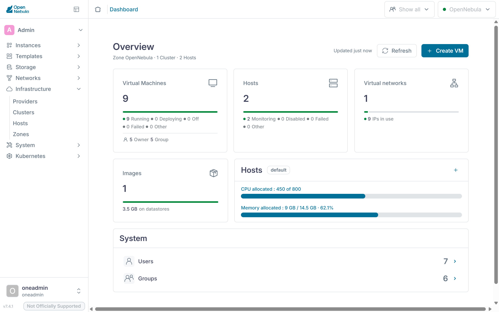

:::goals
After this chapter you can:

- Name the OpenNebula services on the front-end and what each one does
- Explain how oned, the scheduler, monitoring and the drivers work together
- Find the datastores for system disks, images, files and backups in the lab
- Tell the network modes bridge, 802.1Q and VXLAN apart by the devices they create on a node
- Describe how the CLI, Sunstone and OpenTofu use the oned API
- Follow a VM from its template to a running process on a node
:::

[Chapter 2.1](../../iaas/architecture/) gives an overview of the building blocks of OpenNebula. This supplement goes one level deeper, to the processes, files and devices you find on your servers. The examples use the code `mmuster` with the front-end at 192.168.210.137, the nodes at .138 and .139, the VXLAN identifier 5862 and the interface `eth0`. Use your own values instead.

## The oned daemon

At the core of OpenNebula sits the program `oned`, which systemd runs as the service `opennebula`. It accepts every request through the API, checks permissions and quotas, and keeps the state of all objects in a database, each object stored as an XML document. OpenNebula uses SQLite unless configured otherwise, and OneDeploy sets up MariaDB in the lab. `onevm show <vm> -x` prints such a document. Settings live in `/etc/one/oned.conf` and messages in `/var/log/one/oned.log`, as the [oned documentation](https://docs.opennebula.io/7.4/product/operation_references/opennebula_services_configuration/oned/) describes.

`oned` hands the actual work on hosts, VMs and disks to **drivers**, separate programs it launches at startup. `onemonitord` collects monitoring data, `one_sched` places new VMs, `one_vmm_exec` controls the VMs, `one_tm` moves disks to the nodes and `one_datastore` manages the images. All of them run as the user `oneadmin`.

```bash
systemctl status opennebula --no-pager
ps -u oneadmin -o pid,args | grep -E 'oned|onemonitord|one_'
```

The second command lists `oned` and the drivers it started, each with its arguments.

![Services and drivers of OpenNebula. At the top the services on the front-end. FireEdge serves Sunstone on port 2616, and guacd on port 4822 brings the console of a VM into the browser. OneFlow runs on port 2474, OneGate on port 5030. Like the CLI and OpenTofu, FireEdge, OneFlow and OneGate call the oned API, through XML-RPC on port 2633 or gRPC on port 2634. oned stores every object as XML in MariaDB and hands the work to its drivers, which run as oneadmin like oned. The scheduler and the datastore driver only work on the front-end. The drivers for virtualization and transfer reach the nodes over SSH. There their scripts sit in /var/tmp/one/, copied from /var/lib/one/remotes/ on the front-end. vmm/kvm starts the VMs with libvirt and KVM, and vnm/vxlan sets up their network. The transfer driver puts disk.0 and disk.1 into datastore 0. An agent runs the probes from im/kvm-probes.d/ and sends the values to onemonitord on port 4124. Notice that no OpenNebula service runs on the nodes. Only scripts work there, started by the front-end over SSH.](../../../../assets/figures/en/ex-opennebula.svg)

## Scheduler and monitoring

In OpenNebula 7.4 the scheduler is a driver too, configured as `SCHED_MAD` in `oned.conf`. `oned` asks it for a plan for the pending VMs and then carries out that plan itself. `-p rank` selects the rank scheduler from [chapter 2.5](../../iaas/hosts/) for the initial placement. `-o one_drs` adds the Distributed Resource Scheduler, which can rebalance running VMs.

`oned` collects pending VMs in a window. With the defaults that ship with OpenNebula 7.4, the window closes after ten seconds or as soon as more than seven VMs are waiting. If the scheduler finds no room for a VM, `oned` asks again after 60 seconds. Each host runs at most one scheduled deployment or migration at a time, as the [scheduler documentation](https://docs.opennebula.io/7.4/product/cloud_system_administration/scheduler/configuration/) explains. A new VM can therefore sit in `pend` for a few seconds even when there is room.

```bash
sudo sed -n '/^SCHED_MAD/,/^MAX_ACTIONS_PER_CLUSTER/p' /etc/one/oned.conf
```

The output shows the driver with its arguments, the limits of the window, the retry interval and the actions allowed per host.

`onemonitord` supplies the state of hosts and VMs and listens on port 4124 for both UDP and TCP. On each node, OpenNebula starts a small agent over SSH that runs the probes from `im/kvm-probes.d/` and pushes the results to the front-end on its own. According to the [monitoring documentation](https://docs.opennebula.io/7.4/product/cloud_system_administration/resource_monitoring/monitoring_system/), a heartbeat and the state and usage of the VMs arrive every 30 seconds, the load of the host every 120 seconds. When the heartbeats stop, OpenNebula restarts the probes. If that fails, `onehost list` shows the node as `err`.

```bash
sudo ss -tulpn | grep 4124
onehost show <node>
```

`ss` shows `onemonitord` on port 4124 for TCP and UDP. `onehost show` gives the time of the last report under `LAST MONITORING TIME` and the reported values in the section `MONITORING INFORMATION`.

## Web interface and add-on services

Sunstone is a React application served by **FireEdge**. FireEdge runs on Node.js as the service `opennebula-fireedge` on port 2616. For every action it calls the same XML-RPC API as the CLI, at `http://localhost:2633/RPC2`. A VM console in the browser goes through guacd on port 4822, the Apache Guacamole proxy, which connects to the VM over VNC. The views from [chapter 3.4](../../tenants/self-service/) live in `/etc/one/fireedge/sunstone/`, as the [FireEdge documentation](https://docs.opennebula.io/7.4/product/operation_references/opennebula_services_configuration/fireedge/) describes.

The menu on the left divides Sunstone into sections such as "Instances", "Templates", "Storage", "Networks", "Infrastructure" and "System".



[OneFlow](https://docs.opennebula.io/7.4/product/operation_references/opennebula_services_configuration/oneflow/) runs as the service `opennebula-flow` on port 2474. It manages services made of several VMs, with roles and elasticity rules. In this course OneFlow belongs to the advanced tasks of milestone 1, which [chapter 3.5](../../tenants/advanced/#services-and-roles) describes. It stores service templates and services in `oned` as documents, which is why the member groups need the right to create documents. OneFlow starts its VMs through the API like any other client.

[OneGate](https://docs.opennebula.io/7.4/product/operation_references/opennebula_services_configuration/onegate/) runs as the service `opennebula-gate` on port 5030 and accepts reports from VMs, such as custom metrics for a OneFlow rule. A VM identifies itself with a token from its context. By default OneGate only accepts requests from the front-end itself, as `ss` shows in [chapter 2.2](../../iaas/installation/). The VMs in cc-net cannot reach it, so OneGate stays theory in this course.

All three services sit on top of `oned`. If one of them stops, the VMs keep running and the CLI works as before.

```bash
systemctl is-active opennebula-fireedge opennebula-guacd opennebula-flow opennebula-gate
sudo journalctl -u opennebula-fireedge -n 20 --no-pager
```

The first command reports `active` for each of the four services, the second shows the latest FireEdge messages.

## Drivers

Behind each driver are small Ruby and shell programs, one per action. On the front-end they live in `/var/lib/one/remotes/`. Whatever has to run on the nodes, OpenNebula copies to `/var/tmp/one/` once it monitors a node. After a change, `onehost sync -f` copies the files again, as the [host documentation](https://docs.opennebula.io/7.4/product/cluster_configuration/hosts_and_clusters/hosts/) describes.

| Driver | Program on the front-end | Actions in `remotes/` | Example in the lab |
|---|---|---|---|
| Monitoring (IM) | `onemonitord` | `im/kvm-probes.d/` | Probes for the host and its VMs run on every node |
| Virtualization (VMM) | `one_vmm_exec` | `vmm/kvm/` | `deploy` starts a VM with `virsh create` |
| Transfer (TM) | `one_tm` | `tm/ssh/` | `clone` copies an image to the node over SSH |
| Datastore (DS) | `one_datastore` | `datastore/fs/` | `cp` stores a new image as a file in the datastore |
| Network (VNM) | none of its own | `vnm/vxlan/` | `pre` before a VM starts, `post` after, `clean` when it stops |

The network driver has no program of its own. `one_vmm_exec` calls its actions when a VM starts, migrates or stops. OneDeploy registered both nodes with `kvm` for monitoring and virtualization.

```bash
onehost show <node> | grep -E 'IM_MAD|VM_MAD'
sudo ls /var/lib/one/remotes/
ssh mmuster-node1 sudo ls /var/tmp/one/
```

In `/var/tmp/one/` on the node you find the folders from `remotes` again, such as `im`, `vmm` and `vnm`.

## Datastores

OneDeploy created three datastores, and [chapter 6.2](../../operations/backup/) adds one for backups. An image datastore has two drivers. `DS_MAD` manages the images, in the lab `fs` with plain files. `TM_MAD` moves the disks to the VMs, in the lab `ssh`. A system datastore holds the disks of running VMs and only has a transfer driver.

| Datastore | Type | Contents | Location in the lab |
|---|---|---|---|
| 0 `system` | `SYSTEM_DS` | Disks and files of the VMs | on each node for its running VMs, on the front-end for VMs in `unde` |
| 1 `default` | `IMAGE_DS` | Images such as `ubuntu-26.04` | `/var/lib/one/datastores/1/` on the front-end |
| 2 `files` | `FILE_DS` | Kernels, ramdisks and context files | `/var/lib/one/datastores/2/` on the front-end |
| `backups` | `BACKUP_DS` | VM backups | on the front-end named in `RSYNC_HOST` |

With `ssh`, every node has its own part of datastore 0 under `/var/lib/one/datastores/0/`, with one folder per VM. The folder holds the VM's disk `disk.0`, a standalone copy of the image, the context as `disk.1` and the files the VM driver places there at boot. If a node fails, nobody can reach these disks, as chapter 2.5 explains.

The [local storage documentation](https://docs.opennebula.io/7.4/product/cluster_configuration/storage_system/local_ds/) lists `ssh` as a legacy driver in OpenNebula 7.4 that is still supported. For new datastores it defaults to `local`, which also copies over SSH but uses qcow2 features such as thin provisioning. With `mode: ssh` from the inventory in chapter 2.2, OneDeploy creates the legacy one.

```bash
onedatastore list
onedatastore show 0
ssh mmuster-node1 sudo ls /var/lib/one/datastores/0/
```

`onedatastore list` shows the type, drivers and free space of each datastore. On the node you see one folder for each VM running there, named after its ID.

## Network modes

The network drivers build their networks from Linux kernel devices. The documentation covers the [bridge](https://docs.opennebula.io/7.4/product/cluster_configuration/networking_system/bridged/), [802.1Q](https://docs.opennebula.io/7.4/product/cluster_configuration/networking_system/vlan/) and [VXLAN](https://docs.opennebula.io/7.4/product/cluster_configuration/networking_system/vxlan/) modes one by one. The supplement [Linux networking in the lab](../network/) shows how to inspect these devices.

| Mode | Devices on the node | What it needs from the network below |
|---|---|---|
| `bridge` | A bridge holding the node's interface and the VM NICs | The switch lets the VMs' MAC addresses through |
| `802.1Q` | One VLAN device per network, such as `eth0.50`, in its own bridge | The ports are trunks carrying these VLANs, and the node loads the `8021q` module |
| `vxlan` | One VXLAN device per network, such as `eth0.5862`, in its own bridge | The nodes reach each other over IP, and multicast reaches the group |

With `bridge`, the node's interface itself is a port of the bridge, so the node's address sits on the bridge. OneDeploy sets up such a bridge with netplan when the inventory contains a network of this kind, for example under the name `br0`. Your inventory contains none, so your nodes keep their address on the interface.

With `vxlan`, `pre` creates the bridge and the VXLAN device as soon as the first VM of the network starts on a node. The device is named after the interface and the identifier, `eth0.5862` in the example. When the last VM of the network leaves the node, `clean` deletes both again. A VM NIC is named `one-<vm>-<nic>`, so the first NIC of VM 12 is `one-12-0`.

With `fw`, `802.1Q` and `vxlan`, `post` also sets iptables rules for the [security groups](https://docs.opennebula.io/7.4/product/virtual_machines_operation/virtual_machines_networking/security_groups/). Every new network gets the group `default` with ID 0, which allows all traffic. That is why `cc-net` does not filter anything either.

```bash
onevnet show cc-net | grep -E 'VN_MAD|PHYDEV|BRIDGE|VLAN_ID|SECURITY_GROUPS'
ssh mmuster-node1 'ip -d link show eth0.5862; ip link show master ccbr5862'
```

On a node with a VM in cc-net, `ip -d link` shows the VXLAN device with identifier, group and port. `ip link show master` lists the devices in the bridge, the VM NICs among them.

## API and clients

Every client talks to `oned` through the [XML-RPC API](https://docs.opennebula.io/7.4/product/integration_references/system_interfaces/api/) at `http://<front-end>:2633/RPC2`. Each call starts with a session string, which is `user:password` for a password login. The response reports success or failure, then the result or an error message, and an error code. Every CLI command calls such methods. `onetemplate instantiate`, for example, calls `one.template.instantiate`.

The CLI consists of Ruby programs. It takes the API address from `ONE_XMLRPC` and falls back to `http://localhost:2633/RPC2`. It reads user and password from the file named in `ONE_AUTH`, otherwise from `~/.one/one_auth`, as the [CLI configuration](https://docs.opennebula.io/7.4/product/operation_references/command_line_interface/cli_configuration/) describes. That is how you worked as a member in [chapter 3.1](../../tenants/groups/). Sunstone reaches the API through FireEdge, OpenTofu through the provider from [chapter 4.2](../../platform/opentofu/). `oned` also accepts the same calls over [gRPC](https://docs.opennebula.io/7.4/product/control_plane_configuration/large-scale_deployment/grpc/) on port 2634, which the documentation presents as the faster option for large installations. The CLI only uses gRPC with the `--grpc` option.

Since every path ends at `oned`, `oned` checks permissions on every call. A Sunstone view only hides tabs. Whether a request is allowed is up to `oned`, as chapter 3.4 shows.

```bash
onezone show 0 | grep ENDPOINT
onevm list -x | head -20
```

The first command shows the API address registered in the zone. The second shows the answer of `one.vmpool.info` as XML, the way it travels over the network.

## Users, groups, VDCs and ACLs

Every object belongs to a user and a group and carries permissions for the owner, the group and everyone else, much like a file on Unix. `oneadmin` with ID 0 and the members of the group `oneadmin` may do everything. OpenNebula also creates the [service user](https://docs.opennebula.io/7.4/product/cloud_system_administration/multitenancy/manage_users/) `serveradmin`, through which OpenNebula services pass on requests of their users to `oned`. **ACLs** grant users or groups additional rights on whole kinds of objects. A **VDC** assigns clusters, hosts, networks and datastores to groups, and a group without a VDC of its own belongs to `default` with all clusters. [Chapter 3.1](../../tenants/groups/) builds the members from these pieces, and chapter 3.4 shows the order in which `oned` checks permissions.

```bash
oneuser list
onevdc list
oneacl list
```

`oneuser list` shows `serveradmin` next to `oneadmin` and the group admins. `oneacl list` contains the rules that `onegroup create` added for the members.

## The path of a VM

Chapter 2.1 describes the path of a VM in five steps. Here you follow it down to files and processes, for a VM with ID 12 on node 1.

`onetemplate instantiate ubuntu` sends `one.template.instantiate` to `oned`. `oned` checks permissions and quota, creates the VM in the database, gives its NIC an address from `cc-net` and starts the log `/var/log/one/12.log`. The VM sits in `pend` until the scheduler window closes. The rank scheduler drops the nodes without room, ranks the rest and returns its plan. `oned` records the chosen node in the history of the VM, which `onevm show` lists under `VIRTUAL MACHINE HISTORY`.

In the `prol` state, the transfer driver `ssh` copies the image as `disk.0` to `/var/lib/one/datastores/0/12/` on the node. Then comes `boot`. `oned` writes the libvirt description of the VM to `/var/lib/one/vms/12/deployment.0`. In it the VM is called `one-12`, and its NIC `one-12-0` is attached to the bridge `ccbr5862`. `one_vmm_exec` then runs a fixed sequence of steps. First the context is created as the ISO image `disk.1`. `pre` creates the bridge and the VXLAN device if the node lacks them. `deploy` stores the description next to the disks and starts the VM with `virsh create`. Finally `post` sets the security group rules.

Once libvirt has created the VM, it moves to `runn`, and the agent on the node reports its state every 30 seconds. Inside the VM, the context package reads `disk.1` and sets up the address, hostname and keys, as [chapter 2.4](../../iaas/images/) explains. The [state reference](https://docs.opennebula.io/7.4/product/operation_references/configuration_references/vm_states/) describes every state along the way.

```bash
onevm show <vm>
sudo tail -n 30 /var/log/one/<vm-id>.log
ssh mmuster-node1 'sudo virsh list; sudo ls -l /var/lib/one/datastores/0/<vm-id>/'
```

The log lists every state change and every driver action with a timestamp. `virsh list` shows the VM as `one-<vm-id>`. The folder holds the disks, `deployment.0`, and the files `vm.xml` and `ds.xml`, which the VM driver places there before the start.

::::exercise[Lab]
Pick a running VM, such as `web-1` from chapter 2.4 or, from part 4 on, `k3s-agent`. Use the commands on this page to find out which node it runs on, what libvirt calls it, which bridge its NIC is attached to and which files sit in its folder in datastore 0. For each file and device, explain which driver created it.

:::solution
`onevm show` gives the ID of the VM and, under `HOST`, its node. There `sudo virsh list` shows the VM as `one-<id>`. `ip link show master ccbr<identifier>` lists the VXLAN device and the NIC `one-<id>-0`. The `vxlan` network driver created the bridge and the VXLAN device with `pre`, and libvirt created the NIC when `deploy` started the VM. The folder `/var/lib/one/datastores/0/<id>/` holds `disk.0`, the copy of the image made by the transfer driver `ssh`. The context in `disk.1` comes from a transfer driver step at boot. `oned` wrote `deployment.0`, and the VM driver places `vm.xml` and `ds.xml` before `deploy` starts the VM through libvirt.
:::
::::
