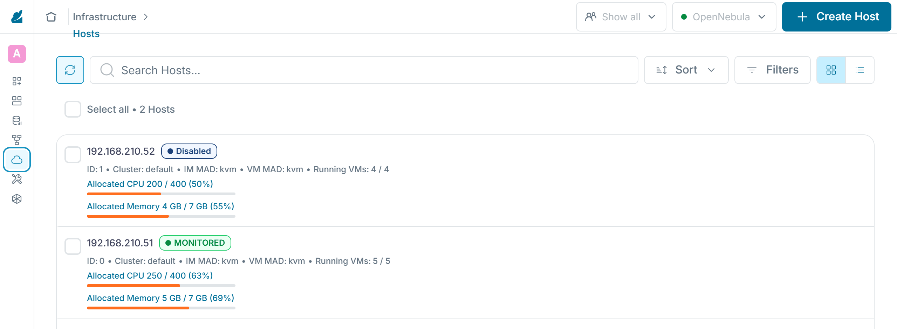
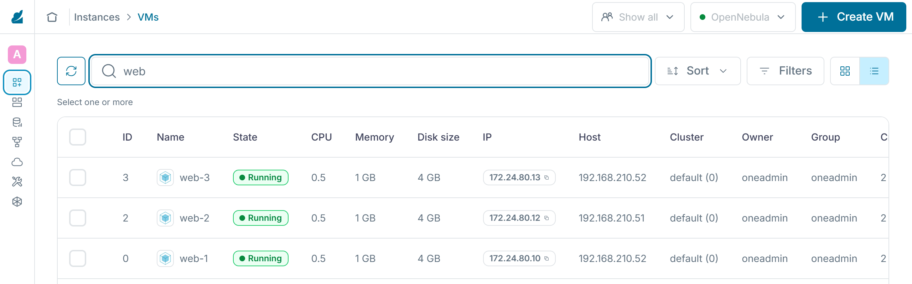

:::assignment
"Next week node 1 gets more memory," Simone Wyss writes. "The practice must not notice anything. And what actually happens when a node simply fails?"
:::

:::goals
After this chapter you can:

- Read and change the states of a host
- Tell real from allocated capacity and explain overcommitment
- Describe the rules the scheduler uses to pick a node and read the states of a VM
- Move VMs to another node with and without interruption
- Empty a node for maintenance and put it back into service
- Describe what happens to its VMs when a node fails
:::

## States of a host

`onehost list` shows the state of every node in the column `STAT`.

| State | Meaning | Command |
|---|---|---|
| `on` | monitored and ready for new VMs | `onehost enable` |
| `dsbl` | monitored, running VMs stay, no new VMs are added | `onehost disable` |
| `off` | no longer monitored, for nodes that are switched off | `onehost offline` |
| `err` | monitoring reports an error, often a missing SSH connection | |

Under "Infrastructure › Hosts", Sunstone shows the states with their full names, such as "Monitored" for `on` and "Disabled" for `dsbl`.



## Capacity and overcommitment

`onehost show` lists two values for memory and CPU. `USED (ALLOCATED)` is what the templates of the running VMs reserve. `USED (REAL)` is what the node actually uses, its VMs and its own system together. Three VMs from the template `ubuntu` reserve 3 GB but use a little under 2 GB when idle. In the lab the system of a node adds about 0.6 GB. OpenNebula counts CPU in hundredths of a core, so a node with four cores has 400. A VM with `CPU = "0.5"` reserves 50 of them.

```bash
onehost show <node> | sed -n '/HOST SHARES/,/LOCAL SYSTEM/p'
```

The scheduler plans with the reserved capacity. Once a node is fully reserved, no further VM starts there, even if its real usage would leave room. With the values `RESERVED_CPU` and `RESERVED_MEM` on the host, the platform team can adjust the capacity. A positive value keeps a reserve free. Without such a value, OpenNebula offers the whole memory of the node to VMs, including the about 0.6 GB its own system needs. A fully reserved node is therefore already slightly overcommitted. In the lab, the swap from chapter 0.4 absorbs this. A negative value allows **overcommitment**, which means that more is reserved on the node than it has. Overcommitment lowers the cost because VMs rarely all work at full load at the same time. If they do all work at once, all of them slow down. Overcommitting memory is riskier than overcommitting CPU, because VMs crash when memory runs out. Missing CPU time only slows them down. The [guide to overcommitment](https://docs.opennebula.io/7.4/product/cloud_system_administration/capacity_planning/overcommitment/) of OpenNebula 7.4 shows how to write `RESERVED_CPU` and `RESERVED_MEM`, as absolute values or in percent.

## Placement by the scheduler

A new VM waits until the scheduler assigns it a node. By default OpenNebula 7.4 uses the [Rank Scheduler](https://docs.opennebula.io/7.4/product/cloud_system_administration/scheduler/rank_scheduler/) for this, and it works in two steps. First it filters. Every node that fails the VM's `SCHED_REQUIREMENTS` expression or lacks free CPU or memory, measured against the reserved capacity, drops out. Datastores and networks go through the same check. Then it sorts the remaining nodes by the expression `SCHED_RANK` and takes the one with the highest value. You can set both expressions in a template, for example to start a VM only on nodes with a certain property. Without `SCHED_RANK` the installation's policy applies. The documentation names four policies.

| Policy | Rank | Effect |
|---|---|---|
| Packing | `RUNNING_VMS` | fills nodes that already run VMs first and leaves others empty |
| Striping | `- RUNNING_VMS` | spreads VMs across as many nodes as possible |
| Load-aware | `FREE_CPU` | prefers the nodes whose CPU currently has the lowest load |
| Fixed | `PRIORITY` | follows a priority the platform team sets on the host or cluster |

In the lab, `/etc/one/schedulers/rank.conf` contains the entry `DEFAULT_SCHED` with `POLICY = 1`, which is striping, unchanged from the file the OpenNebula package ships. That is why your VMs spread across both nodes. Packing needs fewer nodes, so the rest can be switched off. Striping keeps headroom on every node, and a failure hits fewer VMs. Besides the Rank Scheduler, OpenNebula 7.4 includes the [Distributed Resource Scheduler](https://docs.opennebula.io/7.4/product/cloud_system_administration/scheduler/drs/). It takes the actual load of the nodes into account and proposes migrations, which the platform team either reviews or lets run automatically.

In Sunstone the "Host" column of the list under "Instances › VMs" shows where each VM ended up.



## Life cycle of a VM

`onevm list` shows the state of every VM in short form in the column `STAT`. The [state reference](https://docs.opennebula.io/7.4/product/operation_references/configuration_references/vm_states/) lists a great many of them, and in daily work you will mostly meet the following ones.

| State | Meaning | Trigger |
|---|---|---|
| `pend` | waiting for the scheduler to pick a node | `onetemplate instantiate`, `onevm resume` from `unde` |
| `prol` | OpenNebula copies the disks to the node | node chosen |
| `boot` | OpenNebula waits for the hypervisor to create the VM | copying finished |
| `runn` | the VM is running, including its own boot and shutdown | started by the hypervisor |
| `poff` | switched off, the disks stay on the node | `onevm poweroff` |
| `unde` | switched off, the disks are back in the `system` datastore of the front-end | `onevm undeploy` |
| `fail` | a step such as copying or booting failed | error in `prol`, `boot` or during a migration |
| `unkn` | monitoring can no longer reach the VM | node failure |
| `done` | terminated, `onevm list` no longer shows the VM | `onevm terminate` |

The difference between `poff` and `unde` matters for capacity. A powered-off VM keeps its place on the node, while a VM in `unde` frees it and goes through the scheduler and `prol` again at its next start. `onevm resume` starts the VM again from both states. When a VM ends up in `fail`, its log in `/var/log/one/<id>.log` shows the cause, and `onevm recover` brings it back afterwards.

![The states of a VM with the short form that onevm list shows in the column STAT. onetemplate instantiate creates a VM in pend, where it waits for the scheduler. Once the scheduler has picked a node, OpenNebula copies the disks there in prol. In boot the hypervisor creates the VM, which then runs in runn. onevm migrate moves a running VM to another node. onevm poweroff switches it off to poff, and its disks stay on the node. onevm undeploy takes it to unde, with the disks back on the front-end. onevm resume starts the VM again from both states, from poff directly through boot and from unde through pend. onevm terminate ends it in done. An error while copying, booting or migrating leads to fail, and after a look at the log onevm recover brings the VM back. If its node fails, the VM shows unkn. Notice the difference between poff and unde. Only in unde does a VM free its place on the node.](../../../../assets/figures/en/p2c5-states.svg)

## Migration

`onevm migrate` moves a VM to another node. Without further options OpenNebula pauses the VM briefly, copies its memory and disk and lets it continue on the target. With `--live` the VM keeps running during the migration. Only the last part of its memory follows at the end, in a very short moment. In the lab, migrating a small VM took 7 seconds without the option and 10 seconds with `--live`. The [guide to VM instances](https://docs.opennebula.io/7.4/product/virtual_machines_operation/virtual_machines/vm_instances/) explains both kinds of migration.

```bash
onevm migrate --live web-1 <other-node>
onevm list
```

## Maintenance of a node

For maintenance you empty a node and then put it back into service. `onehost flush` disables the node and marks its VMs for rescheduling, after which the scheduler moves them to the other nodes. In `onevm list` these VMs briefly carry an asterisk in front of their names. In the lab three VMs had moved after about 10 seconds.

```bash
onehost flush <node>
onevm list
onehost offline <node>
```

After the maintenance you start the node again and release it with `onehost enable`. New VMs then land on both nodes again. The moved VMs stay where they are until you bring them back yourself. The [guide to hosts](https://docs.opennebula.io/7.4/product/cluster_configuration/hosts_and_clusters/hosts/) covers `onehost flush` and the commands for the states of a host.

Maintenance only works if the remaining nodes have enough capacity for all VMs. With two nodes, each one must be able to carry all VMs alone. Whoever plans such a reserve keeps it free for maintenance and failures and includes it in the cost.

:::caution[Screenshot of the maintenance]
No check covers the maintenance with the migration. For requirement 4 of [milestone 1](../../assessment/milestone-1/) your screenshot is the only proof. Take it right during the exercise "Maintenance" and name the file something like `4-migration.png`, because from chapter 4.2 on the Kubernetes cluster takes up the nodes and neither of them can easily be emptied any more.
:::

## Failure of a node

When a node fails, its VMs stop running. After a while `onehost list` shows the node as `err`, and `onevm list` shows its VMs as `unkn`. In the lab the disks of running VMs sit in the `system` datastore of the node itself. As long as the node is down, nobody can reach these disks, and the VMs cannot be started on another node.

A cloud that survives failures therefore needs shared storage that all nodes can reach, such as Ceph or an NFS server, and a rule that automatically restarts the VMs of a failed node on another one. OpenNebula offers hooks for that. The lab deliberately lacks both so that it gets by with the front-end and two nodes. In part 6 this gap is part of the availability assessment.

::::exercise[Maintenance]
Start two VMs from the template `ubuntu`, empty a node one of them runs on, take it offline and put it back into service. Finally move one VM back live. Write down the commands in the right order.

:::solution
1. `onetemplate instantiate ubuntu --name web-2` and `--name web-3`, then `onevm list --size host=15` for the nodes, because without the option the column `HOST` cuts the address
2. `onehost flush <node>` and wait until `onevm list` shows no asterisk anymore
3. `onehost offline <node>`
4. `onehost enable <node>` after the maintenance
5. `onevm migrate --live web-2 <node>`
:::
::::

::::exercise[Capacity]
Gemeinde Hinterbüel wants to know whether two nodes are enough when one is down for maintenance. Use `onehost show` to work out how many VMs from the template `ubuntu` fit on a single node, and explain whether overcommitting memory would be a good idea.

:::solution
A node with about 7.2 GB and 400 hundredths of CPU carries seven VMs with 1 GB and 50 hundredths each, so memory sets the limit. With seven VMs the node is fully reserved and, together with its own system, already slightly overcommitted. That works as long as the VMs use little memory, otherwise only the swap helps. Spread over both nodes there must therefore be no more than seven if one node alone has to carry all of them. Overcommitting memory would be risky, because VMs crash when memory runs out, and during maintenance all of them run on one node.
:::
::::

::::exercise[Scheduler policy]
Gemeinde Hinterbüel would like to save power at night by switching off nodes that run no VMs. Which scheduler policy fits, where would you set it, and what does the municipality accept in return?

:::solution
Packing fits, because it fills the nodes that already run VMs first and leaves the others empty. You set it in `/etc/one/schedulers/rank.conf` with `POLICY = 0` in the entry `DEFAULT_SCHED`, or for single VMs with `SCHED_RANK = "RUNNING_VMS"` in the template. In return more VMs share the same node. If it fails, more VMs are affected, and load peaks of those VMs slow each other down. Packing only affects new placements and does not move existing VMs.
:::
::::
