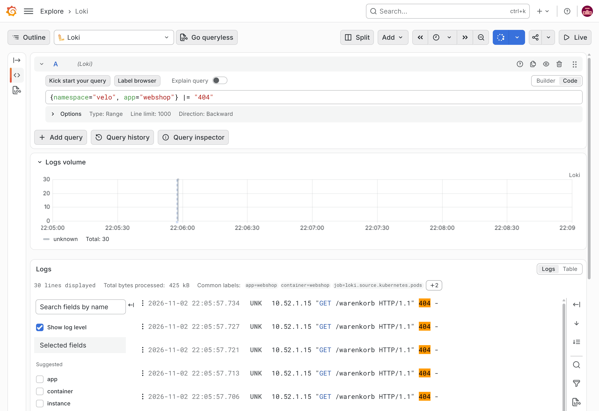

:::assignment
"On Saturday three customers got an error message at checkout," Veloatelier Matte writes. "Can you find out what happened?"
:::

:::goals
After this chapter you can:

- Explain what logs show that metrics do not
- Describe how Loki and Alloy are set up in the cluster
- Filter and count logs by namespace, pod and text with LogQL
- Find the error of a deployment in the logs
:::

## Logs and metrics

**Metrics** are numbers at fixed intervals. They show that 5% of the requests fail, but not which ones and with what message. **Logs** are lines of text a program writes when something happens. They hold the details but take more storage. In Kubernetes, every container writes its logs to standard output and standard error, and the node stores them as files. `kubectl logs` reads these files, but only as long as the pod exists. Once it is replaced, its logs are gone.

## Loki and Alloy

Loki collects logs centrally and keeps them beyond the end of a pod. A full-text search engine indexes all of the text. Loki only indexes a few labels such as namespace and pod and searches the text when you run a query. This keeps Loki small, but every search has to start by narrowing down with labels.

Alloy from Grafana runs as a **DaemonSet**, with one pod per node. Each of them reads the logs of the pods on its node, adds labels and sends them to Loki. Both came into your repo with the copy in chapter 5.1, as two applications in `apps/loki.yaml`. The [Alloy 1.21 guide for Kubernetes](https://grafana.com/docs/alloy/v1.21/set-up/install/kubernetes/) installs the same chart with Helm.

![The path of the logs in the cluster. Two nodes of the cluster, k3s-server and k3s-agent. On each node the pods write their logs to stdout and stderr. Alloy runs as a DaemonSet with one pod per node, reads the logs of the pods on its node and sends them to Loki with the labels namespace, pod, container and app. Loki runs as a single process, indexes only the labels and keeps the logs for three days. In Grafana you query Loki under "Explore" with LogQL. A query such as {namespace="velo", app="webshop"} |= "404" first selects the streams by their labels and then searches the text. It also finds lines of pods that no longer exist.](../../../../assets/figures/en/p5c2-logs.svg)

::code{file="platform/observability/repo/monitoring/loki.yaml"}

Here Loki runs as a single process and stores its data on the disk of a node. That is enough for a lab. In production you would spread Loki over several processes and keep the data in object storage. Loki deletes logs older than three days. The mode `SingleBinary` also appears in the [Loki 3.6 guide to the monolithic chart](https://grafana.com/docs/loki/v3.6.x/setup/install/helm/install-monolithic/), there with object storage.

::code{file="platform/observability/repo/monitoring/alloy.yaml"}

The Alloy configuration is a chain of four components. `discovery.kubernetes` finds the pods of its own node. `discovery.relabel` turns Kubernetes details into the labels `namespace`, `pod`, `container` and `app`. `loki.source.kubernetes` reads the logs, and `loki.write` sends them to Loki. More examples with these components are in the [Alloy 1.21 guide to Kubernetes logs](https://grafana.com/docs/alloy/v1.21/collect/logs-in-kubernetes/). In the test setup, a configuration with a block written on one line failed with "expected TERMINATOR". Alloy wants every attribute on a line of its own.

In the lab, Loki and Alloy were ready a little over two minutes after the push. Argo CD had created their applications about 40 seconds earlier.

```bash
kubectl -n monitoring get pods -o wide | grep -E 'loki|alloy'
```

The output shows one Loki pod and one Alloy pod each on `k3s-server` and `k3s-agent`, all of them `Running`.

## LogQL

You write queries in Grafana under "Explore" with the data source Loki. A query always starts with a selection of streams in curly braces.

| Query | Result |
|---|---|
| `{namespace="velo"}` | all logs of the bike shop |
| `{namespace="velo", app="webshop"} \|= "404"` | lines of the web shop containing `404` |
| `{namespace="velo"} \|~ "(?i)error\|exception"` | lines matching the regular expression |
| `{namespace="velo"} != "/healthz"` | everything except the Kubernetes probes |
| `sum by (pod) (count_over_time({namespace="velo"} \|= " 404 " [5m]))` | number of lines with 404 per pod in five minutes |

`|=` filters by text, `|~` by a regular expression, and `!=` excludes lines with the text. `count_over_time` counts the lines in a time window and turns logs into a metric you can use in dashboards and alerts.

In the lab, 20 requests for a page that does not exist produced lines with `404`. The loop runs on the front-end. It calls the web shop through Traefik at the address of `k3s-server`, which `source /etc/cc-lab.env` puts into `$CC_K3S_SERVER_IP`.

```bash
source /etc/cc-lab.env
for i in $(seq 20); do curl -s -o /dev/null http://$CC_K3S_SERVER_IP/warenkorb; done
```

```text
10.52.1.10 "GET /warenkorb HTTP/1.1" 404 -
```

Traefik spreads the requests across the pods. The query with `count_over_time` then showed how many of these requests each pod had answered.

In Grafana you run the query under "Explore" with the data source Loki.



## Labels in moderation

In Loki, every combination of labels is a **stream** of its own. Labels such as namespace, pod or app have few values and work well. An IP address, an order number or a path as a label would create thousands of streams and slow Loki down. Whatever changes often stays in the text and is found with `|=`.

## Your values for milestone 3

In chapter 5.3 you fire an alert through Git, and in chapter 5.4 you let the web shop grow under load. For milestone 3 the alert uses the SLO target from your [personal values](../../start/parameters/#your-values-for-the-milestones), and the HPA grows up to your personal maximum. So that you run the alert and the load test only once, you set both values now in a single commit. The generator lists them in the table "Your values for the milestones" as "SLO target of the web shop" and "Maximum number of pods in the HPA".

The alert works with the error budget, which is 1 minus your target, so `0.01` at 99.0% and `0.001` at 99.9%. First type your budget and your maximum as two variables. These are the values of `mmuster`, with the target 99.0% and at most five pods.

```bash
budget=0.01
max=5
```

The next block puts your budget into both lines of the alert in `monitoring/config/webshop-slo.yaml`, where the course file has `0.005`. In `webshop/hpa.yaml` it replaces `maxReplicas: 6` with your maximum. If one of the variables is missing, for example in a new session, the shell reports "parameter null or not set" and that line changes nothing.

```bash
cd ~/platform
sed -i "s/(14.4 \* [0-9.]*)/(14.4 * ${budget:?})/" monitoring/config/webshop-slo.yaml
sed -i "s/maxReplicas: [0-9]*/maxReplicas: ${max:?}/" webshop/hpa.yaml
grep -n '14.4 \*' monitoring/config/webshop-slo.yaml
grep -n maxReplicas webshop/hpa.yaml
```

`grep` shows the two lines of the alert with your budget and the line with your maximum. If the numbers are right, push the change. Running the block again with other values replaces the numbers once more. Chapter 5.3 explains what the factor 14.4 means, and chapter 5.4 covers the maximum.

```bash
git commit -am "Personal values for milestone 3"
git push
```

::::exercise[Lab]
Check that Loki and Alloy are running. They came with the additions of chapter 5.1. Create requests with `404` and find them in Grafana. Count them per pod. Finally set your values for milestone 3.

:::solution
`kubectl -n monitoring get pods -o wide | grep -E 'loki|alloy'` shows Loki and one Alloy pod on each of the two nodes. `{namespace="velo", app="webshop"} |= "404"` shows the lines with `/warenkorb`, and the label `pod` tells you which pod answered. `sum by (pod) (count_over_time({namespace="velo"} |= " 404 " [5m]))` shows one number per pod, about 20 together. For `mmuster`, both lines of the alert hold `(14.4 * 0.01)` after the commit, and the HPA holds `maxReplicas: 5`.
:::
::::

::::exercise[Finding the error]
First stage the fault as if you were someone else on the team. The command sets the variable `FAIL_PERCENT` in the web shop deployment to `30`, so the shop answers three out of ten requests with an error.

```bash
cd ~/platform
sed -i '/FAIL_PERCENT/{n;s/value: "0"/value: "30"/}' webshop/deployment.yaml
git commit -am "Tune the web shop"
git push
```

Argo CD picks up the change at its next poll of Gitea and replaces the pods. On smartlearn the new pods ran about 90 seconds after the push, and `kubectl -n velo get pods` shows them with new names and an age of a few seconds. Then send 20 requests to the shop from the front-end. The loop prints the status of every answer.

```bash
source /etc/cc-lab.env
for i in $(seq 20); do curl -s -o /dev/null -w "%{http_code}\n" http://$CC_K3S_SERVER_IP/; done
```

Use the logs to find out what customers experience and the Git history to find out who did it. Then restore the old state.

:::solution
The loop reports about three out of ten answers with `500`. `{namespace="velo", app="webshop"} |~ "error| 500 "` shows lines like `error: simulated failure on /` next to the lines of the requests with status `500`. With `|= "error"` alone those lines would be missing, because they do not contain the word. `git log -p webshop/deployment.yaml` shows the commit with its author and the change, and its time matches the first error line. `git revert --no-edit HEAD` followed by `git push` restores the old state, and Argo CD rolls it out.
:::
::::

::::exercise[One label too many]
A colleague suggests setting the customer's IP address as a label in Alloy, so that you can search for a customer faster. What do you answer?

:::solution
Every address would be a stream of its own, thousands with many customers. Loki would get slower and need more storage. Values that change often belong in the text and are searched with `|=`. In the lab, though, the text only holds the address of Traefik, such as `10.52.1.10`. The web shop sees the connection from Traefik, not the one from the customer. Data protection matters too. An IP address is personal data, and storing it needs a purpose and a retention period.
:::
::::
