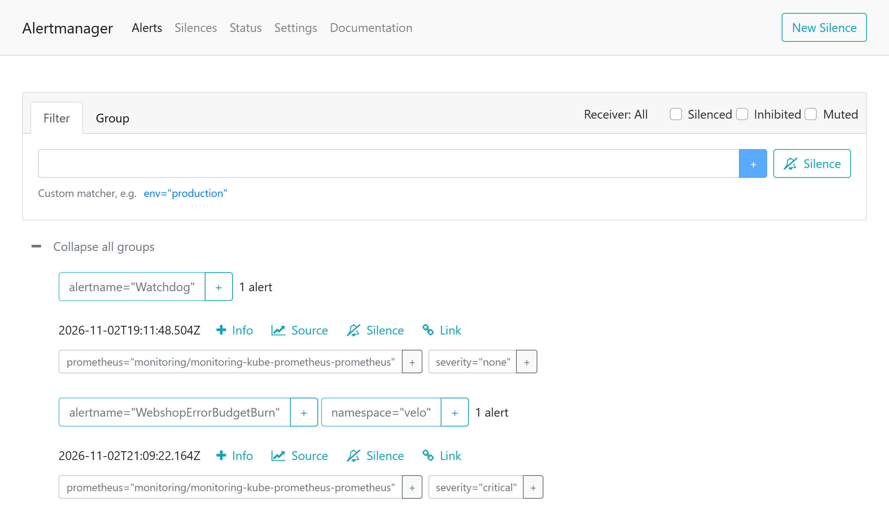

:::assignment
"We don't want to be woken up for every small error," Veloatelier Matte writes. "But if the shop stops selling on a Saturday, we want to know before customers call."
:::

:::goals
After this chapter you can:

- Tell SLI, SLO, SLA and error budget apart
- Define an SLO for the web shop and calculate its error budget
- Read and justify a burn rate alert
- Tell alerts on symptoms from alerts on causes
- Explain how Alertmanager groups and routes alerts
:::

## SLI, SLO and SLA

A **service level indicator (SLI)** measures how well a service works from the customers' point of view, usually as a share of good events. The target for this share over a period is called a **service level objective (SLO)**. A **service level agreement (SLA)** is a contract that sets out consequences if the target is missed. SLAs follow in part 6, and this chapter stays with the internal target.

| Term | Web shop |
|---|---|
| SLI | share of shop requests answered without a server error |
| SLO | 99.5% over 7 days |
| Error budget | 0.5% of the requests may fail |

No service reaches 100%. The **error budget** states how many failures the period allows, a number you can plan with. As long as budget is left, the bike shop may try new things. Once it is used up, stability and fixes come first.

## Recording rules

The rules are in your repo at `monitoring/config/webshop-slo.yaml`, as a PrometheusRule.

::code{file="platform/observability/repo/monitoring/config/webshop-slo.yaml"}

The first two rules are recording rules. Prometheus regularly computes the error ratio over five minutes and over one hour and stores each as a time series of its own, `webshop:error_ratio:rate5m` and `webshop:error_ratio:rate1h`. Alerts and dashboards read these series instead of repeating the calculation every time. `clamp_min` prevents a division by zero when nobody is shopping.

## Burn rate

An alert on "more than 0.5% errors" would fire at every short spike. The **burn rate** measures how fast the budget is being used up. A burn rate of 1 uses up the budget in exactly the 7 days, while at 14.4 it would be gone after 168 / 14.4 ≈ 12 hours. The alert `WebshopErrorBudgetBurn` fires when the error ratios over five minutes and over one hour have both been above 14.4 × 0.5% = 7.2% for two minutes.

In milestone 3 the target from your [personal values](../../start/parameters/#your-values-for-the-milestones) applies. The error budget is then 1 minus your target, so 1% at 99.0%. You replace `0.005` in both lines of the alert with your budget, and the threshold becomes 14.4 × 1% = 14.4%.

| Window | Job |
|---|---|
| 1 hour | shows that the problem persists and really eats into the budget |
| 5 minutes | shows that it still exists now and ends the alert soon after the fix |

![Error budget and burn rate of the web shop. At the top the numbers of the web shop. The SLO asks for 99.5% of the requests without a server error over 7 days, so the error budget is 0.5% of the requests. At a burn rate of 1 the budget lasts exactly 7 days, at 14.4 it is gone after 12 hours. Below, a schematic course with steady traffic. Once the errors start, the burn rate in the five-minute window quickly rises above the threshold of 14.4, which is 7.2% errors. In the one-hour window it rises slowly. The alert only fires when both windows have been above the threshold for two minutes. As soon as the fix takes effect, the short window drops and the alert ends, although the long window is still high.](../../../../assets/figures/en/p5c3-budget.svg)

The lab showed the effect of the long window clearly. A load test had produced tens of thousands of good requests before. When every eighth request failed afterwards, the five-minute ratio jumped to 12% at once, but the one-hour ratio stayed at 3 to 4% for a long time. The alert fired after about 25 minutes, once the error ratio had risen further.

## Symptoms and causes

The three web shop alerts `WebshopErrorBudgetBurn`, `WebshopSlow` and `WebshopDown` report symptoms, meaning what customers notice. Causes such as a full disk, a pod in a restart loop or a node without memory come as rules of their own with kube-prometheus-stack, for example `KubePodCrashLooping` or `KubePersistentVolumeFillingUp`. In the lab, Prometheus reported `KubePersistentVolumeFillingUp` when the agent's disk was 87% full after the download of the Ollama image for the [advanced tasks](../advanced/#memory-and-load). The local-path volumes live on the same disk as the images.

Symptoms justify waking someone up, because they are sure to affect customers. Causes belong in tickets and dashboards. An alert nobody has to act on should be deleted. Otherwise the team learns to ignore alerts.

## Alertmanager

Prometheus evaluates the rules and sends firing alerts to Alertmanager. Alertmanager groups similar alerts, suppresses repetitions and forwards them to receivers such as email, a chat or a webhook. The routing is part of the kube-prometheus-stack values.

```yaml
route:
  receiver: "null"
  group_by: [alertname, namespace]
  group_wait: 30s
  group_interval: 5m
  repeat_interval: 4h
receivers:
  - name: "null"
```

In the base every alert goes to the receiver `null`, which sends nothing. The alerts only appear in the Alertmanager interface on port 30093 of the server. Like Prometheus, you reach the interface through a tunnel. Add `-L 9093:<server-address>:30093` to the command of chapter 5.1 and open `http://localhost:9093/` in the browser of the client. You set up a receiver of your own with a route in advanced task B of [chapter 5.5](../advanced/#task-b--triage-with-approval). `group_wait` waits 30 seconds for more alerts of the same group, and `repeat_interval` repeats an open alert only after four hours.

## Firing an alert

You break the SLO on purpose through Git. The web shop has the variable `FAIL_PERCENT` for that, the percentage of requests it answers with an error.

```bash
cd ~/platform
sed -i '/FAIL_PERCENT/{n;s/value: "0"/value: "60"/}' webshop/deployment.yaml
git commit -am "New payment module in the web shop"
git push
kubectl run load --restart=Never --image=ghcr.io/ndum/cc/webshop:1.0.0 -- \
  python3 /app/load.py http://<server-address>/ --workers 1 --seconds 1800
```

In Prometheus under "Alerts", `WebshopErrorBudgetBurn` first turns `pending` and after two minutes `firing`. The load also makes the HPA of chapter 5.4 grow the web shop. Afterwards you restore the old state with `git revert` and `git push`. Only delete the pod `load` once the alert is inactive. Without traffic the ratio in the five-minute window would stay where it is and only drop once the window is empty. In the lab the alert was inactive again six to seven minutes after the revert. Up to two minutes of that passed before Argo CD rolled out the revert.




::::exercise[Lab]
Fire the alert as shown above, watch it in Prometheus and Alertmanager and restore the old state. Note the times.

:::solution
After the push, `webshop:error_ratio:rate5m` rises above 7.2% within a few minutes. How long `webshop:error_ratio:rate1h` takes depends on the traffic of the last hour. Without a load test before, it is faster. Alertmanager shows the alert in its interface. After the revert, the five-minute ratio drops and the alert ends, although the one-hour ratio is still high.
:::
::::

::::exercise[Error budget]
On a Saturday the web shop answers 40,000 requests. How many may fail before that day's budget is used up? What does a burn rate of 6 mean for the week's budget?

:::solution
0.5% of 40,000 is 200 requests. A burn rate of 6 uses the budget six times as fast as allowed, so the 7-day budget would be gone after 28 hours. A second alert with a lower threshold and longer windows would report that without waking anyone right away.
:::
::::

::::exercise[For the practice]
Praxis Rosenweg wants an alert before patients notice anything. Propose an SLI and an SLO for its appointment portal and justify the values.

:::solution
A possible SLI is the share of calls to the appointment page that answer without an error in under one second. An SLO of 99.9% over 30 days allows about 43 minutes of downtime per month. The practice has office hours, so you could count only requests between 7 am and 7 pm. Higher targets cost redundancy that a lab with one server does not have.
:::
::::
