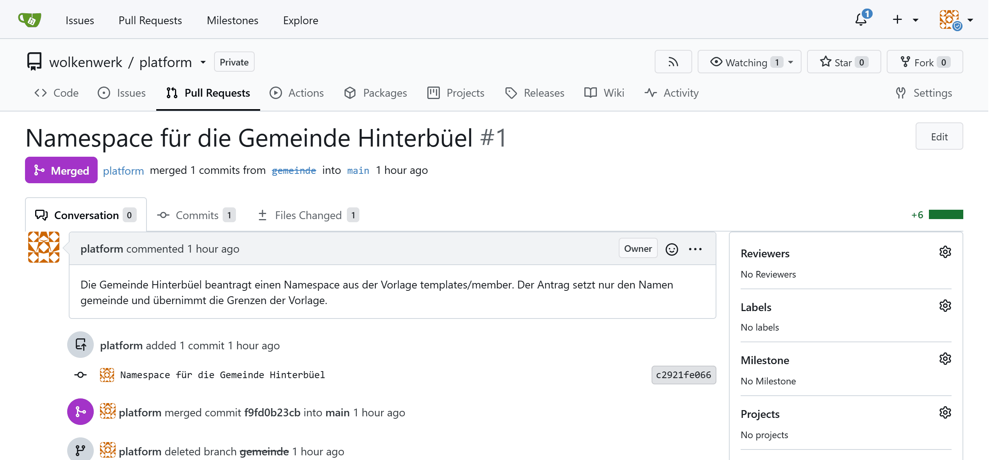
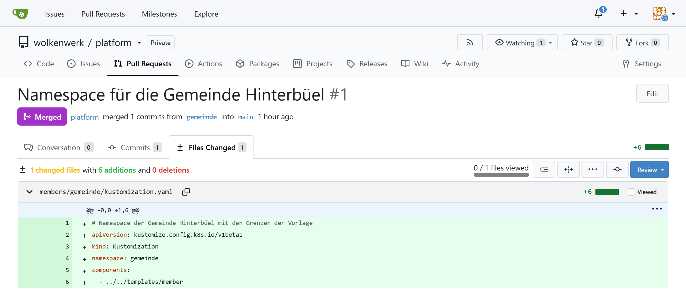
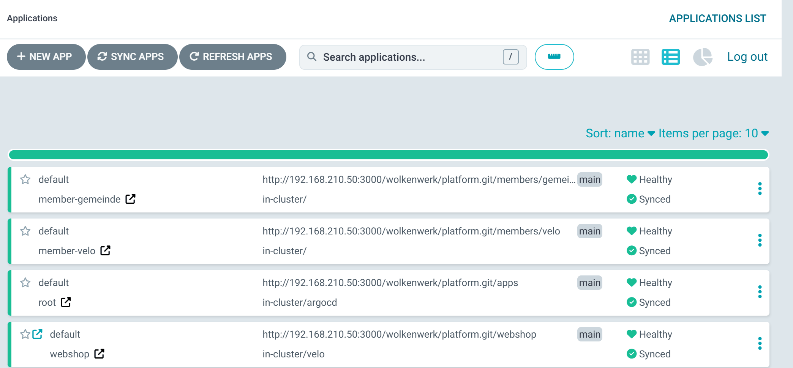

:::assignment
"Gemeinde Hinterbüel heard about the web shop and wants to run its forms on containers too," Simone Wyss writes. "If every member wants that, you can't start from scratch each time. And the municipality must not take the cluster away from the bike shop on a Saturday."
:::

:::goals
After this chapter you can:

- Explain what a platform template is and what it gives a member
- Limit and separate namespaces with ResourceQuota, LimitRange and NetworkPolicy
- Use one template for several members with Kustomize
- Generate an application for every folder in Git with an ApplicationSet
- Review and accept a member's request as a pull request
:::

## Templates

A platform team offers a tested path that other teams follow on their own, often called a golden path. It then no longer has to build an environment by hand for every team. The template defines what every member gets, and the member requests its space instead of waiting for an appointment. In part 3, groups, a VDC and quotas did this job in OpenNebula. In the cluster, namespaces and three kinds of objects take over.

| Part 3 in OpenNebula | Part 4 in Kubernetes |
|---|---|
| group | namespace |
| group quota | ResourceQuota |
| size of the template `ubuntu` | LimitRange |
| VDC and own network | NetworkPolicy |

## ResourceQuota

A ResourceQuota limits what all pods of a namespace may request together.

::code{file="platform/repo/templates/member/resourcequota.yaml"}

Requests are what the scheduler reserves for a container, like the `CPU` column of a VM in OpenNebula. Limits are the ceiling a container never exceeds. One CPU is one core, and `250m` is a quarter of it. `services.nodeports: "0"` and `services.loadbalancers: "0"` stop members from opening their own ports on the nodes. Without the second line, ServiceLB opened a port on both nodes in the lab for a service of type LoadBalancer without a node port. The members' way out is the ingress.

## LimitRange

Once a quota limits CPU and memory, Kubernetes rejects every pod without requests and limits. The LimitRange sets defaults for those and a ceiling per container.

::code{file="platform/repo/templates/member/limitrange.yaml"}

## NetworkPolicy

Without a rule, every pod in the cluster can reach every other pod, across namespaces too. A NetworkPolicy defines who may talk to a pod. In k3s, a built-in controller enforces such rules.

::code{file="platform/repo/templates/member/networkpolicy.yaml"}

`podSelector: {}` means all pods of the namespace. They only accept connections from pods in their own namespace and from `kube-system`, where Traefik runs. In the lab, a pod in the namespace `default` got "Connection refused" from the web shop, while a pod in `velo` reached it. A freshly started pod failed its first two requests, though. After a pod starts, the controller needs a few seconds to add its address to its rules.

```bash
kubectl -n default run np-test --rm -i --restart=Never --image=busybox:1.37 -- sh -c "sleep 5; wget -qO- -T 5 http://webshop.velo/healthz"
kubectl -n velo run np-test --rm -i --restart=Never --image=busybox:1.37 -- sh -c "sleep 5; wget -qO- -T 5 http://webshop.velo/healthz"
```

The `sleep 5` gives the controller time to add the new pod to its rules.

## Kustomize

Together with a fourth file for the namespace, these three files make up the template in `templates/member`. Kustomize, which is built into kubectl and Argo CD, assembles the right objects for each member from it without copying the template.

::code{file="platform/repo/templates/member/kustomization.yaml"}

A member is a folder in `members` with a single file. The line `namespace` sets the namespace of all objects and also renames the template's Namespace object. The bike shop needs more CPU for its web shop than the template gives, so a patch replaces that one value.

::code{file="platform/repo/members/velo/kustomization.yaml"}

```bash
kubectl kustomize ~/platform/members/velo
```

The command prints the finished objects without changing anything. Use it to check a member before it lands in Git.

## ApplicationSet

Instead of writing an application for every member, you let an ApplicationSet generate them from a pattern.

::code{file="platform/repo/apps/members.yaml"}

The `git` generator looks for folders under `members` in the repo and creates an application `member-<folder>` for each. When a folder is added, a namespace appears. When a folder disappears, Argo CD deletes the namespace and everything in it, thanks to `prune`. By default, the ApplicationSet checks every three minutes, and `requeueAfterSeconds: 60` shortens that to one minute.

![A namespace from the template. At the top is the template templates/member, a Kustomize component with the namespace member, a ResourceQuota with requests.cpu 1, a LimitRange with a default of 250m per container and a NetworkPolicy that only lets in its own namespace and kube-system. In the middle, the folder members/velo sets the namespace velo and replaces requests.cpu with 2 through a patch. The ApplicationSet members reads the folder with its git generator and creates the application member-velo. Argo CD renders it with Kustomize, and the objects in the cluster are at the bottom. Notice the differences from the template. The namespace is called velo and the quota allows 2 CPUs, while everything else comes unchanged from the template.](../../../../assets/figures/en/p4c5-kustomize.svg)

```bash
kubectl -n argocd get applicationsets
kubectl -n argocd get applications
kubectl -n velo get resourcequota,limitrange,networkpolicy
kubectl -n velo describe resourcequota member
```

## The municipality's request

The municipality requests its namespace with a pull request. In practice the member works in its own branch or fork. In the lab you play both sides.

```bash
cd ~/platform
git switch -c gemeinde
mkdir -p members/gemeinde
cat > members/gemeinde/kustomization.yaml <<'EOF'
# Namespace of Gemeinde Hinterbüel with the limits of the template
apiVersion: kustomize.config.k8s.io/v1beta1
kind: Kustomization
namespace: gemeinde
components:
  - ../../templates/member
EOF
kubectl kustomize members/gemeinde
git add members
git commit -m "Namespace for Gemeinde Hinterbüel"
git push -u origin gemeinde
```

Gitea then offers to open a pull request for the branch `gemeinde`. As the platform team you review the change and check whether the member only sets its name or also changes the template. A request that changes `templates/member` affects every member and deserves closer attention. If everything is fine, you merge the pull request and pull the new state.

After the merge the pull request shows "Merged" in Gitea, and the "Files Changed" tab shows its diff.





```bash
git switch main
git pull
kubectl get namespace gemeinde
kubectl -n argocd get applications
```

In the lab, the namespace `gemeinde` with its quota, LimitRange and NetworkPolicy was in place ten seconds after the merge. Since the ApplicationSet only looks once a minute, it can also take a good minute. Nobody ran `kubectl apply` for it.

Argo CD then lists the municipality as an application of its own.



For milestone 2 the municipality gets the limits from your [personal values](../../start/parameters/). In a second pull request you add a patch to its file as for the bike shop. One patch may hold several operations, one `- op: replace` each for `limits.cpu` and for `limits.memory`. With smaller limits the test below stops earlier, in the lab with 1 CPU already after four pods.

## At the limit

A deployment that asks for too much shows what the quota does.

```bash
kubectl -n gemeinde create deployment fill --image=busybox:1.37 --replicas=12 -- sleep 3600
kubectl -n gemeinde get deployment fill
kubectl -n gemeinde get events --field-selector reason=FailedCreate
kubectl -n gemeinde delete deployment fill
kubectl -n gemeinde wait --for=delete pod -l app=fill --timeout=60s
```

In the lab, 8 of 12 pods ran with the values of the template. Each pod got a limit of `250m` CPU from the LimitRange, and after eight pods the quota of two CPUs was used up.

```text
Error creating: pods "fill-56886798df-vjq4b" is forbidden: exceeded quota: member, requested: limits.cpu=250m, used: limits.cpu=2, limited: limits.cpu=2
```

As with the quota in OpenNebula, the other members are not affected. The bike shop's web shop keeps running, whatever the municipality starts.

## The check of part 4

The check of this part tests the three tools and the two VMs in the OpenTofu state, the cluster with the addresses of its pods, Gitea with the repo, the applications in Argo CD, the web shop behind Traefik and the member namespaces with their quota, LimitRange and NetworkPolicy. Run it on the front-end once the municipality's namespace is in place.

```bash
python3 ~/cc/checks/check.py platform
```

::::exercise[Lab]
Roll out the template for the bike shop, request the municipality's namespace as a pull request and accept it. Show the quota at its limit and the separation by the NetworkPolicy. Finally run the check `platform` and add its report to your hand-in repo.

:::solution
`kubectl -n argocd get applications` shows `member-velo` and `member-gemeinde` as `Synced` and `Healthy`. `kubectl -n velo describe resourcequota member` shows `requests.cpu` with a limit of 2, while the municipality has the template's limit of 1. With the values of the template the deployment `fill` stops at 8 pods, with the limits from your personal values at 4 or 6 pods. A test pod in `gemeinde` gets "Connection refused" from the web shop in `velo`. The check ends with "19 of 19 base checks passed".
:::
::::

::::exercise[Overcommitting]
Add up the members' quotas and compare them with what the cluster has. Is it a mistake if the sum is larger?

:::solution
With the bike shop and the municipality, the requests add up to 3 CPUs and 2 Gi of memory, the limits to 4 CPUs and 4 Gi. The two VMs have 8 vCPUs and 12 GB, part of which k3s needs itself. A larger sum of limits is not a mistake as long as not everyone hits their limit at once, just like the quotas in chapter 3.2. Overcommitting requests would be riskier, because the scheduler starts no more pods once the reserved values fill the nodes.
:::
::::
