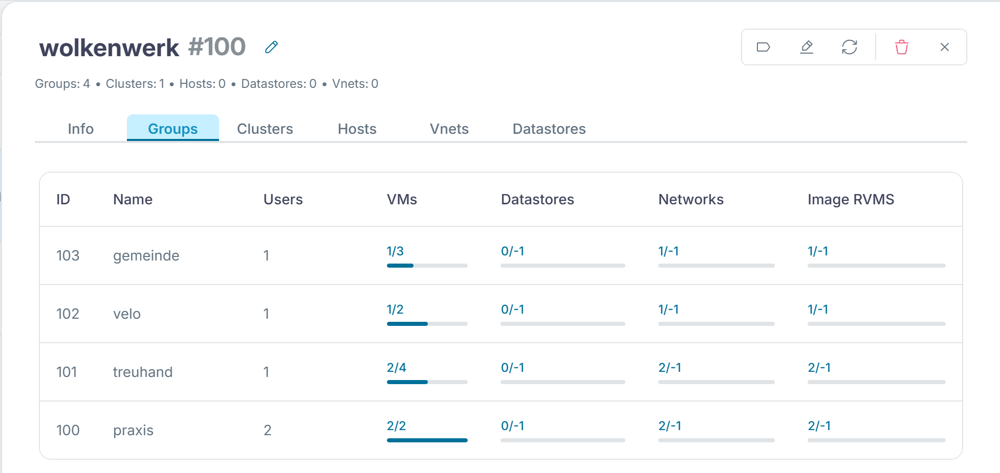
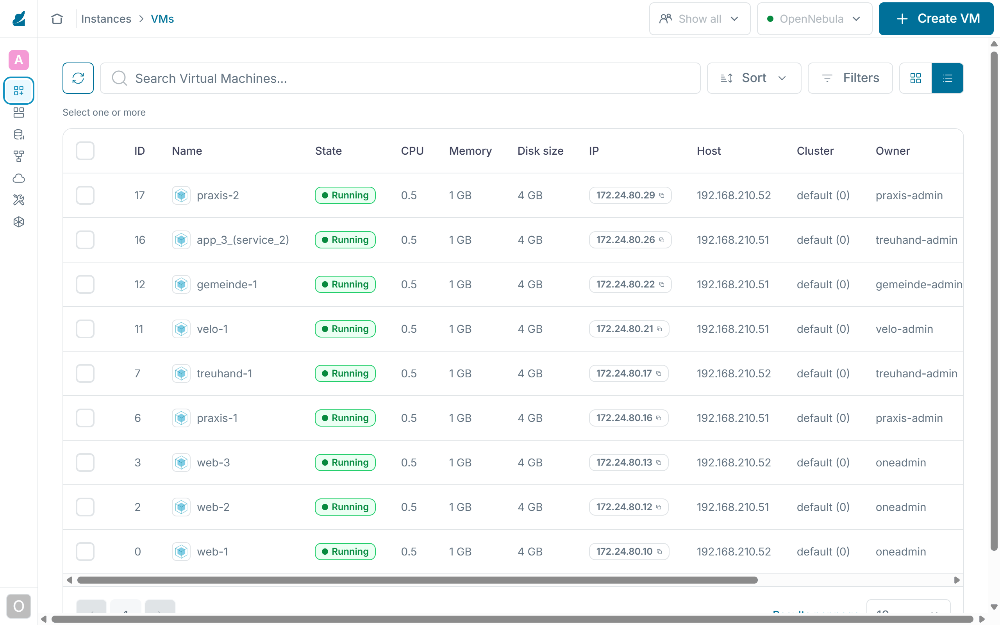

:::assignment
"Starting next month, all four members want to get going," Simone Wyss writes. "But Praxis Rosenweg must not see anything of the bike shop's web shop, and vice versa. And I don't want a phone call for every new VM."
:::

:::goals
After this chapter you can:

- Explain what multi-tenancy means in a cloud
- Tell users, groups and group admins in OpenNebula apart
- Create a group with an admin for every member
- Set up a virtual data center (VDC) and justify it
- Read an ACL
:::

## Multi-tenancy

So far you have worked alone as `oneadmin` and seen everything. A cloud for several organizations needs multi-tenancy. The tenants share the same hardware but only see their own VMs, images and templates. Each tenant manages its own people, and the platform team decides which resources it may use and how much of them.

OpenNebula builds this from three building blocks.

| Building block | What it decides | In the lab |
|---|---|---|
| Group | who belongs together and shares resources, separate from the other groups | one group per member |
| Group admin | who may create users in a group and manage all VMs of the group | `praxis-admin`, `treuhand-admin` and so on |
| VDC | which clusters, hosts, networks and datastores a group may use | the VDC `wolkenwerk` for all members |

A VDC (virtual data center) is a slice of the infrastructure that OpenNebula assigns to one or more groups. Within it the groups only see their own objects, even though they share the same nodes.


## Groups and group admins

`onegroup create` creates a group and, if you like, an admin with it. `--resources` decides which objects the users of the group may create themselves. In the lab these are VMs, images, templates and documents. OneFlow in [chapter 3.5](../advanced/#services-and-roles) needs the documents because OpenNebula stores a service as a document.

The script `lab/tenants/make-tenants.sh` creates the four members. It generates random passwords for the group admins and stores them in `~/cc-lab/tenants/`, where only your user can read them.

::code{file="lab/tenants/make-tenants.sh"}

```bash
~/cc/lab/tenants/make-tenants.sh
onegroup list
oneuser list
```

Every new group first lands in the VDC `default`, which grants all clusters to all groups. The script takes the members out of it and gathers them in the VDC `wolkenwerk`. It assigns cluster 0, which holds both nodes, the network `cc-net` and the datastores, to that VDC. Finally it uses `chmod 604` to let everybody use the template `ubuntu` and its image. The first digit 6 lets the owner use and manage the object, the 0 gives the group `oneadmin` no extra rights, and the 4 lets everybody else use it.

In Sunstone the VDC is under "System › VDCs", and its "Groups" tab lists the four groups.



## Working as a member

To see what a member sees, you log in as its admin. The CLI reads user and password from the file that `ONE_AUTH` points to. The loop creates such a file for each of the four admins. You will need these files in the next chapters as well.

```bash
for m in praxis treuhand velo gemeinde; do
  printf '%s-admin:%s\n' "$m" "$(cat ~/cc-lab/tenants/$m-admin.pass)" > ~/cc-lab/tenants/$m.auth
done
chmod 600 ~/cc-lab/tenants/*.auth
export ONE_AUTH=~/cc-lab/tenants/praxis.auth
onetemplate list
onevnet list
onevm list
unset ONE_AUTH
```

The practice sees the template `ubuntu` and the network `cc-net`, but no VMs of `oneadmin`. For SSH access to its VMs, `praxis-admin` needs a public key as well, because the context takes the key from the user who starts the VM. As `oneadmin` you add it the same way as in chapter 2.4.

```bash
printf 'SSH_PUBLIC_KEY="%s"\n' "$(cat ~/.ssh/id_ed25519.pub)" > /tmp/key.tpl
oneuser update praxis-admin --append /tmp/key.tpl
```

If the practice now starts a VM, the bike shop does not see it. In the lab, `onevm list` as `velo-admin` showed no VM at all while two of the practice's VMs were running.

As `oneadmin`, by contrast, Sunstone shows you the VMs of all members.



## ACLs

Groups and VDCs are built on ACLs (access control lists). Each rule says who may work on which resources with which rights. `oneacl list` shows the rules as a table of letters, and `oneacl create` adds a new one.

```text
@100 VM+IMAGE+TEMPLATE+DOCUMENT/* CREATE
```

`@100` is the group with the number 100, `VM+IMAGE+TEMPLATE+DOCUMENT` are the resources, `/*` means all objects of that kind, and `CREATE` is the right. `onegroup create` made this rule from the `--resources` option. In `oneacl list` the same rule reads `V--I-T---O---------` with the operation `---c`. If you forgot a resource, you add it with a rule of your own and do not have to create the group again.

::::exercise[Lab]
Create the four members, log in as `praxis-admin` and start the VM `praxis-1` from the template `ubuntu`. Show as `velo-admin` that the bike shop does not see this VM.

:::solution
After `make-tenants.sh`, `onegroup list` shows the groups `praxis`, `treuhand`, `velo` and `gemeinde`. As `praxis-admin`, `onetemplate instantiate ubuntu --name praxis-1` starts the VM, and `onevm list` shows it with the owner `praxis-admin` and the group `praxis`. With the auth file of `velo-admin`, `onevm list` stays empty.
:::
::::

::::exercise[Group or VDC]
Gemeinde Hinterbüel plans to buy a node of its own later, for its use only. Is a separate group enough for that, or does it need its own VDC? Explain.

:::solution
A group only separates the objects. The municipality's VMs could still run on any node. Only a VDC of its own that has just the new node assigned makes sure they run there and nowhere else. So it needs both, the group for the objects and the VDC for the infrastructure.
:::
::::
