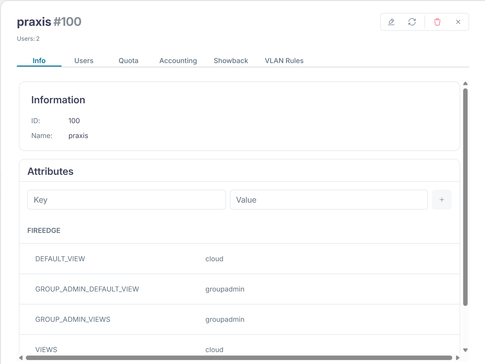

:::assignment
"Praxis Rosenweg has a new medical assistant who needs a test VM now and then," Simone Wyss writes. "Can the practice set that up itself without us having to do anything?"
:::

:::goals
After this chapter you can:

- Explain what self-service means in a cloud and why it is one of the characteristics of a cloud
- Tell the Sunstone views for members and group admins apart
- Create users and derive templates of your own as a group admin
- Explain what a member may change and what it may not
:::

## Self-service

In [chapter 1.1](../../basics/characteristics/), on-demand self-service is one of the five characteristics of a cloud. The NIST definition in [SP 800-145](https://csrc.nist.gov/pubs/sp/800/145/final) requires that consumers can provision computing power and storage on their own and as needed, without any human interaction on the provider's side. So a member gets resources when it needs them, without waiting for the platform team to work through a ticket.

The platform team sets the framework with the groups, the VDC and the quotas from chapters 3.1 and 3.2, and with shared templates. Within this framework the members act on their own.

## Duties of the platform team and the members

Self-service redistributes the work between the platform team and the members. The split follows the shared responsibility for IaaS from [chapter 1.2](../../basics/models/#shared-responsibility). The platform team runs the nodes, the network, the datastores and OpenNebula itself. It creates the members, sets their quotas and prices and maintains the shared templates and images. The member is responsible for whatever runs inside a VM. It creates its users, starts and deletes its VMs, keeps their operating system up to date and backs up its data. The line runs at the hypervisor, with the platform team below it and the member above it.

For the platform team this means fewer individual requests and more time spent on good defaults. A mistake in a shared template affects every member at once.

## Sunstone views

Sunstone does not show everybody the same thing. The template of a user's group defines which view they get. `onegroup create` set these values for the members.

```text
FIREEDGE=[
  DEFAULT_VIEW="cloud",
  GROUP_ADMIN_DEFAULT_VIEW="groupadmin",
  GROUP_ADMIN_VIEWS="groupadmin",
  VIEWS="cloud" ]
```

Sunstone shows these values under "System › Groups" in the "Info" tab of the group.



| View | For | What it shows |
|---|---|---|
| `cloud` | users of a member | dashboard, VMs, templates, services, marketplace and their own account |
| `user` | users who need more, not assigned in the lab | in addition images, networks, security groups and backups, but no users and no service templates |
| `groupadmin` | group admins | in addition images, networks, users of the group, service templates, security groups and backups |
| `admin` | the platform team | everything, including hosts, clusters, datastores and VDCs |

OpenNebula 7.4 ships these four views, and the [views documentation](https://docs.opennebula.io/7.4/product/cloud_system_administration/multitenancy/fireedge_sunstone_views/) describes them. The view `cloud` is meant for end users who only start VMs from ready-made templates.

The views live on the front-end in `/etc/one/fireedge/sunstone/views/`. Every view is a folder with one file per tab. If you want to take a tab away from a view, you adapt these files. If a group has no values of its own, the assignment in `sunstone-views.yaml` in the same folder applies. There the group `oneadmin` gets all four views and everybody else gets `user` and `cloud`.

Open Sunstone in the browser of the client (the Kali VM on smartlearn, your PC with an own hypervisor) at `http://<front-end>:2616` and log in as `praxis-admin`. You see the view `groupadmin` with the practice's VMs and the template `ubuntu`. Hosts and datastores are missing because they remain the platform team's business.

## ACLs behind the views

A view only hides tabs and buttons, which makes the interface easier to use. It is not a security boundary, because for every action Sunstone calls the same OpenNebula API as the CLI. Only the API decides whether a request is allowed.

OpenNebula checks every request in a fixed order, as the [documentation on permissions and ACLs](https://docs.opennebula.io/7.4/product/cloud_system_administration/multitenancy/chmod/) describes. The user `oneadmin` and the group `oneadmin` may do anything. For VMs, networks, images, templates and documents, the object's permissions for owner, group and others come next, such as the `chmod 604` of the template `ubuntu`. If they do not settle it, OpenNebula walks through the ACLs from chapter 3.1 until a rule allows the request. ACLs only grant rights and never take any away. If no rule allows the request, OpenNebula refuses it.

To stop a member from doing something, you therefore change the ACLs or the permissions of the objects. A tab missing from a view does not stop anyone who uses the CLI or the API.

![Roles and views in Sunstone. On the left is the platform team as oneadmin with the view admin. It runs the nodes, networks and datastores, creates the members with their admins, sets quotas and prices and maintains the shared template ubuntu. On the right is the member praxis. Its group admin praxis-admin has the view groupadmin and creates the users of the group, manages all VMs of the group, sets the quotas of their users and copies templates, but may not change the template ubuntu. The medical assistant praxis-mpa has the view cloud. This account starts VMs from ready-made templates and at most adjusts size and disks, and these VMs count against the group's quota. Look at the line at the bottom. A view only hides tabs. Permissions and ACLs decide whether a request is allowed.](../../../../assets/figures/en/p3c4-roles.svg)

## Users in the group

A member's group admin creates the member's users. New users land in the admin's group, and their VMs count against the group's quota.

```bash
export ONE_AUTH=~/cc-lab/tenants/praxis.auth
oneuser create praxis-mpa "<password>"
oneuser list
unset ONE_AUTH
```

The medical assistant then logs in to Sunstone, gets the view `cloud` and starts VMs from the template `ubuntu`. The group admin sees and manages these VMs as well.

## The service catalog

A service catalog is the list of services a provider offers ready-made, each with a defined scope, price and owner. Whoever needs something picks it from the catalog instead of describing a wish in free form. For the provider this means it only runs what it has tested and documented.

In OpenNebula the shared templates form this catalog. The template `ubuntu` fixes image, size, network and context, and since chapter 3.3 it carries its price as well. The OneFlow service templates from [chapter 3.5](../advanced/#services-and-roles) add services made of several VMs. According to the [Cloud View documentation](https://docs.opennebula.io/7.4/product/control_plane_configuration/graphical_user_interface/cloud_view/), users there select one of the templates the administrators prepared and at most adjust capacity and disks before they start it. The catalog is the interface between the platform team and the members. Every entry is a promise to maintain it, so the platform team only adds what it can actually run.

## The limits of a member

The template `ubuntu` belongs to `oneadmin`, and `chmod 604` lets the members only use it. An attempt to change it fails with this message:

```text
[one.template.update] User [2] : Not authorized to perform MANAGE TEMPLATE [1].
```

The members may create templates of their own, though, because their group has allowed it since chapter 3.1. If the practice needs a larger VM, it copies the template and changes the copy.

```bash
onetemplate clone ubuntu praxis-gross
onetemplate update praxis-gross
```

The copy takes over everything, including the prices from chapter 3.3, and belongs to the practice. Whatever the practice puts in it is still limited by its quota. The platform team only has to maintain a few shared templates, networks and images, and the members set up everything else themselves within their quota.

Under "Templates › VM Templates", `oneadmin` sees the templates of the platform team and the copies of the members side by side.


## The check of part 3

The check of this part tests the groups with their admins and quotas, the VDC `wolkenwerk`, the sharing and the prices of the template `ubuntu`, and the showback. Run it only after you have calculated the showback of chapter 3.3. Until then the showback has no costs yet, and the check reports `[!!]` there.

```bash
python3 ~/cc/checks/check.py tenants
```

The two lines about OneFlow marked `[+!!]` belong to advanced task A in chapter 3.5 and do not count for the base.

::::exercise[Lab]
With two VMs the practice's quota from chapter 3.2 is full. So first delete the VM `praxis-2` as `praxis-admin` with `onevm terminate`. Sunstone sets the CPU of a new VM to 1, which just fits next to `praxis-1` into the practice's 1.5 CPU. Then create the user `praxis-mpa`, log in to Sunstone as this user in the browser of the client and start a VM. As `praxis-admin`, check that you can see it, then delete it. Finally run the check `tenants` and add its report to your hand-in repo.

:::solution
`oneuser create praxis-mpa <password>` creates the user in the group `praxis`. In Sunstone the view `cloud` shows the template `ubuntu`, and the VM only starts as long as the practice's quota has room. As `praxis-admin`, `onevm list` shows the VM with the owner `praxis-mpa`, and `onevm terminate` deletes it. The check ends with "19 of 19 base checks passed" and "0 of 2 checks of the advanced tasks passed".
:::
::::

::::exercise[Setting the frame]
Gemeinde Hinterbüel wants its users to start VMs but not upload images of their own. How do you implement that?

:::solution
The group `gemeinde` only gets the resources `VM+TEMPLATE+DOCUMENT`, without `IMAGE`. For an existing group you delete the group's ACL with `oneacl delete` and create it again without `IMAGE`. The view `cloud` has no tab for images anyway, but the ACL also prevents uploads through the CLI.
:::
::::

::::exercise[Responsibility]
The practice wants its medical assistant to have at most one VM at a time. It would also like a Windows template for all members. Who implements what, and with which tools?

:::solution
The limit for the medical assistant is a user quota with `VMS = 1`. `praxis-admin` sets it with `oneuser quota praxis-mpa`, because a group admin may manage the users of their group. A template for all members belongs in the shared catalog and so with the platform team. It decides whether it can maintain the image and cover the licenses, creates the template as `oneadmin` and shares it with `chmod 604`. The practice could create a template of its own, but that template would belong to the practice and not to the catalog the platform team maintains.
:::
::::
