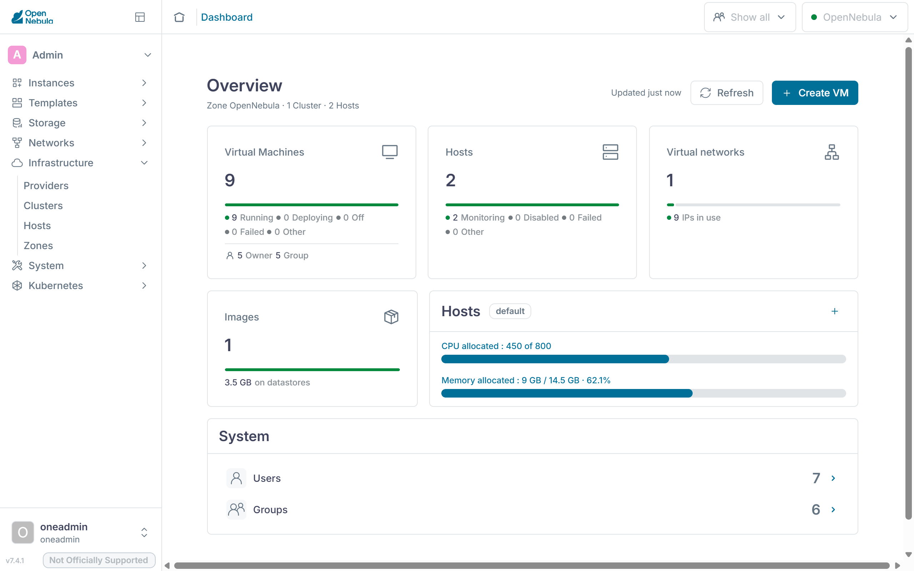

:::goals
Nach diesem Kapitel kannst du:

- Die Dienste von OpenNebula auf dem Front-end und ihre Aufgaben nennen
- Erklären, wie oned, Scheduler, Monitoring und Treiber zusammenarbeiten
- Die Datastores für System, Images, Dateien und Backups im Lab finden
- Die Netzmodi bridge, 802.1Q und VXLAN an ihren Geräten auf einem Knoten unterscheiden
- Beschreiben, wie CLI, Sunstone und OpenTofu die API von oned nutzen
- Den Weg einer VM von der Vorlage bis zum Prozess auf dem Knoten verfolgen
:::

[Kapitel 2.1](../../iaas/architecture/) zeigt die Bausteine von OpenNebula im Überblick. Diese Ergänzung geht eine Ebene tiefer, zu den Prozessen, Dateien und Geräten auf deinen Servern. Die Beispiele verwenden den Code `mmuster` mit dem Front-end 192.168.210.137, den Knoten .138 und .139, der VXLAN-Kennung 5862 und der Schnittstelle `eth0`. Setze deine eigenen Werte ein. In den Befehlen von OpenNebula heissen die Knoten so, wie OneDeploy sie eingetragen hat, nach ihrer IP-Adresse. Für `<knoten>` setzt du deshalb den Namen aus der Spalte `NAME` von `onehost list` ein, etwa `192.168.210.138`, oder die Nummer aus der Spalte `ID`. Mit `ssh` erreichst du die Knoten dagegen unter ihren Hostnamen wie `mmuster-node1`.

## Der Dienst oned

Der Kern von OpenNebula ist das Programm `oned`, das systemd als Dienst `opennebula` startet. Es nimmt jeden Auftrag über die API an, prüft Rechte und Quotas und speichert den Zustand aller Objekte in einer Datenbank, jedes Objekt als XML-Dokument. Ohne weitere Angabe nimmt OpenNebula dafür SQLite, OneDeploy richtet im Lab MariaDB ein. Ein solches Dokument zeigt dir `onevm show <vm> -x`. Einstellungen und Meldungen stehen in `/etc/one/oned.conf` und `/var/log/one/oned.log`, wie die [Dokumentation zu oned](https://docs.opennebula.io/7.4/product/operation_references/opennebula_services_configuration/oned/) beschreibt.

Die Arbeit an Hosts, VMs und Disks gibt `oned` an **Treiber** ab, eigene Programme, die es beim Start aufruft. `onemonitord` sammelt das Monitoring, `one_sched` plant neue VMs, `one_vmm_exec` steuert die VMs, `one_tm` bringt Disks zu den Knoten und `one_datastore` verwaltet die Images. Alle laufen unter dem Benutzer `oneadmin`.

```bash
systemctl status opennebula --no-pager
ps -u oneadmin -o pid,args | grep -E 'oned|onemonitord|one_'
```

Die zweite Zeile listet `oned` und die Treiber, die es gestartet hat, jeweils mit ihren Argumenten.

![Dienste und Treiber von OpenNebula. Oben die Dienste auf dem Front-end. FireEdge liefert Sunstone auf Port 2616 aus. guacd auf Port 4822 bringt die Konsole einer VM in den Browser. OneFlow läuft auf Port 2474, OneGate auf Port 5030. Wie die CLI und OpenTofu rufen FireEdge, OneFlow und OneGate die API von oned auf, über XML-RPC auf Port 2633 oder gRPC auf Port 2634. oned speichert alle Objekte als XML in MariaDB und gibt die Arbeit an seine Treiber ab, die wie oned als oneadmin laufen. Scheduler und Datastore arbeiten nur auf dem Front-end. Die Treiber für Virtualisierung und Transfer erreichen die Knoten über SSH. Dort liegen ihre Skripte unter /var/tmp/one/, kopiert aus /var/lib/one/remotes/ auf dem Front-end. vmm/kvm startet die VMs mit libvirt und KVM, vnm/vxlan richtet ihr Netz ein. Der Transfertreiber legt disk.0 und disk.1 in den Datastore 0. Ein Agent führt die Proben aus im/kvm-probes.d/ aus und schickt die Werte an onemonitord auf Port 4124. Achte darauf, dass auf den Knoten kein Dienst von OpenNebula läuft. Dort arbeiten nur Skripte, die das Front-end über SSH startet.](../../../assets/figures/de/ex-opennebula.svg)

## Scheduler und Monitoring

Der Scheduler ist in OpenNebula 7.4 ebenfalls ein Treiber, in `oned.conf` als `SCHED_MAD` eingetragen. `oned` verlangt von ihm einen Plan für die wartenden VMs und führt diesen Plan selbst aus. `-p rank` wählt für die erste Platzierung den Rank Scheduler aus [Kapitel 2.5](../../iaas/hosts/). `-o one_drs` ergänzt den Distributed Resource Scheduler, der laufende VMs umverteilen kann.

Wartende VMs sammelt `oned` in einem Fenster. Mit den Werten, die OpenNebula 7.4 mitliefert, schliesst es nach zehn Sekunden oder sobald mehr als sieben VMs warten. Findet der Scheduler keinen Platz, fragt `oned` nach 60 Sekunden erneut. Pro Host läuft höchstens ein geplanter Start oder eine Migration gleichzeitig, wie die [Dokumentation des Schedulers](https://docs.opennebula.io/7.4/product/cloud_system_administration/scheduler/configuration/) erklärt. Eine neue VM kann darum einige Sekunden auf `pend` stehen, obwohl Platz frei ist.

```bash
sudo sed -n '/^SCHED_MAD/,/^MAX_ACTIONS_PER_CLUSTER/p' /etc/one/oned.conf
```

Die Ausgabe zeigt den Treiber mit seinen Argumenten, die Grenzen des Fensters, die Wartezeit bis zum nächsten Versuch und die Aktionen pro Host.

Den Zustand von Hosts und VMs liefert `onemonitord` auf Port 4124 für UDP und TCP. Auf jedem Knoten startet OpenNebula über SSH einen kleinen Agenten, der die Proben aus `im/kvm-probes.d/` ausführt und die Werte selbst an das Front-end schickt. Laut der [Dokumentation zum Monitoring](https://docs.opennebula.io/7.4/product/cloud_system_administration/resource_monitoring/monitoring_system/) kommen alle 30 Sekunden ein Lebenszeichen sowie Zustand und Verbrauch der VMs, alle 120 Sekunden die Auslastung des Hosts. Bleibt das Lebenszeichen aus, startet OpenNebula die Proben neu. Misslingt das, steht der Knoten in `onehost list` auf `err`.

```bash
sudo ss -tulpn | grep 4124
onehost show <knoten>
```

`ss` zeigt `onemonitord` mit TCP und UDP auf Port 4124. `onehost show` nennt bei `LAST MONITORING TIME` den Zeitpunkt der letzten Meldung und im Abschnitt `MONITORING INFORMATION` die gemeldeten Werte.

## Weboberfläche und Zusatzdienste

Sunstone ist eine Anwendung in React, die der Server **FireEdge** ausliefert. FireEdge läuft mit Node.js als Dienst `opennebula-fireedge` auf Port 2616. Für jede Aktion ruft er dieselbe XML-RPC-API auf wie die CLI, unter `http://localhost:2633/RPC2`. Die Konsole einer VM im Browser läuft über guacd auf Port 4822, den Proxy von Apache Guacamole, der sich per VNC mit der VM verbindet. Die Ansichten aus [Kapitel 3.4](../../tenants/self-service/) liegen unter `/etc/one/fireedge/sunstone/`, wie die [Dokumentation zu FireEdge](https://docs.opennebula.io/7.4/product/operation_references/opennebula_services_configuration/fireedge/) beschreibt.

Das Menü links gliedert Sunstone in Bereiche wie «Instances», «Templates», «Storage», «Networks», «Infrastructure» und «System».



[OneFlow](https://docs.opennebula.io/7.4/product/operation_references/opennebula_services_configuration/oneflow/) läuft als Dienst `opennebula-flow` auf Port 2474. Er verwaltet Dienste aus mehreren VMs mit Rollen und Regeln für die Elastizität. Im Kurs gehört OneFlow zu den Zusatzaufträgen von Meilenstein 1, die [Kapitel 3.5](../../tenants/advanced/#dienste-und-rollen) beschreibt. Dienstvorlagen und Dienste speichert er in `oned` als Dokumente. Deshalb brauchen die Gruppen der Mitglieder das Recht, Dokumente anzulegen. Seine VMs startet OneFlow über die API wie jeder andere Client.

[OneGate](https://docs.opennebula.io/7.4/product/operation_references/opennebula_services_configuration/onegate/) läuft als Dienst `opennebula-gate` auf Port 5030 und nimmt Meldungen aus VMs an, etwa eigene Messwerte für eine Regel von OneFlow. Eine VM weist sich dabei mit einem Token aus ihrem Kontext aus. In der Grundeinstellung nimmt OneGate nur Anfragen vom Front-end selbst an, wie `ss` in [Kapitel 2.2](../../iaas/installation/) zeigt. Die VMs in cc-net erreichen ihn nicht, im Kurs bleibt OneGate Theorie.

Alle drei Dienste ergänzen `oned`. Hält einer an, laufen die VMs weiter und die CLI arbeitet wie vorher.

```bash
systemctl is-active opennebula-fireedge opennebula-guacd opennebula-flow opennebula-gate
sudo journalctl -u opennebula-fireedge -n 20 --no-pager
```

Die erste Zeile meldet für jeden der vier Dienste `active`, die zweite zeigt die letzten Meldungen von FireEdge.

## Treiber

Hinter jedem Treiber stehen kleine Programme in Ruby und Shell, eines pro Aktion. Auf dem Front-end liegen sie unter `/var/lib/one/remotes/`. Was auf den Knoten laufen muss, kopiert OpenNebula nach `/var/tmp/one/`, sobald es einen Knoten überwacht. Nach einer Änderung verteilt `onehost sync -f` die Dateien neu, wie die [Dokumentation zu den Hosts](https://docs.opennebula.io/7.4/product/cluster_configuration/hosts_and_clusters/hosts/) beschreibt.

| Treiber | Programm auf dem Front-end | Aktionen unter `remotes/` | Beispiel im Lab |
|---|---|---|---|
| Monitoring (IM) | `onemonitord` | `im/kvm-probes.d/` | Proben für Host und VMs laufen auf jedem Knoten |
| Virtualisierung (VMM) | `one_vmm_exec` | `vmm/kvm/` | `deploy` startet eine VM mit `virsh create` |
| Transfer (TM) | `one_tm` | `tm/ssh/` | `clone` kopiert ein Image per SSH auf den Knoten |
| Datastore (DS) | `one_datastore` | `datastore/fs/` | `cp` legt ein neues Image als Datei im Datastore ab |
| Netz (VNM) | kein eigenes | `vnm/vxlan/` | `pre` vor dem Start einer VM, `post` danach, `clean` beim Beenden |

Der Netztreiber hat kein eigenes Programm. `one_vmm_exec` ruft seine Aktionen beim Starten, Verschieben und Beenden einer VM auf. OneDeploy hat beide Knoten mit `kvm` für Monitoring und Virtualisierung eingetragen.

```bash
onehost show <knoten> | grep -E 'IM_MAD|VM_MAD'
sudo ls /var/lib/one/remotes/
ssh mmuster-node1 sudo ls /var/tmp/one/
```

Unter `/var/tmp/one/` auf dem Knoten findest du die Ordner aus `remotes` wieder, etwa `im`, `vmm` und `vnm`.

## Datastores

OneDeploy hat drei Datastores angelegt, [Kapitel 6.2](../../operations/backup/) ergänzt einen für Backups. Ein Datastore für Images hat zwei Treiber. `DS_MAD` verwaltet die Images, im Lab `fs` mit gewöhnlichen Dateien. `TM_MAD` bringt die Disks zu den VMs, im Lab `ssh`. Ein Datastore vom Typ System enthält die Disks laufender VMs und hat nur einen Transfertreiber.

| Datastore | Typ | Inhalt | Ort im Lab |
|---|---|---|---|
| 0 `system` | `SYSTEM_DS` | Disks und Dateien der VMs | auf jedem Knoten für seine laufenden VMs, auf dem Front-end für VMs in `unde` |
| 1 `default` | `IMAGE_DS` | Images wie `ubuntu-26.04` | `/var/lib/one/datastores/1/` auf dem Front-end |
| 2 `files` | `FILE_DS` | Kernel, Ramdisks und Dateien für den Kontext | `/var/lib/one/datastores/2/` auf dem Front-end |
| `backups` | `BACKUP_DS` | Backups von VMs | auf dem Front-end, das `RSYNC_HOST` nennt |

Mit `ssh` hat jeder Knoten seinen eigenen Teil des Datastores 0 unter `/var/lib/one/datastores/0/`, mit einem Ordner pro VM. Darin liegen ihre Disk `disk.0` als eigenständige Kopie des Images, der Kontext als `disk.1` und die Dateien, die der Treiber für VMs beim Start ablegt. Fällt ein Knoten aus, kommt niemand an diese Disks, wie Kapitel 2.5 beschreibt.

Die [Dokumentation zu lokalem Speicher](https://docs.opennebula.io/7.4/product/cluster_configuration/storage_system/local_ds/) führt `ssh` in OpenNebula 7.4 als älteren Treiber, der weiter unterstützt wird. Für neue Datastores gibt sie `local` vor, der ebenfalls über SSH kopiert und Funktionen von qcow2 wie Thin Provisioning nutzt. OneDeploy legt mit `mode: ssh` aus dem Inventar von Kapitel 2.2 den älteren an.

```bash
onedatastore list
onedatastore show 0
ssh mmuster-node1 sudo ls /var/lib/one/datastores/0/
```

`onedatastore list` zeigt Typ, Treiber und freien Platz jedes Datastores. Auf dem Knoten steht für jede VM, die dort läuft, ein Ordner mit ihrer Nummer.

## Netzmodi

Die Netztreiber bauen ihre Netze aus Geräten des Linux-Kernels. Die Dokumentation beschreibt die Modi [bridge](https://docs.opennebula.io/7.4/product/cluster_configuration/networking_system/bridged/), [802.1Q](https://docs.opennebula.io/7.4/product/cluster_configuration/networking_system/vlan/) und [VXLAN](https://docs.opennebula.io/7.4/product/cluster_configuration/networking_system/vxlan/) einzeln. Wie du die Geräte ansiehst, zeigt die Ergänzung [Linux-Netz im Lab](../network/).

| Modus | Geräte auf dem Knoten | Verlangt vom Netz darunter |
|---|---|---|
| `bridge` | Eine Bridge mit der Schnittstelle des Knotens und den Karten der VMs | Der Switch lässt die MAC-Adressen der VMs durch |
| `802.1Q` | Pro Netz ein VLAN-Gerät wie `eth0.50` in einer eigenen Bridge | Die Ports sind Trunks mit diesen VLANs, der Knoten lädt das Modul `8021q` |
| `vxlan` | Pro Netz ein VXLAN-Gerät wie `eth0.5862` in einer eigenen Bridge | Die Knoten erreichen sich über IP, Multicast erreicht die Gruppe |

Bei `bridge` hängt die Schnittstelle des Knotens selbst in der Bridge, seine Adresse liegt dann auf der Bridge. OneDeploy richtet eine solche Bridge mit netplan ein, wenn das Inventar ein Netz dieser Art enthält, etwa unter dem Namen `br0`. Dein Inventar enthält keines, deine Knoten behalten ihre Adresse auf der Schnittstelle.

Bei `vxlan` legt `pre` Bridge und VXLAN-Gerät an, sobald die erste VM des Netzes auf einem Knoten startet. Das Gerät heisst nach Schnittstelle und Kennung, im Beispiel `eth0.5862`. Verlässt die letzte VM des Netzes den Knoten, löscht `clean` beide wieder. Die Karte einer VM heisst `one-<vm>-<karte>`, die erste Karte der VM 12 also `one-12-0`.

Bei `fw`, `802.1Q` und `vxlan` setzt `post` zudem Regeln mit iptables für die [Sicherheitsgruppen](https://docs.opennebula.io/7.4/product/virtual_machines_operation/virtual_machines_networking/security_groups/). Jedes neue Netz bekommt die Gruppe `default` mit der Nummer 0, die allen Verkehr erlaubt. Auch `cc-net` filtert deshalb nichts.

```bash
onevnet show cc-net | grep -E 'VN_MAD|PHYDEV|BRIDGE|VLAN_ID|SECURITY_GROUPS'
ssh mmuster-node1 'ip -d link show eth0.5862; ip link show master ccbr5862'
```

Auf einem Knoten mit einer VM in cc-net zeigt `ip -d link` das VXLAN-Gerät mit Kennung, Gruppe und Port. `ip link show master` listet die Geräte in der Bridge, darunter die Karten der VMs.

## API und Clients

Alle Clients sprechen mit `oned` über die [XML-RPC-API](https://docs.opennebula.io/7.4/product/integration_references/system_interfaces/api/) unter `http://<front-end>:2633/RPC2`. Jeder Aufruf beginnt mit einem Session-String, bei einer Anmeldung mit Passwort `benutzer:passwort`. Die Antwort meldet Erfolg oder Misserfolg, das Ergebnis oder eine Fehlermeldung und einen Fehlercode. Hinter jedem Befehl der CLI stehen solche Methoden, hinter `onetemplate instantiate` etwa `one.template.instantiate`.

Die CLI besteht aus Programmen in Ruby. Die Adresse der API nimmt sie aus `ONE_XMLRPC`, ohne die Variable gilt `http://localhost:2633/RPC2`. Benutzer und Passwort liest sie aus der Datei in `ONE_AUTH`, sonst aus `~/.one/one_auth`, wie die [Konfiguration der CLI](https://docs.opennebula.io/7.4/product/operation_references/command_line_interface/cli_configuration/) beschreibt. Damit hast du in [Kapitel 3.1](../../tenants/groups/) als Mitglied gearbeitet. Sunstone kommt über FireEdge zur API, OpenTofu über den Provider aus [Kapitel 4.2](../../platform/opentofu/). Dieselben Aufrufe nimmt `oned` auch über [gRPC](https://docs.opennebula.io/7.4/product/control_plane_configuration/large-scale_deployment/grpc/) auf Port 2634 an, laut Dokumentation schneller für grosse Installationen. Die CLI nutzt gRPC nur mit der Option `--grpc`.

Weil jeder Weg bei `oned` endet, prüft `oned` bei jedem Aufruf die Rechte. Eine Ansicht in Sunstone blendet nur Reiter aus. Ob ein Auftrag erlaubt ist, entscheidet `oned`, wie Kapitel 3.4 zeigt.

```bash
onezone show 0 | grep ENDPOINT
onevm list -x | head -20
```

Die erste Zeile zeigt die Adresse der API, die in der Zone eingetragen ist. Die zweite zeigt die Antwort von `one.vmpool.info` als XML, so wie sie über das Netz kommt.

## Benutzer, Gruppen, VDCs und ACLs

Jedes Objekt gehört einem Benutzer und einer Gruppe und trägt Rechte für Besitzer, Gruppe und alle anderen, ähnlich wie eine Datei unter Unix. `oneadmin` mit der Nummer 0 und die Mitglieder der Gruppe `oneadmin` dürfen alles. Über den [Dienstbenutzer](https://docs.opennebula.io/7.4/product/cloud_system_administration/multitenancy/manage_users/) `serveradmin` reichen Dienste von OpenNebula Anfragen ihrer Benutzer an `oned` weiter. **ACLs** geben Benutzern oder Gruppen zusätzliche Rechte auf ganze Arten von Objekten. Ein **VDC** teilt Gruppen Cluster, Hosts, Netze und Datastores zu, ohne eigenes VDC gilt `default` mit allen Clustern. [Kapitel 3.1](../../tenants/groups/) baut damit die Mitglieder auf, Kapitel 3.4 zeigt die Reihenfolge der Prüfung.

```bash
oneuser list
onevdc list
oneacl list
```

`oneuser list` zeigt neben `oneadmin` und den Gruppenadmins auch `serveradmin`. `oneacl list` enthält die Regeln, die `onegroup create` für die Mitglieder angelegt hat.

## Der Weg einer VM

Kapitel 2.1 beschreibt den Weg einer VM in fünf Schritten. Hier folgst du ihm bis zu Dateien und Prozessen, für eine VM mit der Nummer 12 auf Knoten 1.

`onetemplate instantiate ubuntu` schickt `one.template.instantiate` an `oned`. Es prüft Rechte und Quota, legt die VM in der Datenbank an, gibt ihrer Karte eine Adresse aus `cc-net` und beginnt das Log `/var/log/one/12.log`. Die VM steht auf `pend`, bis das Fenster des Schedulers schliesst. Der Rank Scheduler streicht die Knoten ohne Platz, ordnet die übrigen und gibt seinen Plan zurück. Den gewählten Knoten trägt `oned` in die Historie der VM ein, die `onevm show` unter `VIRTUAL MACHINE HISTORY` zeigt.

Im Zustand `prol` kopiert der Transfertreiber `ssh` das Image als `disk.0` nach `/var/lib/one/datastores/0/12/` auf dem Knoten. In `boot` schreibt `oned` die Beschreibung für libvirt nach `/var/lib/one/vms/12/deployment.0`. Darin heisst die VM `one-12`, ihre Karte `one-12-0` hängt an der Bridge `ccbr5862`. Dann arbeitet `one_vmm_exec` eine feste Folge ab. Zuerst entsteht der Kontext als ISO-Abbild `disk.1`. `pre` legt Bridge und VXLAN-Gerät an, falls sie fehlen. `deploy` legt die Beschreibung neben die Disks und startet die VM mit `virsh create`. Zuletzt setzt `post` die Regeln der Sicherheitsgruppen.

Hat libvirt die VM angelegt, wechselt sie auf `runn` und der Agent auf dem Knoten meldet ihren Zustand alle 30 Sekunden. In der VM liest das Kontextpaket `disk.1` und richtet Adresse, Hostname und Schlüssel ein, wie [Kapitel 2.4](../../iaas/images/) erklärt. Alle Zustände beschreibt die [Referenz der Zustände](https://docs.opennebula.io/7.4/product/operation_references/configuration_references/vm_states/).

```bash
onevm show <vm>
sudo tail -n 30 /var/log/one/<vm-id>.log
ssh mmuster-node1 'sudo virsh list; sudo ls -l /var/lib/one/datastores/0/<vm-id>/'
```

Das Log nennt jeden Zustandswechsel und jede Aktion der Treiber mit Uhrzeit. `virsh list` zeigt die VM als `one-<vm-id>`. Im Ordner liegen die Disks, `deployment.0` sowie `vm.xml` und `ds.xml`, die der Treiber für VMs vor dem Start dort ablegt.

::::exercise[Lab]
Wähle eine laufende VM, etwa `web-1` aus Kapitel 2.4 oder ab Teil 4 `k3s-agent`. Finde mit den Befehlen dieser Seite heraus, auf welchem Knoten sie läuft, wie sie in libvirt heisst, an welcher Bridge ihre Karte hängt und welche Dateien in ihrem Ordner im Datastore 0 liegen. Erkläre zu jeder Datei und jedem Gerät, welcher Treiber es angelegt hat.

:::solution
`onevm show` nennt die Nummer der VM und unter `HOST` ihren Knoten. Dort zeigt `sudo virsh list` die VM als `one-<nummer>`. `ip link show master ccbr<kennung>` listet das VXLAN-Gerät und die Karte `one-<nummer>-0`. Bridge und VXLAN-Gerät hat der Netztreiber `vxlan` mit `pre` angelegt, die Karte libvirt beim Start der VM durch `deploy`. Im Ordner `/var/lib/one/datastores/0/<nummer>/` liegt `disk.0`, die Kopie des Images vom Transfertreiber `ssh`. Den Kontext in `disk.1` erzeugt beim Start ein Schritt des Transfertreibers. `deployment.0` stammt von `oned`, `vm.xml` und `ds.xml` legt der Treiber für VMs ab, bevor `deploy` die VM über libvirt startet.
:::
::::
