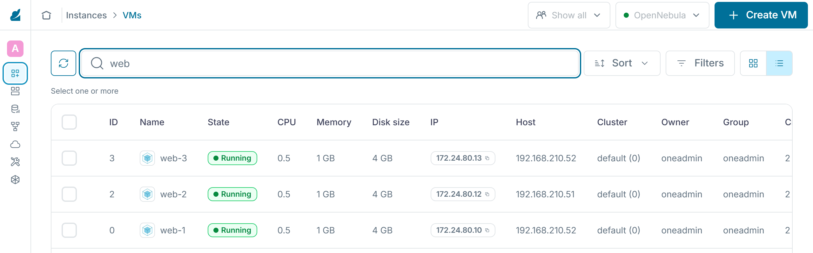

:::assignment
«Nächste Woche bekommt Knoten 1 mehr Arbeitsspeicher», schreibt Simone Wyss. «Die Praxis darf davon nichts merken. Und was passiert eigentlich, wenn ein Knoten einfach ausfällt?»
:::

:::goals
Nach diesem Kapitel kannst du:

- Die Zustände eines Hosts lesen und ändern
- Reale und zugeteilte Kapazität unterscheiden und Überbuchung erklären
- Die Regeln des Schedulers für die Wahl eines Knotens beschreiben und die Zustände einer VM lesen
- VMs mit und ohne Unterbruch auf einen anderen Knoten verschieben
- Einen Knoten für die Wartung leeren und wieder in Betrieb nehmen
- Beschreiben, was beim Ausfall eines Knotens mit seinen VMs geschieht
:::

## Zustände eines Hosts

`onehost list` zeigt in der Spalte `STAT` den Zustand jedes Knotens.

| Zustand | Bedeutung | Befehl |
|---|---|---|
| `on` | überwacht und bereit für neue VMs | `onehost enable` |
| `dsbl` | überwacht, laufende VMs bleiben, neue VMs kommen nicht dazu | `onehost disable` |
| `off` | nicht mehr überwacht, für ausgeschaltete Knoten | `onehost offline` |
| `err` | die Überwachung meldet einen Fehler, oft fehlt die SSH-Verbindung | |

Unter «Infrastructure › Hosts» zeigt Sunstone die Zustände mit ihrem ausgeschriebenen Namen, etwa «Monitored» für `on` und «Disabled» für `dsbl`.


## Kapazität und Überbuchung

`onehost show` zeigt für Arbeitsspeicher und CPU zwei Werte. `USED (ALLOCATED)` ist, was die Vorlagen der laufenden VMs reservieren. `USED (REAL)` ist, was der Knoten tatsächlich belegt, seine VMs und sein eigenes System zusammen. Drei VMs aus der Vorlage `ubuntu` reservieren 3 GB, im Leerlauf belegen sie aber nur knapp 2 GB. Das System eines Knotens braucht im Lab rund 0,6 GB dazu. Die CPU zählt OpenNebula in Hundertsteln eines Kerns, ein Knoten mit vier Kernen hat 400. Eine VM mit `CPU = "0.5"` reserviert 50 davon. Auf smartlearn zeigte `onehost show` für einen Knoten mit zwei VMs aus `ubuntu` beim Arbeitsspeicher 2 GB reserviert und 1 GB real, bei der CPU 100 reserviert und 20 real.

Für `<knoten>` setzt du in diesem Kapitel den Namen ein, den `onehost list` in der Spalte `NAME` zeigt. OneDeploy hat die Knoten unter ihren IP-Adressen eingetragen, für den Code `mmuster` also `192.168.210.138` und `192.168.210.139`. Die Nummer aus der Spalte `ID` geht ebenso. Einen Hostnamen wie `mmuster-node1` kennt OpenNebula dagegen nicht.

```bash
onehost show <knoten> | sed -n '/HOST SHARES/,/LOCAL SYSTEM/p'
```

Der Scheduler plant mit der reservierten Kapazität. Ist ein Knoten voll reserviert, startet dort keine VM mehr, auch wenn er real noch Luft hätte. Mit den Werten `RESERVED_CPU` und `RESERVED_MEM` im Host kann das Plattform-Team die Kapazität anpassen. Ein positiver Wert hält Reserve frei. Ohne einen solchen Wert bietet OpenNebula den VMs den ganzen Arbeitsspeicher des Knotens an, auch die rund 0,6 GB, die sein eigenes System braucht. Ein voll reservierter Knoten ist also schon leicht überbucht. Im Lab fängt das der Swap aus Kapitel 0.4 auf. Ein negativer Wert erlaubt **Überbuchung**, dann ist auf dem Knoten mehr reserviert, als er hat. Überbuchung senkt die Kosten, weil selten alle VMs gleichzeitig voll arbeiten. Arbeiten doch alle gleichzeitig, werden alle langsamer. Beim Arbeitsspeicher ist Überbuchung heikler als bei der CPU, weil VMs bei fehlendem Speicher abstürzen. Fehlende CPU-Zeit bremst sie nur. Wie du `RESERVED_CPU` und `RESERVED_MEM` absolut oder in Prozent angibst, zeigt die [Anleitung zur Überbuchung](https://docs.opennebula.io/7.4/product/cloud_system_administration/capacity_planning/overcommitment/) von OpenNebula 7.4.

## Platzierung durch den Scheduler

Eine neue VM wartet, bis der Scheduler ihr einen Knoten zuweist. OpenNebula 7.4 nutzt dafür standardmässig den [Rank Scheduler](https://docs.opennebula.io/7.4/product/cloud_system_administration/scheduler/rank_scheduler/), der in zwei Schritten arbeitet. Zuerst filtert er und streicht jeden Knoten, der die Bedingung `SCHED_REQUIREMENTS` der VM nicht erfüllt oder zu wenig freie CPU oder zu wenig freien Arbeitsspeicher hat, gemessen an der reservierten Kapazität. Auf dieselbe Weise prüft er Datastores und Netze. Danach ordnet er die übrigen Knoten nach dem Ausdruck `SCHED_RANK` und nimmt den Knoten mit dem höchsten Wert. Beide Ausdrücke kannst du in einer Vorlage setzen, etwa damit eine VM nur auf Knoten mit einer bestimmten Eigenschaft startet. Fehlt `SCHED_RANK`, gilt die Strategie der Installation. Die Dokumentation nennt vier Strategien.

| Strategie | Rang | Wirkung |
|---|---|---|
| Packing | `RUNNING_VMS` | füllt zuerst Knoten mit laufenden VMs und lässt andere leer |
| Striping | `- RUNNING_VMS` | verteilt die VMs auf möglichst viele Knoten |
| Load-aware | `FREE_CPU` | bevorzugt Knoten, deren CPU gerade am wenigsten belastet ist |
| Fixed | `PRIORITY` | folgt einer Priorität, die das Plattform-Team bei Host oder Cluster setzt |

Im Lab steht in `/etc/one/schedulers/rank.conf` der Eintrag `DEFAULT_SCHED` mit `POLICY = 1`, also Striping, so wie das Paket von OpenNebula die Datei ausliefert. Deshalb verteilen sich deine VMs auf beide Knoten. Packing braucht weniger Knoten, die übrigen lassen sich ausschalten. Striping hält auf jedem Knoten Reserve frei. Fällt ein Knoten aus, trifft es weniger VMs. Neben dem Rank Scheduler bringt OpenNebula 7.4 den [Distributed Resource Scheduler](https://docs.opennebula.io/7.4/product/cloud_system_administration/scheduler/drs/) mit. Er berücksichtigt die tatsächliche Auslastung der Knoten und schlägt Migrationen vor, die das Plattform-Team prüft oder automatisch ausführen lässt.

Starte zwei weitere VMs aus der Vorlage `ubuntu` und sieh nach, wo der Scheduler sie platziert. Die Option `--size host=15` verbreitert die Spalte `HOST`, sonst kürzt `onevm list` die Adresse des Knotens.

```bash
onetemplate instantiate ubuntu --name web-2
onetemplate instantiate ubuntu --name web-3
onevm list --size host=15
```

Die drei VMs `web-1` bis `web-3` verteilen sich auf beide Knoten. In Sunstone zeigt die Spalte «Host» der Liste unter «Instances › VMs» dasselbe.



## Lebenszyklus einer VM

`onevm list` zeigt in der Spalte `STAT` den Zustand jeder VM in einer Kurzform. Die [Referenz der Zustände](https://docs.opennebula.io/7.4/product/operation_references/configuration_references/vm_states/) führt sehr viele davon auf, im Alltag begegnen dir vor allem die folgenden.

| Zustand | Bedeutung | Auslöser |
|---|---|---|
| `pend` | wartet darauf, dass der Scheduler einen Knoten wählt | `onetemplate instantiate`, `onevm resume` aus `unde` |
| `prol` | OpenNebula kopiert die Disks auf den Knoten | Wahl des Knotens |
| `boot` | OpenNebula wartet, bis der Hypervisor die VM angelegt hat | Ende des Kopierens |
| `runn` | die VM läuft, ihr eigenes Hoch- und Herunterfahren eingeschlossen | Start durch den Hypervisor |
| `poff` | ausgeschaltet, die Disks bleiben auf dem Knoten | `onevm poweroff` |
| `unde` | ausgeschaltet, die Disks liegen wieder im Datastore `system` des Front-ends | `onevm undeploy` |
| `fail` | ein Schritt wie das Kopieren oder der Start ist fehlgeschlagen | Fehler in `prol`, `boot` oder bei einer Migration |
| `unkn` | die Überwachung erreicht die VM nicht mehr | Ausfall des Knotens |
| `done` | beendet, `onevm list` zeigt die VM nicht mehr | `onevm terminate` |

Der Unterschied zwischen `poff` und `unde` zählt für die Kapazität. Eine ausgeschaltete VM behält ihren Platz auf dem Knoten, eine VM in `unde` gibt ihn frei und läuft beim nächsten Start wieder durch Scheduler und `prol`. Aus beiden Zuständen startet `onevm resume` die VM wieder. Steht eine VM auf `fail`, nennt ihr Log auf dem Front-end die Ursache. `sudo tail -n 30 /var/log/one/<id>.log` zeigt seine letzten Zeilen, für `<id>` setzt du die Nummer der VM aus `onevm list` ein. Hast du die Ursache behoben, wiederholt `onevm recover --retry <id>` den gescheiterten Schritt. `onevm recover --recreate <id>` löscht die VM dagegen und stellt sie zurück auf `pend`, sie startet also von vorne. Die übrigen Optionen von `onevm recover` nennt die [Anleitung zu VM-Instanzen](https://docs.opennebula.io/7.4/product/virtual_machines_operation/virtual_machines/vm_instances/).

![Die Zustände einer VM mit der Kurzform, die onevm list in der Spalte STAT zeigt. onetemplate instantiate legt eine VM in pend an, wo sie auf den Scheduler wartet. Hat er einen Knoten gewählt, kopiert OpenNebula in prol die Disks dorthin. In boot legt der Hypervisor die VM an, danach läuft sie in runn. onevm migrate verschiebt eine laufende VM auf einen anderen Knoten. onevm poweroff schaltet sie nach poff aus, ihre Disks bleiben auf dem Knoten. onevm undeploy bringt sie nach unde, die Disks liegen dann wieder auf dem Front-end. onevm resume startet die VM aus beiden Zuständen wieder, aus poff direkt über boot, aus unde über pend. onevm terminate beendet sie mit done. Ein Fehler beim Kopieren, beim Start oder bei einer Migration führt nach fail. Nach einem Blick ins Log holt onevm recover mit einer Option wie --retry die VM zurück. Fällt ihr Knoten aus, steht sie auf unkn. Achte auf den Unterschied zwischen poff und unde. Nur in unde gibt eine VM ihren Platz auf dem Knoten frei.](../../../assets/figures/de/p2c5-states.svg)

## Migration

Mit `onevm migrate` verschiebst du eine VM auf einen anderen Knoten. Ohne weitere Option hält OpenNebula die VM kurz an, kopiert ihren Arbeitsspeicher und ihre Disk und lässt sie auf dem Ziel weiterlaufen. Mit `--live` läuft die VM während der Migration weiter. Nur der letzte Teil des Arbeitsspeichers folgt am Schluss in einem sehr kurzen Moment. Im Lab des Kurses dauerte die Migration einer kleinen VM ohne Option 7 Sekunden und mit `--live` 10 Sekunden. Beide Arten der Migration erklärt die [Anleitung zu VM-Instanzen](https://docs.opennebula.io/7.4/product/virtual_machines_operation/virtual_machines/vm_instances/).

Die Vorlage `ubuntu` zeigt der VM mit `host-passthrough` die echte CPU des Knotens. Laut der [Dokumentation von libvirt](https://libvirt.org/formatdomain.html#cpu-model-and-topology) ist es riskant, eine solche VM zwischen Knoten zu verschieben, die sich in Hardware, Microcode, Version von QEMU oder Konfiguration unterscheiden. Im Lab des Kurses und auf smartlearn klappte die Migration. Wer Knoten mit verschiedenen CPUs betreibt, gibt den VMs besser ein allgemeines CPU-Modell, wie Kapitel 1.3 erklärt.

Für `<anderer-knoten>` setzt du den Knoten ein, auf dem `web-1` gerade nicht läuft.

```bash
onevm migrate --live web-1 <anderer-knoten>
onevm list --size host=15
```

## Wartung eines Knotens

Für die Wartung leerst du einen Knoten und nimmst ihn danach wieder in Betrieb. `onehost flush` sperrt den Knoten und markiert seine VMs für eine neue Planung, worauf der Scheduler sie auf die anderen Knoten verschiebt. In `onevm list` tragen diese VMs kurz einen Stern vor dem Namen. Im Lab des Kurses waren drei VMs nach etwa 10 Sekunden verschoben, auf smartlearn war der Knoten nach rund 25 Sekunden leer.

```bash
onehost flush <knoten>
onevm list --size host=15
onehost offline <knoten>
```

Nach der Wartung startest du den Knoten wieder und gibst ihn mit `onehost enable` frei. Neue VMs landen dann wieder auf beiden Knoten. Die verschobenen VMs bleiben, wo sie sind, bis du sie selbst zurückholst. `onehost flush` und die Befehle für die Zustände eines Hosts stehen in der [Anleitung zu den Hosts](https://docs.opennebula.io/7.4/product/cluster_configuration/hosts_and_clusters/hosts/).

Die Wartung klappt nur, wenn die übrigen Knoten genug Kapazität für alle VMs haben. Bei zwei Knoten heisst das, dass jeder allein alle VMs tragen muss. Wer eine solche Reserve plant, hält sie für Wartung und Ausfälle frei und rechnet sie in die Kosten ein.

:::caution[Screenshot der Wartung]
Die Wartung mit der Migration prüft kein Check. Für Anforderung 4 von [Meilenstein 1](../../assessment/milestone-1/) ist dein Screenshot `4-migration.png` der einzige Beleg. Mach ihn gleich bei der Aufgabe «Wartung» am Ende dieses Kapitels, denn ab Kapitel 4.2 belegt der Kubernetes-Cluster die Knoten und keiner lässt sich mehr ohne Weiteres leeren.
:::

## Ausfall eines Knotens

Fällt ein Knoten aus, laufen seine VMs nicht mehr. Nach einiger Zeit zeigt `onehost list` den Knoten als `err` und `onevm list` seine VMs als `unkn`. Im Lab liegen die Disks laufender VMs im Datastore `system` des Knotens selbst. Solange der Knoten aus ist, kommt niemand an diese Disks, die VMs lassen sich also auch nicht auf einem anderen Knoten starten.

Eine Cloud, die Ausfälle verkraftet, braucht deshalb gemeinsamen Speicher, den alle Knoten erreichen, etwa Ceph oder einen NFS-Server. Dazu kommt eine Regel, die VMs eines ausgefallenen Knotens automatisch auf einem anderen neu startet. OpenNebula bietet dafür Hooks. Im Lab fehlt beides bewusst, damit es mit dem Front-end und zwei Knoten auskommt. In Teil 6 beurteilst du die Verfügbarkeit, diese Lücke gehört dazu.

::::exercise[Wartung]
Leere mit den Befehlen aus dem Abschnitt «Wartung eines Knotens» einen Knoten, auf dem eine der VMs `web-1` bis `web-3` läuft. Nimm ihn offline und danach wieder in Betrieb. Den Knoten selbst schaltest du dabei nicht aus. Verschiebe zum Schluss eine der VMs, etwa `web-2`, live auf diesen Knoten. Notiere die Befehle in der richtigen Reihenfolge.

Für Anforderung 4 von Meilenstein 1 zeigt dein Screenshot `4-migration.png` die vier Befehle `onehost flush`, `onehost offline`, `onehost enable` und `onevm migrate --live`. Zwischen den Befehlen zeigen `onehost list` und `onevm list --size host=15`, was jeder bewirkt hat. Zuletzt ist die verschobene VM auf ihrem neuen Knoten zu sehen. Passt das nicht auf ein Bild, machst du zwei, `4-migration-1.png` und `4-migration-2.png`. Kopiere die Bilder wie in Kapitel 2.2 in den Ordner `m1/` deines Abgabe-Repos.

:::solution
1. `onevm list --size host=15` zeigt, auf welchen Knoten `web-1` bis `web-3` laufen
2. `onehost flush <knoten>` und warten, bis `onevm list --size host=15` keinen Stern mehr zeigt und alle VMs auf dem anderen Knoten laufen
3. `onehost offline <knoten>`, danach zeigt `onehost list` den Knoten mit `off`
4. `onehost enable <knoten>` nach der Wartung, `onehost list` zeigt kurz `init` und dann wieder `on`
5. `onevm migrate --live web-2 <knoten>`, danach zeigt `onevm list --size host=15` die VM `web-2` auf diesem Knoten
:::
::::

::::exercise[Kapazität]
Die Gemeinde Hinterbüel will wissen, ob zwei Knoten reichen, wenn einer zur Wartung ausfällt. Berechne mit `onehost show`, wie viele VMs aus der Vorlage `ubuntu` auf einem einzelnen Knoten Platz haben. Begründe auch, ob Überbuchung beim Arbeitsspeicher eine gute Idee wäre.

:::solution
Ein Knoten mit rund 7,2 GB und 400 Hundertsteln CPU trägt sieben VMs mit je 1 GB und 50 Hundertsteln, der Arbeitsspeicher setzt die Grenze. Mit sieben VMs ist der Knoten voll reserviert und zusammen mit seinem System schon leicht überbucht. Das geht gut, solange die VMs wenig Speicher brauchen, sonst hilft nur der Swap. Über beide Knoten verteilt dürfen es also nicht mehr als sieben sein, wenn einer allein alle tragen soll. Überbuchung beim Arbeitsspeicher wäre riskant, weil VMs bei fehlendem Speicher abstürzen und gerade während der Wartung alle auf einem Knoten laufen.
:::
::::

::::exercise[Strategie des Schedulers]
Die Gemeinde Hinterbüel möchte nachts Strom sparen und Knoten ausschalten, auf denen keine VMs laufen. Welche Strategie des Schedulers passt dazu, wo würdest du sie einstellen und was nimmt die Gemeinde damit in Kauf?

:::solution
Packing passt, weil es zuerst die Knoten mit laufenden VMs füllt und andere leer lässt. Du stellst es in `/etc/one/schedulers/rank.conf` mit `POLICY = 0` im Eintrag `DEFAULT_SCHED` ein, für einzelne VMs auch mit `SCHED_RANK = "RUNNING_VMS"` in der Vorlage. Dafür nimmt die Gemeinde in Kauf, dass mehr VMs auf demselben Knoten laufen. Fällt er aus, trifft es mehr VMs. Ausserdem bremsen sich die Lastspitzen dieser VMs gegenseitig. Packing wirkt nur auf neue Platzierungen, bestehende VMs verschiebt es nicht.
:::
::::
