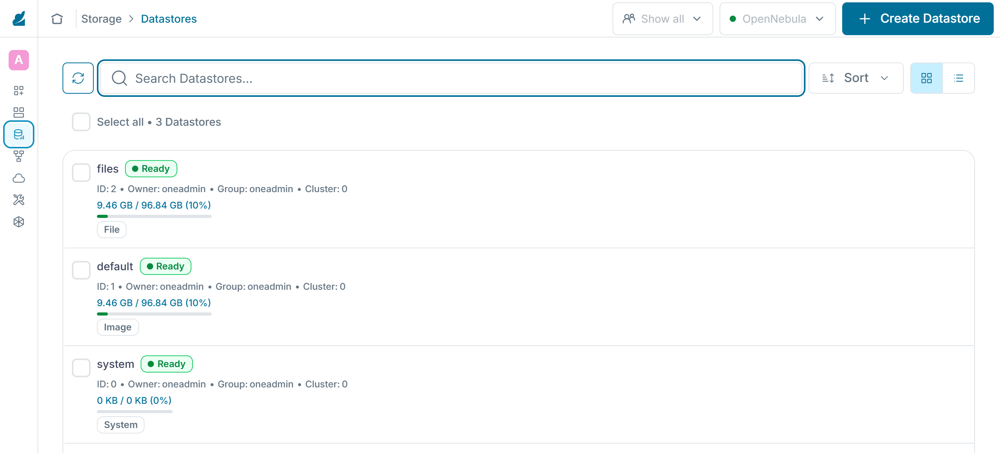
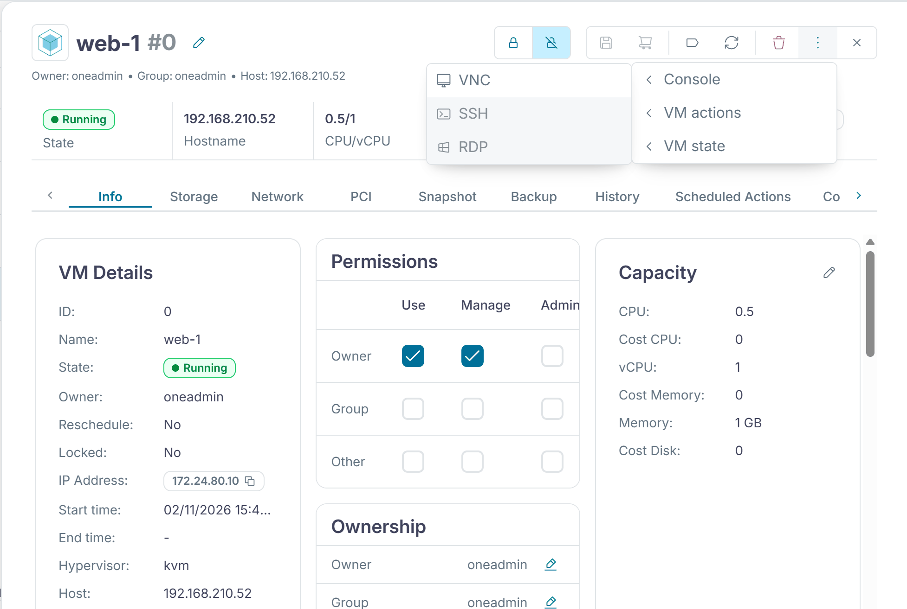
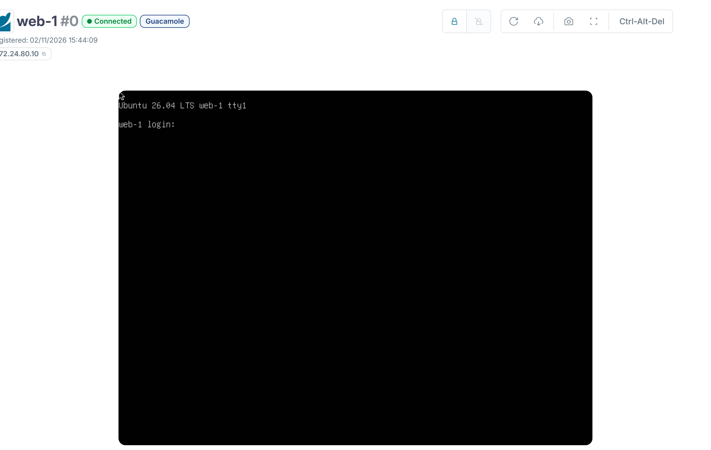

:::assignment
«Die Praxis Rosenweg möchte eine erste Testmaschine», schreibt Simone Wyss. «Ubuntu, klein, im internen Netz und ohne dass jemand von uns sie von Hand einrichten muss. Geht das in ein paar Minuten?»
:::

:::goals
Nach diesem Kapitel kannst du:

- Datastores, Images und Vorlagen unterscheiden
- Ein Image aus dem Marketplace in deine Cloud holen
- Die Formate raw und qcow2 sowie persistente und nicht persistente Images unterscheiden
- Eine Vorlage für VMs lesen und anpassen
- Erklären, wie die Kontextualisierung eine VM beim ersten Start einrichtet
- Eine VM starten, dich per SSH anmelden und den Check dieses Teils bestehen
:::

## Datastores und Images

Ein Image ist eine Disk, aus der VMs starten, etwa ein vorbereitetes Ubuntu. Images speichert OpenNebula in Datastores. OneDeploy hat drei davon angelegt. In `default` liegen die Images, in `system` die Disks laufender VMs und in `files` kleinere Dateien wie Skripte. Startet eine VM, kopiert der Transfertreiber `ssh` ihr Image in den Datastore `system` des Knotens. Die VM arbeitet auf dieser Kopie, das Image im Datastore bleibt unverändert.

Sunstone zeigt die drei Datastores unter «Storage › Datastores».



Fertige Images liefert der Marketplace von OpenNebula. Mit `onemarketapp export` holst du ein Image in deinen Datastore. OpenNebula legt dazu eine einfache Vorlage an.

```bash
onemarketapp list | grep -i ubuntu
onemarketapp export "Ubuntu Minimal 26.04" ubuntu-26.04 --datastore default
oneimage list
```

Das Image ist bereit, sobald `oneimage list` in der Spalte `STAT` den Wert `rdy` zeigt.

## Formate von Images

Ein Image im Format raw enthält die Disk Byte für Byte, so wie sie auf einer echten Festplatte läge. Das Format ist einfach, schnell und lässt sich mit jedem Werkzeug lesen. Eine Disk von 30 GB belegt als raw-Datei 30 GB, ausser das Dateisystem unterstützt Sparse Files und reserviert nur die beschriebenen Bereiche, wie die [Dokumentation von QEMU](https://www.qemu.org/docs/master/system/qemu-block-drivers.html) erklärt.

Der Name qcow2 steht für QEMU Copy On Write in der Version 2. Die Datei wächst nur mit den tatsächlich beschriebenen Blöcken und kann Snapshots enthalten. Ausserdem kann eine qcow2-Datei auf ein Backing File verweisen, ein anderes Image, aus dem sie nur liest. Braucht die VM einen Block, den die eigene Datei nicht enthält, kommt er aus dem Backing File. Schreibt sie einen Block, landet er in der eigenen Datei. Das Backing File bleibt dabei unverändert, wie die [Spezifikation von qcow2](https://www.qemu.org/docs/master/interop/qcow2.html) beschreibt. Viele VMs können so ein gemeinsames Grundimage nutzen, jede speichert nur ihre eigenen Änderungen. Auf Datastores mit gemeinsamem Speicher legt OpenNebula neue Disks auf diese Weise an, mit dem Image als Backing File, wie die [Dokumentation zu NFS-Datastores](https://docs.opennebula.io/7.4/product/cluster_configuration/storage_system/nas_ds/) zeigt.

Dein Lab nutzt qcow2. `oneimage show ubuntu-26.04` zeigt `FORMAT : qcow2` und eine Grösse von 3,5 GB, so gross ist die Disk für die VM. Die Datei unter `SOURCE` belegt im Datastore aber nur rund 450 MB, wie `qemu-img info` auf dieser Datei zeigt. Weil der Transfertreiber `ssh` das Image auf den Knoten kopiert, hat die Disk einer VM im Lab kein Backing File. Sie ist eine eigenständige Kopie. Das Kopieren kostet beim Start etwas Zeit, dafür läuft die VM ohne Zugriff auf den Datastore des Front-ends.

## Persistente Images

Ein Image ist in OpenNebula entweder persistent oder nicht persistent. Ein nicht persistentes Image dient als Vorlage für Disks. Beliebig viele VMs können es gleichzeitig nutzen, jede auf ihrer eigenen Kopie. Was eine VM auf ihre Disk schreibt, ist nach dem Beenden der VM weg. Ein persistentes Image behält die Änderungen über das Ende der VM hinaus, darf aber nur von einer einzigen VM gleichzeitig genutzt werden, wie die [Dokumentation zu Images](https://docs.opennebula.io/7.4/product/virtual_machines_operation/virtual_machines/images/) festhält. Mit `oneimage persistent` und `oneimage nonpersistent` wechselst du die Art.

Das Image `ubuntu-26.04` ist nicht persistent, `oneimage show` zeigt `PERSISTENT : No`. Für Systemdisks ist das richtig, denn jede VM soll aus demselben Stand starten. Wie viele VMs das Image gerade nutzen, zeigt die Spalte `RVMS` von `oneimage list`. Daten, die bleiben müssen, etwa die einer Datenbank, gehören auf eine zweite Disk aus einem persistenten Image. Willst du den Stand einer Disk als neues Image sichern, kopiert `onevm disk-saveas` sie in den Datastore.

## Vorlagen

Eine Vorlage beschreibt eine VM. Aus derselben Vorlage startest du beliebig viele VMs. Der Kurs liefert die Vorlage `ubuntu` für kleine VMs im internen Netz.

::code{file="lab/iaas/ubuntu.tpl"}

`CPU` ist der Anteil eines physischen Kerns, den der Scheduler für die VM reserviert. `VCPU` ist die Anzahl CPUs, die die VM sieht. Mit `CPU = "0.5"` und `VCPU = "1"` passen doppelt so viele VMs auf einen Knoten, wie er Kerne hat, solange nicht alle gleichzeitig voll rechnen. `CPU_MODEL` mit `host-passthrough` zeigt der VM die echte CPU, wie Kapitel 1.3 erklärt. `DISK` nennt das Image, `NIC` das Netz. Den Block `CONTEXT` erklärt der nächste Abschnitt.

```bash
onetemplate create ~/cc/lab/iaas/ubuntu.tpl
onetemplate list
```

## Kontextualisierung

Ein Image ist für alle VMs gleich, jede VM braucht aber ihre eigene Adresse, ihren Namen und die Schlüssel ihrer Benutzer. Diese Angaben gibt OpenNebula der VM beim Start mit. Es hängt sie als kleines virtuelles CD-Laufwerk an die VM. Das Paket `one-context` im Image liest sie beim ersten Start und richtet die VM danach ein. Dieses Prinzip heisst Kontextualisierung.

![Eine VM aus Image, Vorlage und Kontext. Oben liegen auf dem Front-end das Image ubuntu-26.04 im Datastore default und die Vorlage ubuntu. Deren DISK verweist auf das Image. onetemplate instantiate ubuntu --name web-1 legt daraus die VM web-1 auf einem Knoten an. Dabei kopiert OpenNebula das Image als Disk in den Datastore system des Knotens und hängt die Werte aus CONTEXT als CD-Laufwerk mit context.sh an. Beim ersten Start liest one-context diese Datei und richtet die VM ein. NETWORK gibt ihr Adresse, Gateway, DNS und MTU aus cc-net. SET_HOSTNAME macht den Namen der VM zum Hostnamen, SSH_PUBLIC_KEY legt den Schlüssel von oneadmin in authorized_keys von root ab. Achte darauf, dass das Image für alle VMs gleich bleibt. Adresse, Name und Schlüssel bekommt jede VM erst über den Kontext.](../../../assets/figures/de/p2c4-template.svg)

| Angabe | Wirkung in der VM |
|---|---|
| `NETWORK = "YES"` | Adresse, Gateway, DNS und MTU aus dem Netz `cc-net` |
| `SSH_PUBLIC_KEY` | der öffentliche Schlüssel in `authorized_keys` von root |
| `SET_HOSTNAME` | der Hostname, hier der Name der VM |
| `START_SCRIPT` | ein Skript, das beim Start läuft, in Teil 4 für k3s |

`$USER[SSH_PUBLIC_KEY]` übernimmt den Schlüssel vom Benutzer, der die VM startet. Damit du dich vom Front-end aus anmelden kannst, legst du den Schlüssel des Front-ends bei `oneadmin` ab.

```bash
printf 'SSH_PUBLIC_KEY="%s"\n' "$(cat ~/.ssh/id_ed25519.pub)" > /tmp/key.tpl
oneuser update oneadmin --append /tmp/key.tpl
```

## Kontextualisierung und cloud-init

OpenNebula schreibt die Werte aus `CONTEXT` in eine Datei `context.sh` mit Zeilen der Form `NAME='Wert'`. Diese Datei legt es auf ein ISO-Abbild, das die VM als CD-Laufwerk sieht, wie die [Referenz der VM-Vorlage](https://docs.opennebula.io/7.4/product/operation_references/configuration_references/template/) beschreibt. Im Lab liegt dieses Abbild auf dem Knoten neben der Disk im Verzeichnis der VM, als `disk.1` mit der Bezeichnung `CONTEXT`. Die [Kontextualisierungspakete](https://docs.opennebula.io/7.4/product/virtual_machines_operation/guest_operating_systems/kvm_contextualization/) von OpenNebula hängen das Laufwerk beim Start ein, lesen die Variablen und richten danach Netz, Hostname, Schlüssel und Skripte ein. Die Images im Marketplace bringen diese Pakete schon mit.

In öffentlichen Clouds übernimmt meist [cloud-init](https://docs.cloud-init.io/en/latest/) diese Aufgabe. Auch cloud-init richtet eine generische VM beim ersten Start mit den Daten ihrer Instanz ein. Es holt diese Daten aus einer Datenquelle, je nach Cloud aus einem Metadatendienst im Netz oder von einer angehängten Disk. Die Einrichtung selbst kommt meist als YAML-Datei im Format `#cloud-config`. Für OpenNebula hat cloud-init eine eigene [Datenquelle](https://docs.cloud-init.io/en/latest/reference/datasources/opennebula.html), die dasselbe CD-Laufwerk mit `context.sh` liest. Ein Image, das für cloud-init gebaut ist, lässt sich also auch in OpenNebula einrichten. Der Unterschied liegt vor allem in der Form der Angaben. OpenNebula arbeitet mit einfachen Variablen, cloud-init mit einer Konfiguration aus Modulen für Pakete, Dateien, Benutzer und Befehle.

## Deine erste VM

Die erste VM startest du aus der Vorlage `ubuntu` und meldest dich vom Front-end aus per SSH an. Sie läuft meist nach wenigen Sekunden, SSH ist nach 10 bis 30 Sekunden bereit.

```bash
onetemplate instantiate ubuntu --name web-1
onevm list
onevm show web-1 | grep -E 'IP=|HOST'
ssh root@<adresse-der-vm>
```

Was die Kontextualisierung eingerichtet hat, siehst du in der VM. `hostname` zeigt den Namen, `ip -br addr` die Adresse und `ip link show eth0` die MTU. Mit `curl -I https://ubuntu.com` prüfst du, ob die VM über das Gateway ins Internet kommt. Sunstone zeigt den Bildschirm der VM im Browser des Clients. Dazu klickst du unter «Instances › VMs» auf die VM, öffnest oben rechts das Menü mit den drei Punkten und wählst «Console» und dann «VNC».





Der Check dieses Teils prüft das Netz, die Vorlage, eine laufende VM, die Anmeldung per SSH, ihren Hostnamen und den Zugang zum Internet.

```bash
python3 ~/cc/checks/check.py iaas
```

::::exercise[Lab]
Hole das Image, lege die Vorlage an, starte die VM `web-1` und lade den Bericht des Checks `iaas` in dein Abgabe-Repo.

:::solution
Der Check endet mit «11 von 11 Prüfungen der Basis erfüllt». In der VM zeigt `hostname` den Namen `web-1`, `ip -br addr` eine Adresse aus deinem internen Netz und `ip link show eth0` die MTU 1450.
:::
::::

::::exercise[Vorlage anpassen]
Die Treuhand Aaregg braucht am Monatsende eine grössere VM mit zwei CPUs und 2 GB Arbeitsspeicher. Lege eine Kopie der Vorlage unter dem Namen `ubuntu-medium` an und starte daraus eine VM. Wie viele solcher VMs passen nach `onehost list` auf einen Knoten?

:::solution
`onetemplate clone ubuntu ubuntu-medium` und danach `onetemplate update ubuntu-medium` mit `CPU = "1"` und `VCPU = "2"`, dazu `MEMORY = "2048"`. Ein Knoten mit 7,2 GB Arbeitsspeicher und vier Kernen trägt drei solcher VMs. Die Grenze setzt der Arbeitsspeicher, die CPU reichte für vier.
:::
::::

::::exercise[Persistente Daten]
Die Praxis Rosenweg will in einer VM eine kleine Datenbank betreiben. Die Daten sollen erhalten bleiben, auch wenn die VM beendet und neu angelegt wird. Wie richtest du die Disks ein und was spricht dagegen, einfach das Image `ubuntu-26.04` persistent zu machen?

:::solution
Die Systemdisk kommt weiterhin aus dem nicht persistenten Image `ubuntu-26.04`. Für die Daten legst du ein leeres persistentes Image an, etwa mit `oneimage create -d default --name praxis-db --type DATABLOCK --size 2048 --persistent`. Dieses Image hängst du als zweite Disk an die VM. Wird die VM beendet, bleiben die Daten im Image. Eine neue VM kann es wieder einbinden. Wäre `ubuntu-26.04` persistent, dürfte es nur noch eine VM nutzen. Alle weiteren VMs aus der Vorlage könnten dann nicht mehr starten. Zudem landete jede Änderung an dieser Systemdisk im gemeinsamen Grundimage.
:::
::::
