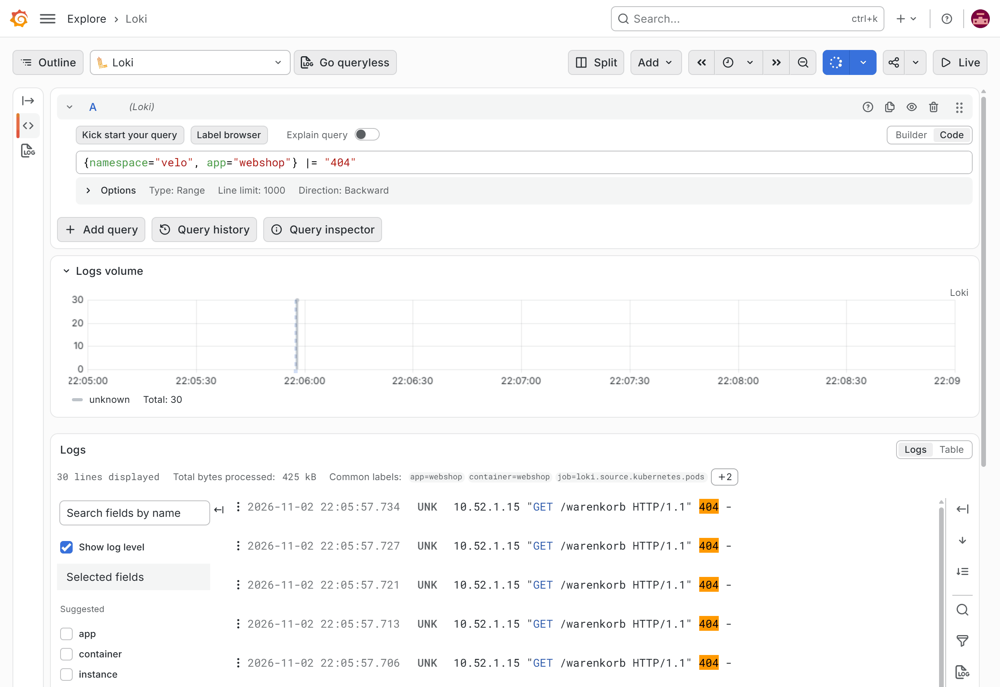

:::assignment
«Am Samstag hatten drei Kundinnen beim Bezahlen eine Fehlermeldung», schreibt das Veloatelier Matte. «Könnt ihr herausfinden, was da los war?»
:::

:::goals
Nach diesem Kapitel kannst du:

- Erklären, was Logs zeigen, das Metriken nicht zeigen
- Den Aufbau von Loki und Alloy im Cluster beschreiben
- Logs mit LogQL nach Namespace, Pod und Text filtern und zählen
- Den Fehler eines Deployments in den Logs finden
:::

## Logs und Metriken

**Metriken** sind Zahlen in festen Abständen. Sie zeigen, dass 5 % der Anfragen scheitern, aber nicht, welche und mit welcher Meldung. **Logs** sind Textzeilen, die ein Programm bei einem Ereignis schreibt. Sie enthalten die Einzelheiten, kosten aber mehr Speicher. In Kubernetes schreibt jeder Container seine Logs nach Standardausgabe und Standardfehler, der Node legt sie als Dateien ab. `kubectl logs` liest diese Dateien, aber nur, solange der Pod existiert. Wird er ersetzt, sind seine Logs weg.

## Loki und Alloy

Loki sammelt Logs zentral und behält sie über das Ende eines Pods hinaus. Eine Volltextsuche indexiert den ganzen Text. Loki legt einen Index nur über wenige Labels wie Namespace und Pod an und durchsucht den Text erst bei der Abfrage. Das hält Loki klein. Dafür grenzt du jede Suche zuerst mit Labels ein.

Alloy von Grafana läuft als **DaemonSet**, also mit einem Pod pro Node. Jeder davon liest die Logs der Pods auf seinem Node, versieht sie mit Labels und schickt sie an Loki. Beide kamen mit dem Kopieren in Kapitel 5.1 in dein Repo, als zwei Applications in `apps/loki.yaml`. Die [Anleitung von Alloy 1.21 für Kubernetes](https://grafana.com/docs/alloy/v1.21/set-up/install/kubernetes/) installiert dasselbe Chart mit Helm.

![Der Weg der Logs im Cluster. Zwei Nodes des Clusters, k3s-server und k3s-agent. Auf jedem Node schreiben die Pods ihre Logs nach stdout und stderr. Alloy läuft als DaemonSet mit einem Pod pro Node, liest die Logs der Pods auf seinem Node und schickt sie mit den Labels namespace, pod, container und app an Loki. Loki läuft als ein einziger Prozess, legt einen Index nur über die Labels an und behält die Logs drei Tage. In Grafana fragst du Loki unter «Explore» mit LogQL ab. Eine Abfrage wie {namespace="velo", app="webshop"} |= "404" wählt zuerst die Streams über ihre Labels und durchsucht dann den Text. Sie findet auch Zeilen von Pods, die es nicht mehr gibt.](../../../assets/figures/de/p5c2-logs.svg)

::code{file="platform/observability/repo/monitoring/loki.yaml"}

Loki läuft hier als ein einziger Prozess und speichert auf der Disk eines Nodes. Für ein Lab genügt das. Im Betrieb würde man Loki auf mehrere Prozesse verteilen und die Daten in einen Objektspeicher legen. Logs, die älter als drei Tage sind, löscht Loki. Den Modus `SingleBinary` beschreibt auch die [Anleitung von Loki 3.6 zum monolithischen Chart](https://grafana.com/docs/loki/v3.6.x/setup/install/helm/install-monolithic/), dort mit einem Objektspeicher.

::code{file="platform/observability/repo/monitoring/alloy.yaml"}

Die Konfiguration von Alloy ist eine Kette aus vier Komponenten. `discovery.kubernetes` findet die Pods des eigenen Nodes. `discovery.relabel` macht aus Angaben von Kubernetes die Labels `namespace`, `pod`, `container` sowie `app`. `loki.source.kubernetes` liest die Logs, `loki.write` schickt sie an Loki. Weitere Beispiele mit diesen Komponenten stehen in der [Anleitung von Alloy 1.21 für Logs aus Kubernetes](https://grafana.com/docs/alloy/v1.21/collect/logs-in-kubernetes/). Im Testaufbau scheiterte eine Konfiguration, in der ein Block auf einer Zeile stand, mit «expected TERMINATOR». Alloy verlangt jedes Attribut auf einer eigenen Zeile.

Im Lab waren Loki und Alloy gut zwei Minuten nach dem Push bereit. Argo CD hatte ihre Applications gut 40 Sekunden vorher angelegt.

```bash
kubectl -n monitoring get pods -o wide | grep -E 'loki|alloy'
```

Die Ausgabe zeigt einen Pod von Loki und je einen Pod von Alloy auf `k3s-server` und `k3s-agent`, alle im Zustand `Running`.

## LogQL

Abfragen schreibst du in Grafana unter «Explore» mit der Datenquelle Loki. Eine Abfrage beginnt immer mit einer Auswahl von Streams in geschweiften Klammern.

| Abfrage | Ergebnis |
|---|---|
| `{namespace="velo"}` | alle Logs des Veloateliers |
| `{namespace="velo", app="webshop"} \|= "404"` | Zeilen des Webshops, die `404` enthalten |
| `{namespace="velo"} \|~ "(?i)error\|exception"` | Zeilen, auf die der reguläre Ausdruck passt |
| `{namespace="velo"} != "/healthz"` | alles ausser den Proben von Kubernetes |
| `sum by (pod) (count_over_time({namespace="velo"} \|= " 404 " [5m]))` | Zahl der Zeilen mit 404 pro Pod in fünf Minuten |

`|=` filtert nach Text, `|~` nach einem regulären Ausdruck, `!=` schliesst Zeilen mit dem Text aus. `count_over_time` zählt die Zeilen in einem Zeitfenster und macht aus Logs eine Metrik, die du in Dashboards und Alerts verwenden kannst.

Im Lab erzeugten 20 Aufrufe einer Seite, die es nicht gibt, Zeilen mit `404`. Die Schleife läuft auf dem Front-end. Sie ruft den Webshop über Traefik an der Adresse von `k3s-server` auf, die nach `source /etc/cc-lab.env` in `$CC_K3S_SERVER_IP` steht.

```bash
source /etc/cc-lab.env
for i in $(seq 20); do curl -s -o /dev/null http://$CC_K3S_SERVER_IP/warenkorb; done
```

```text
10.52.1.10 "GET /warenkorb HTTP/1.1" 404 -
```

Traefik verteilt die Anfragen auf die Pods. Die Abfrage mit `count_over_time` zeigte danach, wie viele dieser Aufrufe jeder Pod beantwortet hatte.

In Grafana stellst du die Abfrage unter «Explore» mit der Datenquelle Loki.



## Labels mit Mass

Jede Kombination von Labels ist in Loki ein eigener **Stream**. Labels wie Namespace, Pod oder App haben wenige Werte und eignen sich gut. Eine IP-Adresse, eine Bestellnummer oder ein Pfad als Label würden Tausende Streams erzeugen und Loki langsam machen. Was sich oft ändert, bleibt im Text und wird mit `|=` gesucht.

## Deine Werte für Meilenstein 3

In Kapitel 5.3 löst du einen Alert über Git aus, in Kapitel 5.4 lässt du den Webshop unter Last wachsen. Für Meilenstein 3 rechnet der Alert mit dem Ziel des SLO aus deinen [persönlichen Werten](../../start/parameters/#deine-werte-für-die-meilensteine) und der HPA wächst bis zu deiner persönlichen Obergrenze. Damit du Alert und Lasttest nur einmal durchführst, setzt du beide Werte jetzt in einem Commit. Der Generator nennt sie in der Tabelle «Deine Werte für die Meilensteine» als «Ziel des SLO für den Webshop» und «Höchstzahl Pods im HPA».

Der Alert rechnet mit dem Fehlerbudget. Es ist 1 minus dein Ziel, bei 99,0 % also `0.01` und bei 99,9 % `0.001`. Tippe zuerst dein Budget und deine Obergrenze als zwei Variablen ein, hier die Werte von `mmuster` mit dem Ziel 99,0 % und höchstens fünf Pods.

```bash
budget=0.01
max=5
```

Der nächste Block setzt dein Budget in `monitoring/config/webshop-slo.yaml` in beide Zeilen des Alerts, wo die Datei des Kurses `0.005` hat. In `webshop/hpa.yaml` ersetzt er `maxReplicas: 6` durch deine Obergrenze. Fehlt eine der Variablen, etwa in einer neuen Sitzung, meldet die Shell «parameter null or not set» und die Zeile ändert nichts.

```bash
cd ~/platform
sed -i "s/(14.4 \* [0-9.]*)/(14.4 * ${budget:?})/" monitoring/config/webshop-slo.yaml
sed -i "s/maxReplicas: [0-9]*/maxReplicas: ${max:?}/" webshop/hpa.yaml
grep -n '14.4 \*' monitoring/config/webshop-slo.yaml
grep -n maxReplicas webshop/hpa.yaml
```

`grep` zeigt die zwei Zeilen des Alerts mit deinem Budget und die Zeile mit deiner Obergrenze. Stimmen die Zahlen, lädst du die Änderung hoch. Ein zweiter Lauf mit anderen Werten ersetzt die Zahlen noch einmal. Was der Faktor 14,4 bedeutet, erklärt Kapitel 5.3, die Obergrenze Kapitel 5.4.

```bash
git commit -am "Persönliche Werte für Meilenstein 3"
git push
```

::::exercise[Lab]
Prüfe, dass Loki und Alloy laufen, die mit den Ergänzungen aus Kapitel 5.1 kamen. Erzeuge Aufrufe mit `404` und finde sie in Grafana. Zähle sie pro Pod. Setze zum Schluss deine Werte für Meilenstein 3.

:::solution
`kubectl -n monitoring get pods -o wide | grep -E 'loki|alloy'` zeigt Loki und je einen Pod von Alloy auf beiden Nodes. `{namespace="velo", app="webshop"} |= "404"` zeigt die Zeilen mit `/warenkorb`, das Label `pod` sagt, welcher Pod geantwortet hat. `sum by (pod) (count_over_time({namespace="velo"} |= " 404 " [5m]))` zeigt eine Zahl pro Pod, zusammen etwa 20. Bei `mmuster` steht nach dem Commit in beiden Zeilen des Alerts `(14.4 * 0.01)` und im HPA `maxReplicas: 5`.
:::
::::

::::exercise[Fehler finden]
Spiele zuerst den Fehler nach, als wärst du jemand anderes aus dem Team. Der Befehl setzt im Deployment des Webshops die Variable `FAIL_PERCENT` auf `30`. Danach antwortet der Shop auf drei von zehn Anfragen mit einem Fehler.

```bash
cd ~/platform
sed -i '/FAIL_PERCENT/{n;s/value: "0"/value: "30"/}' webshop/deployment.yaml
git commit -am "Webshop anpassen"
git push
```

Argo CD übernimmt die Änderung bei seiner nächsten Abfrage von Gitea und ersetzt die Pods. Auf smartlearn liefen die neuen Pods etwa 90 Sekunden nach dem Push, `kubectl -n velo get pods` zeigt sie mit neuen Namen und einem Alter von wenigen Sekunden. Schick danach vom Front-end aus 20 Anfragen an den Shop. Die Schleife gibt den Status jeder Antwort aus.

```bash
source /etc/cc-lab.env
for i in $(seq 20); do curl -s -o /dev/null -w "%{http_code}\n" http://$CC_K3S_SERVER_IP/; done
```

Finde in den Logs heraus, was die Kundschaft erlebt. Suche danach im Git-Verlauf, wer es war. Stelle zum Schluss den alten Stand her.

:::solution
Die Schleife meldet rund drei von zehn Antworten mit `500`. `{namespace="velo", app="webshop"} |~ "error| 500 "` zeigt Zeilen wie `error: simulated failure on /` und daneben die Zeilen der Anfragen mit dem Status `500`. Mit `|= "error"` allein fehlten diese, denn sie enthalten das Wort nicht. `git log -p webshop/deployment.yaml` zeigt den Commit mit Autor und Änderung, seine Zeit passt zur ersten Fehlerzeile. `git revert --no-edit HEAD` und `git push` stellen den alten Stand her, Argo CD rollt ihn aus.
:::
::::

::::exercise[Ein Label zu viel]
Ein Kollege schlägt vor, in Alloy die IP-Adresse der Kundschaft als Label zu setzen, damit man schneller nach einer Kundin suchen kann. Was antwortest du?

:::solution
Jede Adresse wäre ein eigener Stream, bei vielen Kundinnen und Kunden Tausende. Loki würde langsamer und bräuchte mehr Speicher. Was sich oft ändert, gehört in den Text und wird mit `|=` gesucht. Im Lab steht dort allerdings nur die Adresse von Traefik, etwa `10.52.1.10`. Der Webshop sieht die Verbindung von Traefik und nicht die der Kundschaft. Dazu kommt der Datenschutz. Eine IP-Adresse ist ein Personendatum. Wer sie speichert, braucht dafür einen Zweck und eine Aufbewahrungsfrist.
:::
::::
