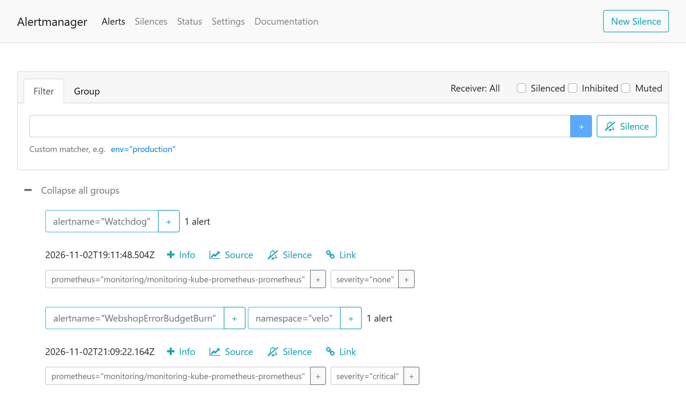

:::assignment
«Wir wollen nicht bei jedem kleinen Fehler geweckt werden», schreibt das Veloatelier Matte. «Aber wenn der Shop am Samstag nicht verkauft, wollen wir es wissen, bevor die Kundschaft anruft.»
:::

:::goals
Nach diesem Kapitel kannst du:

- SLI, SLO, SLA und Fehlerbudget unterscheiden
- Ein SLO für den Webshop formulieren und sein Fehlerbudget berechnen
- Einen Alert nach Burn Rate lesen und begründen
- Alerts auf Symptome von Alerts auf Ursachen unterscheiden
- Erklären, wie Alertmanager Alerts gruppiert und weiterleitet
:::

## SLI, SLO und SLA

Ein **Service Level Indicator (SLI)** misst, wie gut ein Dienst aus Sicht der Kundschaft arbeitet, meist als Anteil guter Ereignisse. Das Ziel für diesen Anteil über einen Zeitraum heisst **Service Level Objective (SLO)**. Ein **Service Level Agreement (SLA)** ist ein Vertrag, der Folgen festlegt, wenn das Ziel verfehlt wird. SLAs kommen in Teil 6, dieses Kapitel bleibt beim internen Ziel.

| Begriff | Webshop |
|---|---|
| SLI | Anteil der Anfragen an den Shop, die ohne Serverfehler beantwortet werden |
| SLO | 99,5 % über 7 Tage |
| Fehlerbudget | 0,5 % der Anfragen dürfen scheitern |

Kein Dienst erreicht 100 %. Das **Fehlerbudget** legt fest, wie viele Fehler im Zeitraum erlaubt sind. Mit dieser Zahl lässt sich planen. Solange Budget übrig ist, darf das Veloatelier Neues ausprobieren. Ist es aufgebraucht, haben Stabilität und Korrekturen Vorrang.

## Recording Rules

Die Regeln liegen in deinem Repo unter `monitoring/config/webshop-slo.yaml`, als PrometheusRule.

::code{file="platform/observability/repo/monitoring/config/webshop-slo.yaml"}

Die ersten zwei Regeln sind [Recording Rules](https://prometheus.io/docs/prometheus/3.15/configuration/recording_rules/). Prometheus berechnet den Fehleranteil über fünf Minuten und über eine Stunde regelmässig und speichert beide als eigene Zeitreihen. Sie heissen `webshop:error_ratio:rate5m` und `webshop:error_ratio:rate1h`. Alerts und Dashboards lesen diese Reihen, statt dieselbe Rechnung jedes Mal neu zu machen. `clamp_min` verhindert eine Division durch null, wenn gerade niemand einkauft.

## Burn Rate

Ein Alert auf «mehr als 0,5 % Fehler» würde bei jeder kurzen Spitze auslösen. Die **Burn Rate** gibt an, wie schnell das Budget verbraucht wird. Eine Burn Rate von 1 braucht es genau in den 7 Tagen auf, bei 14,4 wäre es nach 168 / 14,4 ≈ 12 Stunden weg. Der Alert `WebshopErrorBudgetBurn` löst aus, wenn beide Fehleranteile über 14,4 × 0,5 % = 7,2 % liegen, der über fünf Minuten wie der über eine Stunde. Das muss zwei Minuten lang so bleiben. Diese Wartezeit legt das Feld `for` der [Alerting Rule](https://prometheus.io/docs/prometheus/3.15/configuration/alerting_rules/) fest.

Den Faktor 14,4 und die zwei Fenster von einer Stunde und fünf Minuten empfiehlt das Kapitel [Alerting on SLOs](https://sre.google/workbook/alerting-on-slos/) im SRE Workbook von Google für einen Alert, der jemanden weckt. Dort gilt das Budget für 30 Tage, eine Stunde mit dieser Burn Rate verbraucht 2 % davon. Beim Budget des Webshops über 7 Tage sind es 14,4 / 168, also etwa 8,6 % pro Stunde.

Für Meilenstein 3 rechnet dein Alert seit [Kapitel 5.2](../logs/#deine-werte-für-meilenstein-3) mit dem Budget aus deinen [persönlichen Werten](../../start/parameters/#deine-werte-für-die-meilensteine). Das Fehlerbudget ist 1 minus dein Ziel. Bei 99,0 % ist es 1 % und die Schwelle liegt bei 14,4 × 1 % = 14,4 %. Bei 99,9 % sind es 0,1 % und 1,44 %.

| Fenster | Aufgabe |
|---|---|
| 1 Stunde | zeigt, dass das Problem anhält und das Budget wirklich angreift |
| 5 Minuten | zeigt, ob es jetzt noch besteht. Nach der Behebung endet der Alert darum bald |

![Fehlerbudget und Burn Rate des Webshops. Oben die Zahlen des Webshops. Das SLO verlangt 99,5 % der Anfragen ohne Serverfehler über 7 Tage, das Fehlerbudget beträgt 0,5 % der Anfragen. Bei einer Burn Rate von 1 reicht das Budget genau 7 Tage, bei 14,4 ist es nach 12 Stunden weg. Darunter ein schematischer Verlauf bei gleichmässigem Verkehr. Ab dem Beginn der Fehler steigt die Burn Rate im Fenster über fünf Minuten schnell über die Schwelle von 14,4, also 7,2 % Fehler. Im Fenster über eine Stunde steigt sie langsam. Der Alert feuert erst, wenn beide Fenster zwei Minuten lang über der Schwelle liegen. Sobald die Behebung wirkt, fällt das kurze Fenster und der Alert endet, obwohl das lange Fenster noch hoch ist.](../../../assets/figures/de/p5c3-budget.svg)

Im Lab war die Wirkung des langen Fensters gut zu sehen. Ein Lasttest hatte vorher zehntausende gute Anfragen erzeugt. Als danach jede achte Anfrage scheiterte, lag der Anteil über fünf Minuten sofort bei 12 %, der über eine Stunde aber lange bei 3 bis 4 %. Der Alert löste erst nach rund 25 Minuten aus, nachdem der Fehleranteil weiter gestiegen war.

## Symptome und Ursachen

Die drei Alerts des Webshops melden Symptome, also das, was die Kundschaft merkt. Neben `WebshopErrorBudgetBurn` sind das `WebshopSlow` und `WebshopDown`. Ursachen wie eine volle Disk, ein Pod in einer Neustartschleife oder ein Knoten ohne Speicher bringt kube-prometheus-stack als eigene Regeln mit, etwa `KubePodCrashLooping` oder `KubePersistentVolumeFillingUp`. Im Lab meldete Prometheus `KubePersistentVolumeFillingUp`, als die Disk des Agents nach dem Download des Images von Ollama für die [Zusatzaufträge](../advanced/#speicher-und-last) zu 87 % voll war. Die Volumes von local-path liegen auf derselben Disk wie die Images.

Für Symptome darf man Menschen wecken, denn sie betreffen die Kundschaft sicher. Ursachen gehören in Tickets und Dashboards. Ein Alert, auf den niemand reagieren muss, gehört gelöscht, sonst lernt das Team, Alerts zu übersehen.

## Alertmanager

Prometheus wertet die Regeln aus und schickt auslösende Alerts an Alertmanager. Alertmanager fasst ähnliche Alerts zusammen, unterdrückt Wiederholungen und leitet sie an Empfänger weiter, etwa per E-Mail, in einen Chat oder an einen Webhook. Die Weiterleitung steht in den Werten von kube-prometheus-stack, ihre Felder beschreibt die [Konfiguration von Alertmanager 0.34](https://prometheus.io/docs/alerting/0.34/configuration/#route).

```yaml
route:
  receiver: "null"
  group_by: [alertname, namespace]
  group_wait: 30s
  group_interval: 5m
  repeat_interval: 4h
receivers:
  - name: "null"
```

In der Basis gehen alle Alerts an den Empfänger `null`, der nichts verschickt. Sie erscheinen nur in der Oberfläche von Alertmanager auf Port 30093 von `k3s-server`. Der Tunnel aus [Kapitel 5.1](../metrics/#zugriff-vom-client) leitet diesen Port schon weiter, im Browser des Clients öffnest du `http://localhost:9093/`. Einen eigenen Empfänger mit einer Route richtest du in Zusatzauftrag B aus [Kapitel 5.5](../advanced/#triage-mit-freigabe-auftrag-b) ein. `group_wait` wartet 30 Sekunden auf weitere Alerts derselben Gruppe, `repeat_interval` wiederholt einen offenen Alert erst nach vier Stunden.

## Einen Alert auslösen

Du brichst das SLO absichtlich über Git. Der Webshop hat dafür die Variable `FAIL_PERCENT`, sie gibt an, wie viel Prozent der Anfragen er mit einem Fehler beantwortet. Damit die Fenster des Alerts Verkehr sehen, schickt der Pod `load` am Ende des Blocks eine halbe Stunde lang Anfragen an den Shop. Er ruft ihn wie die Schleife aus Kapitel 5.2 über Traefik an der Adresse von `k3s-server` auf, den Lastgenerator erklärt Kapitel 5.4.

```bash
source /etc/cc-lab.env
cd ~/platform
sed -i '/FAIL_PERCENT/{n;s/value: "0"/value: "60"/}' webshop/deployment.yaml
git commit -am "Neues Zahlungsmodul im Webshop"
git push
kubectl run load --restart=Never --image=ghcr.io/ndum/cc/webshop:1.0.0 -- \
  python3 /app/load.py http://$CC_K3S_SERVER_IP/ --workers 1 --seconds 1800
```

In Prometheus unter «Alerts» wechselt `WebshopErrorBudgetBurn` zuerst auf `pending` und nach zwei Minuten auf `firing`. Im Lab feuerte er vier bis sechs Minuten nach dem Push. In dieser Zeit holt Argo CD den Commit und ersetzt die Pods. Danach steigt der Fehleranteil über die Schwelle und der Alert wartet zwei Minuten in `pending`. Liegt die Übung «Fehler finden» aus Kapitel 5.2 weniger als eine Stunde zurück, stehen ihre Fehler noch in den Fenstern des Alerts. Er kann dann schon eine Minute nach dem Push feuern. Die Last lässt nebenbei den Webshop über den HPA aus Kapitel 5.4 wachsen.




Solange der Alert feuert, machst du den Screenshot für Anforderung 5 von [Meilenstein 3](../../assessment/milestone-3/), etwa die Regel in Prometheus wie im ersten Bild mit deinem Budget im Ausdruck. Speichere ihn mit dem Screenshot-Werkzeug von Kali im Home-Ordner als `5-alert.png`, wie es [Kapitel 0.5](../../start/tools/#bericht-und-screenshots-hochladen) beschreibt. Die erste Zeile unten legt einmal den Ordner `m3` in deinem Abgabe-Repo an, die zweite kopiert das Bild dorthin. Starte beide in einem weiteren Tab des Terminals des Clients, denn im zweiten läuft der Tunnel aus Kapitel 5.1.

```bash
ssh mmuster-fe mkdir -p cc-mmuster/m3
scp ~/5-alert.png mmuster-fe:cc-mmuster/m3/
```

Hochladen kannst du ihn am Ende von Kapitel 5.4 mit dem Bericht des Checks `m3`. Danach stellst du mit `git revert --no-edit HEAD` und `git push` den alten Stand wieder her. Ohne Verkehr bliebe der Anteil im Fenster von fünf Minuten stehen und fiele erst, wenn das Fenster leer ist. Darum löschst du den Pod `load` erst, wenn der Alert inaktiv ist, mit `kubectl delete pod load`. Im Lab war der Alert sechs bis sieben Minuten nach dem Revert wieder inaktiv. Bis zu zwei Minuten davon vergingen, bis Argo CD den Revert ausrollte. Der HPA schrumpft den Webshop erst fünf Minuten nach dem Ende der Last.

::::exercise[Lab]
Löse den Alert wie oben aus, beobachte ihn in Prometheus und Alertmanager und mach den Screenshot für Meilenstein 3. Stelle danach den alten Stand wieder her und lösche den Pod `load`, sobald der Alert inaktiv ist. Notiere die Zeiten.

:::solution
Nach dem Push steigt `webshop:error_ratio:rate5m` innerhalb weniger Minuten über deine Schwelle, bei einem Ziel von 99,0 % über 14,4 % und bei 99,9 % über 1,44 %. Wie lange `webshop:error_ratio:rate1h` braucht, hängt vom Verkehr der letzten Stunde ab. Ohne vorherigen Lasttest geht es schneller. Alertmanager zeigt den Alert in seiner Oberfläche. Nach dem Revert fällt der Anteil über fünf Minuten. Der Alert endet, obwohl der Anteil über eine Stunde noch hoch ist.
:::
::::

::::exercise[Fehlerbudget]
Der Webshop beantwortet an einem Samstag 40’000 Anfragen. Wie viele dürfen scheitern, bis das Budget dieses Tages verbraucht ist? Was heisst eine Burn Rate von 6 für das Budget der Woche?

:::solution
0,5 % von 40’000 sind 200 Anfragen. Eine Burn Rate von 6 verbraucht das Budget sechsmal so schnell wie erlaubt, das Budget von 7 Tagen wäre nach 28 Stunden weg. Ein zweiter Alert mit tieferer Schwelle und längeren Fenstern würde so etwas melden, ohne gleich jemanden zu wecken.
:::
::::

::::exercise[Für die Praxis]
Die Praxis Rosenweg will einen Alert, bevor Patientinnen und Patienten etwas merken. Schlage ein SLI und ein SLO für ihr Terminportal vor und begründe die Werte.

:::solution
Ein mögliches SLI ist der Anteil der Aufrufe der Terminseite, die ohne Fehler in weniger als einer Sekunde antworten. Ein SLO von 99,9 % über 30 Tage erlaubt etwa 43 Minuten Ausfall im Monat. Die Praxis hat Sprechzeiten, darum könnte man nur Anfragen zwischen 7 und 19 Uhr zählen. Höhere Ziele kosten Redundanz, die ein Lab mit einem Server nicht hat.
:::
::::
