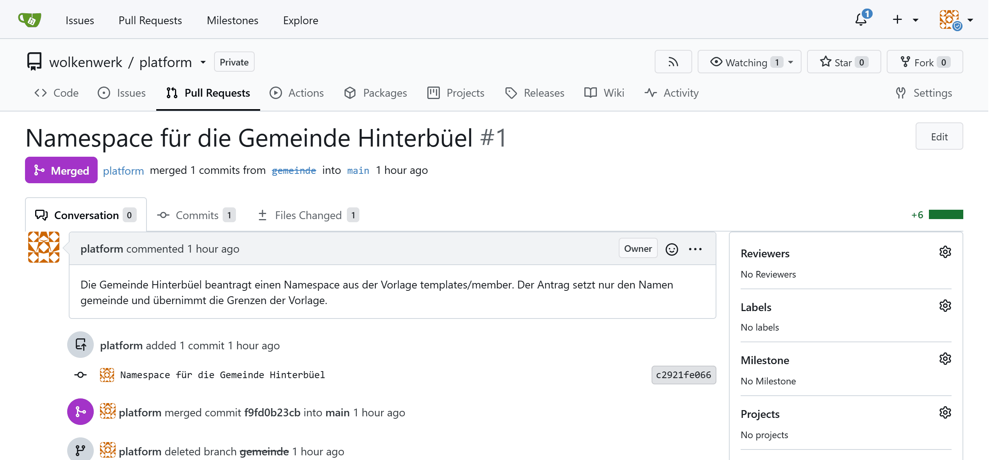
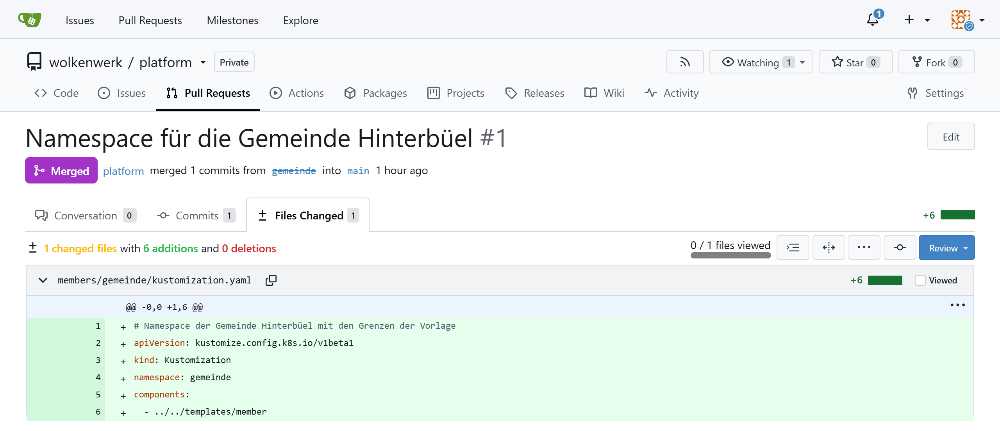
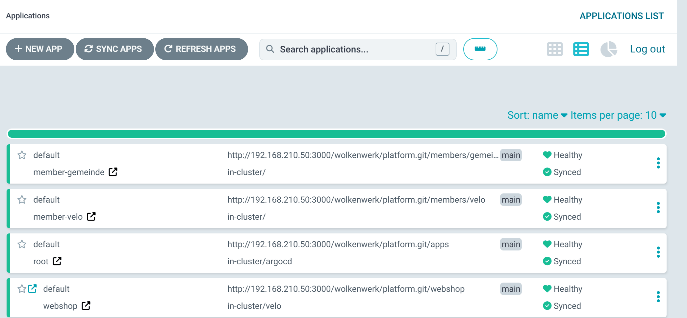

:::assignment
«Die Gemeinde Hinterbüel hat vom Webshop gehört und will ihre Formulare auch auf Containern betreiben», schreibt Simone Wyss. «Wenn das jedes Mitglied will, könnt ihr nicht jedes Mal von vorne anfangen. Und die Gemeinde darf dem Veloatelier am Samstag nicht den Cluster wegnehmen.»
:::

:::goals
Nach diesem Kapitel kannst du:

- Erklären, was eine Plattform-Vorlage ist und was sie einem Mitglied gibt
- Namespaces mit ResourceQuota, LimitRange und NetworkPolicy begrenzen und trennen
- Eine Vorlage mit Kustomize für mehrere Mitglieder verwenden
- Mit einem ApplicationSet für jeden Ordner in Git eine Application erzeugen
- Den Antrag eines Mitglieds als Pull Request prüfen und annehmen
:::

## Vorlagen

Ein Plattform-Team bietet einen geprüften Weg an, den andere Teams selbst gehen, oft **Golden Path** genannt. Es muss dann nicht für jedes Team eine Umgebung von Hand bauen. Die Vorlage legt fest, was jedes Mitglied bekommt. Das Mitglied beantragt seinen Platz, statt auf einen Termin zu warten. In Teil 3 lösten Gruppen, VDC und Quotas in OpenNebula diese Aufgabe. Im Cluster übernehmen das Namespaces und drei Arten von Objekten.

| Teil 3 in OpenNebula | Teil 4 in Kubernetes |
|---|---|
| Gruppe | Namespace |
| Quota der Gruppe | ResourceQuota |
| Grösse der Vorlage `ubuntu` | LimitRange |
| VDC und eigenes Netz | NetworkPolicy |

## ResourceQuota

Eine **ResourceQuota** begrenzt, was alle Pods eines Namespaces zusammen anfordern dürfen.

::code{file="platform/repo/templates/member/resourcequota.yaml"}

Requests sind, was der Scheduler für einen Container reserviert, wie die Spalte `CPU` einer VM in OpenNebula. Limits sind die Obergrenze, die ein Container nie überschreitet. Eine CPU entspricht einem Kern, `250m` einem Viertel davon. `services.nodeports: "0"` und `services.loadbalancers: "0"` verbieten Mitgliedern, eigene Ports auf den Nodes zu öffnen. Ohne die zweite Zeile öffnete ServiceLB im Lab für einen Service vom Typ LoadBalancer ohne NodePort trotzdem einen Port auf beiden Nodes. Der Weg der Mitglieder nach aussen ist der Ingress. Alle Ressourcen, die eine Quota begrenzen kann, nennt die [Dokumentation von Kubernetes 1.36 zu ResourceQuota](https://v1-36.docs.kubernetes.io/docs/concepts/policy/resource-quotas/).

## LimitRange

Sobald eine Quota CPU und Speicher begrenzt, lehnt Kubernetes jeden Pod ohne Requests und Limits ab. Die **LimitRange** setzt dafür Standardwerte und eine Obergrenze pro Container. Wie Standardwerte und Grenzen zusammenwirken, zeigt die [Dokumentation zu LimitRange](https://v1-36.docs.kubernetes.io/docs/concepts/policy/limit-range/).

::code{file="platform/repo/templates/member/limitrange.yaml"}

## NetworkPolicy

Ohne Regel erreicht jeder Pod im Cluster jeden anderen, auch über Namespaces hinweg. Eine **NetworkPolicy** legt fest, wer einen Pod ansprechen darf. In k3s setzt ein eingebauter Controller solche Regeln durch. Regeln für eingehende und ausgehende Verbindungen beschreibt die [Dokumentation zu NetworkPolicy](https://v1-36.docs.kubernetes.io/docs/concepts/services-networking/network-policies/).

::code{file="platform/repo/templates/member/networkpolicy.yaml"}

`podSelector: {}` meint alle Pods des Namespaces. Sie nehmen nur Verbindungen von Pods im eigenen Namespace und aus `kube-system` an, wo Traefik läuft. Im Lab bekam ein Pod im Namespace `default` vom Webshop «Connection refused», ein Pod in `velo` erreichte ihn. Ein frisch gestarteter Pod scheiterte dabei mit seinen ersten zwei Anfragen. Der Controller braucht nach dem Start eines Pods einige Sekunden, bis er dessen Adresse in seine Regeln aufgenommen hat.

```bash
kubectl -n default run np-test --rm -i --restart=Never --image=busybox:1.37 -- sh -c "sleep 5; wget -qO- -T 5 http://webshop.velo/healthz"
kubectl -n velo run np-test --rm -i --restart=Never --image=busybox:1.37 -- sh -c "sleep 5; wget -qO- -T 5 http://webshop.velo/healthz"
```

Das `sleep 5` gibt dem Controller Zeit, den neuen Pod in seine Regeln aufzunehmen.

## Kustomize

Zusammen mit einer vierten Datei für den Namespace bilden diese drei Dateien die Vorlage in `templates/member`. Kustomize, in kubectl und Argo CD eingebaut, setzt daraus für jedes Mitglied die passenden Objekte zusammen, ohne die Vorlage zu kopieren. Wie eine Component in eine Kustomization kommt, beschreibt die [Anleitung zu Components](https://kubectl.docs.kubernetes.io/guides/config_management/components/) von Kustomize.

::code{file="platform/repo/templates/member/kustomization.yaml"}

Ein Mitglied ist ein Ordner in `members` mit einer einzigen Datei. Die Zeile `namespace` setzt den Namespace aller Objekte und benennt das Objekt Namespace der Vorlage gleich mit um. Das Veloatelier braucht für den Webshop mehr CPU, als die Vorlage vorsieht. Ein Patch ersetzt diesen einen Wert.

::code{file="platform/repo/members/velo/kustomization.yaml"}

```bash
kubectl kustomize ~/platform/members/velo
```

Der Befehl zeigt die fertigen Objekte, ohne etwas zu ändern. Damit prüfst du ein Mitglied, bevor es in Git landet.

## ApplicationSet

Statt für jedes Mitglied eine Application zu schreiben, lässt du sie von einem **ApplicationSet** nach einem Muster erzeugen.

::code{file="platform/repo/apps/members.yaml"}

Der Generator `git` durchsucht das Repo nach Ordnern unter `members` und erzeugt für jeden eine Application `member-<ordner>`. Kommt ein Ordner dazu, entsteht ein Namespace. Das ApplicationSet prüft das Repo normalerweise alle drei Minuten, `requeueAfterSeconds: 60` verkürzt das auf eine Minute. Alle Optionen des Generators nennt die Dokumentation von Argo CD 3.5 unter [Git Generator](https://argo-cd.readthedocs.io/en/release-3.5/operator-manual/applicationset/Generators-Git/).

:::caution[Ordner unter members entfernen]
Verschwindet ein Ordner unter `members` aus `main`, löscht das ApplicationSet die Application des Mitglieds und Argo CD mit ihr den Namespace samt allem darin. Das gilt auch für einen Pull Request, der den Ordner nur umbenennt. Prüfe darum bei jedem Antrag, ob er einen Ordner unter `members` entfernt.
:::

![Ein Namespace aus der Vorlage. Oben liegt die Vorlage templates/member, eine Component von Kustomize mit dem Namespace member, einer ResourceQuota mit requests.cpu 1, einer LimitRange mit dem Standard 250m pro Container und einer NetworkPolicy, die nur den eigenen Namespace und kube-system durchlässt. In der Mitte setzt der Ordner members/velo den Namespace velo und ersetzt mit einem Patch requests.cpu durch 2. Das ApplicationSet members liest den Ordner mit dem Generator git und erzeugt die Application member-velo. Argo CD rendert sie mit Kustomize, unten stehen die Objekte im Cluster. Achte auf die Unterschiede zur Vorlage. Der Namespace heisst velo und die Quota erlaubt 2 CPU, alles andere kommt unverändert aus der Vorlage.](../../../assets/figures/de/p4c5-kustomize.svg)

```bash
kubectl -n argocd get applicationsets
kubectl -n argocd get applications
kubectl -n velo get resourcequota,limitrange,networkpolicy
kubectl -n velo describe resourcequota member
```

## Der Antrag der Gemeinde

Die Gemeinde beantragt ihren Namespace mit einem Pull Request. In der Praxis arbeitet das Mitglied in einem eigenen Branch oder Fork. Im Lab spielst du beide Seiten.

```bash
cd ~/platform
git switch -c gemeinde
mkdir -p members/gemeinde
cat > members/gemeinde/kustomization.yaml <<'EOF'
# Namespace der Gemeinde Hinterbüel mit den Grenzen der Vorlage
apiVersion: kustomize.config.k8s.io/v1beta1
kind: Kustomization
namespace: gemeinde
components:
  - ../../templates/member
EOF
kubectl kustomize members/gemeinde
git add members
git commit -m "Namespace für die Gemeinde Hinterbüel"
git push -u origin gemeinde
```

In Gitea erscheint danach der Vorschlag, einen Pull Request für den Branch `gemeinde` zu öffnen. Als Plattform-Team prüfst du, ob das Mitglied nur seinen Namen setzt oder auch die Vorlage ändert. Ein Antrag, der `templates/member` ändert, betrifft alle Mitglieder und braucht mehr Aufmerksamkeit. Ist alles in Ordnung, führst du den Pull Request zusammen und holst den neuen Stand. Öffnen, Prüfen und Schliessen eines Pull Requests beschreibt die [Dokumentation von Gitea 28](https://docs.gitea.com/28/usage/pull-request).

Nach dem Zusammenführen steht der Pull Request in Gitea auf «Merged», der Reiter «Files Changed» zeigt seinen Diff.





```bash
git switch main
git pull
kubectl get namespace gemeinde
kubectl -n argocd get applications
```

Im Lab stand der Namespace `gemeinde` mit Quota, LimitRange und NetworkPolicy zehn Sekunden nach dem Zusammenführen. Weil das ApplicationSet nur jede Minute nachschaut, kann es auch eine gute Minute dauern. Niemand hat dafür `kubectl apply` ausgeführt.

Argo CD führt die Gemeinde danach als eigene Application.



Für Meilenstein 2 bekommt die Gemeinde die Grenzen aus deinen [persönlichen Werten](../../start/parameters/#deine-werte-für-die-meilensteine). Du ergänzt ihre Datei in einem zweiten Pull Request um einen Patch wie beim Veloatelier. Ein Patch darf mehrere Operationen enthalten, je eine Zeile `- op: replace` für `limits.cpu` und für `limits.memory`. Mit kleineren Grenzen stoppt der Test unten früher, im Lab mit 1 CPU schon nach vier Pods.

## An der Grenze

Was die Quota bewirkt, zeigt ein Deployment, das zu viel anfordert.

```bash
kubectl -n gemeinde create deployment fill --image=busybox:1.37 --replicas=12 -- sleep 3600
kubectl -n gemeinde get deployment fill
kubectl -n gemeinde get events --field-selector reason=FailedCreate
```

Im Lab liefen mit den Werten der Vorlage 8 von 12 Pods. Jeder Pod bekam von der LimitRange ein Limit von `250m` CPU, nach acht Pods war die Quota von zwei CPU erreicht.

```text
Error creating: pods "fill-56886798df-vjq4b" is forbidden: exceeded quota: member, requested: limits.cpu=250m, used: limits.cpu=2, limited: limits.cpu=2
```

Wie bei der Quota in OpenNebula bleiben die anderen Mitglieder unberührt. Der Webshop des Veloateliers läuft weiter, egal was die Gemeinde startet. Die Ausgabe gehört zu Anforderung 7 von [Meilenstein 2](../../assessment/milestone-2/). Mach davon wie in Kapitel 4.3 den Screenshot `7-quota.png`, bevor du das Deployment wieder löschst.

```bash
kubectl -n gemeinde delete deployment fill
kubectl -n gemeinde wait --for=delete pod -l app=fill --timeout=60s
```

Zu Anforderung 7 gehört auch die Trennung durch die NetworkPolicy. Jetzt, da beide Mitglieder ihren Namespace haben, zeigst du sie zwischen der Gemeinde und dem Veloatelier. Ein Pod der Gemeinde bekommt vom Webshop «Connection refused», wie der Pod in `default` weiter oben. Seine Requests und Limits setzt die LimitRange. Er passt darum erst in die Quota, wenn die Pods von `fill` weg sind.

```bash
kubectl -n gemeinde run np-test --rm -i --restart=Never --image=busybox:1.37 -- sh -c "sleep 5; wget -qO- -T 5 http://webshop.velo/healthz"
```

Halte das Ergebnis im Screenshot `7-trennung.png` fest.

## Der Check von Meilenstein 2

Teil 4 schliesst Meilenstein 2 ab. Dessen Check `m2` führt den Check `platform` dieses Teils aus. Er prüft die drei Werkzeuge und die zwei VMs im State von OpenTofu. Dazu kommen der Cluster mit den Adressen der Pods, Gitea mit dem Repo, die Applications in Argo CD, der Webshop hinter Traefik und die Namespaces der Mitglieder mit Quota, LimitRange und NetworkPolicy. Darüber hinaus prüft `m2` die ResourceQuota der Gemeinde mit deinen persönlichen Werten, sucht Spuren der Zusatzaufträge und zieht zwei Fragen, die du in der Vorführung der Zusatzaufträge beantwortest. Starte ihn auf dem Front-end, sobald `kubectl -n gemeinde describe resourcequota member` die Grenzen aus deinen persönlichen Werten zeigt.

```bash
python3 ~/cc/checks/check.py m2
```

Die drei Zeilen mit `[+!!]` oder `[+ok]` gehören zu den Zusatzaufträgen B und C in Kapitel 4.6 und zählen nicht zur Basis. Meldet die Zeile der Gemeinde `[!!]`, prüfe den Patch in `members/gemeinde/kustomization.yaml` und ob Argo CD ihn schon angewendet hat. Ohne deine persönlichen Werte und die Fragen prüft `python3 ~/cc/checks/check.py platform` nur diesen Teil mit seinen 19 Prüfungen der Basis.

Den Bericht speichert der Check in `~/cc-reports/`. Der folgende Block holt wie in [Kapitel 0.5](../../start/tools/#bericht-und-screenshots-hochladen) zuerst mit `git pull`, was im Repo neu ist. Dann legt er den Bericht in den Ordner `reports/` deines Abgabe-Repos und lädt ihn mit den Screenshots aus `m2/` hoch. Zu jeder der sieben Anforderungen von Meilenstein 2 gehört mindestens ein Screenshot, dessen Dateiname mit ihrer Nummer beginnt.

```bash
source /etc/cc-lab.env
cd ~/cc-$CC_CODE
git pull
cp ~/cc-reports/m2-*.txt reports/
git add reports m2
git commit -m "Meilenstein 2"
git push
```

::::exercise[Lab]
Rolle die Vorlage für das Veloatelier aus, beantrage den Namespace der Gemeinde als Pull Request und nimm ihn an. Gib der Gemeinde in einem zweiten Pull Request die Grenzen aus deinen persönlichen Werten. Zeige die Quota an ihrer Grenze und die Trennung durch die NetworkPolicy in den Screenshots `7-quota.png` und `7-trennung.png`. Lass zum Schluss den Check `m2` laufen und lade seinen Bericht mit den Screenshots von Teil 4 in dein Abgabe-Repo.

:::solution
`kubectl -n argocd get applications` zeigt `member-velo` und `member-gemeinde` als `Synced` und `Healthy`. `kubectl -n velo describe resourcequota member` zeigt `requests.cpu` mit der Grenze 2, die Gemeinde hat die Grenze 1 der Vorlage. Mit den Werten der Vorlage bleibt das Deployment `fill` bei 8 Pods stehen, mit den Limits aus deinen persönlichen Werten bei 4 oder 6 Pods. Ein Test-Pod in `gemeinde` bekommt vom Webshop in `velo` «Connection refused». Ohne Zusatzaufträge endet der Bericht von `m2` mit «20 von 20 Prüfungen der Basis erfüllt» und «0 von 3 Prüfungen der Zusatzaufträge erfüllt, sie zählen nicht zur Basis». Heisst die Application eines eigenen Mitglieds aus Zusatzauftrag B ebenfalls `member-<name>`, prüft der Check auch seinen Namespace und zählt eine Prüfung der Basis mehr. Im Abgabe-Repo liegen danach der Bericht in `reports/` und in `m2/` die Screenshots, darunter `2-cluster.png`, `3-token.png`, `7-quota.png` und `7-trennung.png`.
:::
::::

::::exercise[Überbuchen]
Zähle die Quotas der Mitglieder zusammen und vergleiche sie mit dem, was der Cluster hat. Ist es ein Fehler, wenn die Summe grösser ist?

:::solution
Mit Velo und Gemeinde ergeben die Requests zusammen 3 CPU und 2 Gi Speicher, die Limits 4 CPU und 4 Gi. Die zwei VMs haben 8 vCPU und 12 GB, davon braucht k3s selbst einen Teil. Eine grössere Summe der Limits ist kein Fehler, solange nicht alle gleichzeitig an ihre Grenze gehen, genau wie bei den Quotas in Kapitel 3.2. Bei den Requests wäre Überbuchen riskanter, denn der Scheduler startet keinen Pod mehr, wenn die reservierten Werte die Nodes füllen.
:::
::::
