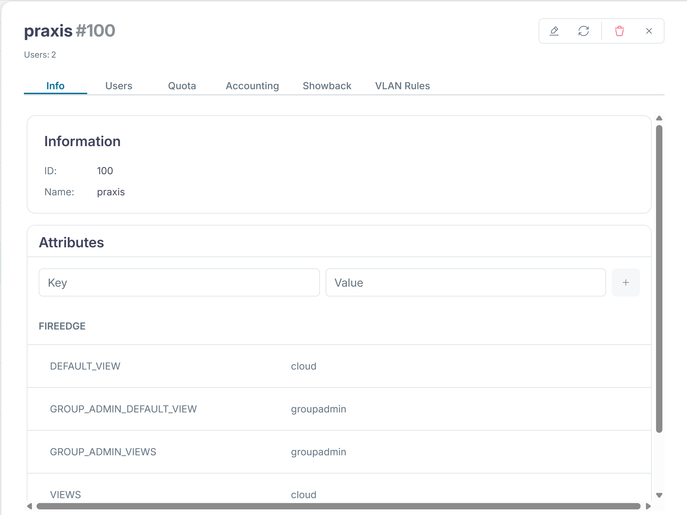
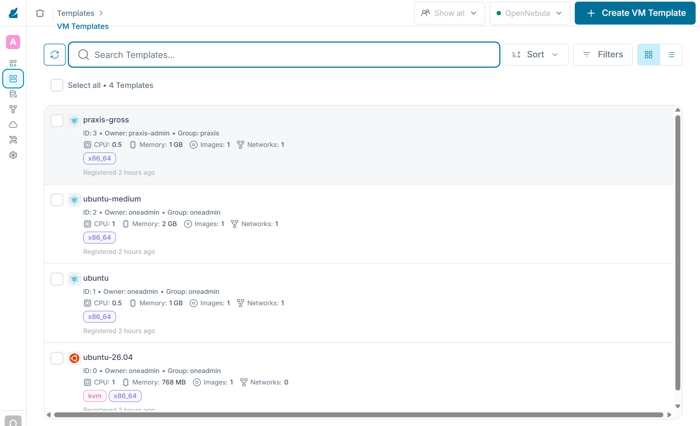

:::assignment
«Die Praxis Rosenweg hat eine neue MPA, die ab und zu eine Test-VM braucht», schreibt Simone Wyss. «Kann die Praxis das selbst einrichten, ohne dass wir etwas tun müssen?»
:::

:::goals
Nach diesem Kapitel kannst du:

- Erklären, was Self-Service in einer Cloud bedeutet und warum er zu den Merkmalen einer Cloud gehört
- Die Ansichten von Sunstone für Mitglieder und Gruppenadmins unterscheiden
- Als Gruppenadmin Benutzer anlegen und eigene Vorlagen ableiten
- Begründen, was ein Mitglied ändern darf und was nicht
- Erklären, was ein Servicekatalog ist und wer ihn pflegt
:::

## Self-Service

In [Kapitel 1.1](../../basics/characteristics/) gehört **On-Demand Self-Service** zu den fünf Merkmalen einer Cloud. Die Definition des NIST in [SP 800-145](https://csrc.nist.gov/pubs/sp/800/145/final) verlangt, dass Nutzende Rechenleistung und Speicher selbst und nach Bedarf beziehen können, ohne dass beim Anbieter ein Mensch eingreift. Ein Mitglied holt sich Ressourcen also dann, wenn es sie braucht. Auf ein Ticket beim Plattform-Team muss es nicht warten.

Den Rahmen setzt das Plattform-Team mit den Gruppen, dem VDC und den Quotas aus den Kapiteln 3.1 und 3.2 sowie mit gemeinsamen Vorlagen. Innerhalb dieses Rahmens handeln die Mitglieder selbst.

## Aufgaben von Plattform-Team und Mitglied

Mit Self-Service teilen Plattform-Team und Mitglieder die Arbeit neu auf. Die Aufteilung folgt der geteilten Verantwortung bei IaaS aus [Kapitel 1.2](../../basics/models/#geteilte-verantwortung). Das Plattform-Team betreibt die Knoten, das Netz, die Datastores und OpenNebula selbst. Es legt die Mitglieder an, setzt ihre Quotas und Preise und pflegt die gemeinsamen Vorlagen und Images. Was in einer VM läuft, verantwortet das Mitglied. Es legt seine Benutzer an, startet und löscht seine VMs, hält das Betriebssystem darin aktuell und sichert seine Daten. Die Grenze liegt am Hypervisor, darunter arbeitet das Plattform-Team, darüber das Mitglied.

Das Plattform-Team erledigt dadurch weniger einzelne Aufträge und steckt mehr Zeit in gute Vorgaben. Ein Fehler in einer gemeinsamen Vorlage trifft nämlich alle Mitglieder zugleich.

## Ansichten von Sunstone

Sunstone zeigt nicht allen dasselbe. Welche Ansicht jemand bekommt, steht in der Vorlage seiner Gruppe. `onegroup create` hat für die Mitglieder diese Werte gesetzt.

```text
FIREEDGE=[
  DEFAULT_VIEW="cloud",
  GROUP_ADMIN_DEFAULT_VIEW="groupadmin",
  GROUP_ADMIN_VIEWS="groupadmin",
  VIEWS="cloud" ]
```

Sunstone zeigt diese Werte unter «System › Groups» im Reiter «Info» der Gruppe.



| Ansicht | Für | Was sie zeigt |
|---|---|---|
| `cloud` | Benutzer eines Mitglieds | Übersicht, VMs, Vorlagen, Dienste, Marketplace und das eigene Konto |
| `user` | Benutzer mit mehr Bedarf, im Lab nicht vergeben | dazu Images, Netze, Sicherheitsgruppen und Backups, aber keine Benutzer und Dienstvorlagen |
| `groupadmin` | Gruppenadmins | dazu Images, Netze, Benutzer der Gruppe, Dienstvorlagen, Sicherheitsgruppen und Backups |
| `admin` | das Plattform-Team | alles, auch Hosts, Cluster, Datastores und VDCs |

OpenNebula 7.4 bringt diese vier Ansichten mit, die [Dokumentation der Ansichten](https://docs.opennebula.io/7.4/product/cloud_system_administration/multitenancy/fireedge_sunstone_views/) beschreibt sie. Die Ansicht `cloud` ist für Endnutzende gedacht, die nur VMs aus fertigen Vorlagen starten.

Die Ansichten liegen auf dem Front-end in `/etc/one/fireedge/sunstone/views/`. Jede Ansicht ist ein Ordner mit einer Datei pro Reiter. Wer einer Ansicht einen Reiter wegnehmen will, passt diese Dateien an. Hat eine Gruppe keine eigenen Werte, gilt die Zuteilung aus `sunstone-views.yaml` im selben Ordner. Dort bekommt die Gruppe `oneadmin` alle vier Ansichten, alle anderen `user` und `cloud`.

Öffne Sunstone im Browser des Clients (auf smartlearn die Kali-VM, mit eigenem Hypervisor dein PC) unter `http://<front-end>:2616` und melde dich als `praxis-admin` an. Du siehst die Ansicht `groupadmin` mit den VMs der Praxis und der Vorlage `ubuntu`. Hosts und Datastores fehlen, denn sie bleiben Sache des Plattform-Teams.


## ACLs hinter den Ansichten

Eine Ansicht blendet nur Reiter und Knöpfe aus und erleichtert so die Bedienung. Als Sicherheitsgrenze taugt sie nicht, denn Sunstone ruft für jede Aktion dieselbe API von OpenNebula auf wie die CLI. Erst dort entscheidet sich, ob ein Auftrag erlaubt ist.

OpenNebula prüft jeden Auftrag in einer festen Reihenfolge, wie die [Dokumentation zu Rechten und ACLs](https://docs.opennebula.io/7.4/product/cloud_system_administration/multitenancy/chmod/) beschreibt. Der Benutzer `oneadmin` und die Gruppe `oneadmin` dürfen alles. Bei VMs, Netzen, Images, Vorlagen und Dokumenten zählen danach die Rechte des Objekts für Besitzer, Gruppe und alle anderen, etwa das `chmod 604` der Vorlage `ubuntu`. Reicht das nicht, geht OpenNebula die ACLs aus Kapitel 3.1 durch, bis eine Regel den Auftrag erlaubt. ACLs geben nur Rechte, sie nehmen keine weg. Erlaubt keine Regel den Auftrag, lehnt OpenNebula ihn ab.

Wer einem Mitglied etwas verbieten will, ändert deshalb die ACLs oder die Rechte der Objekte. Ein Reiter, der in der Ansicht fehlt, hält niemanden auf, der die CLI oder die API benutzt.

![Rollen und Ansichten in Sunstone. Links steht das Plattform-Team als oneadmin mit der Ansicht admin. Es betreibt Knoten, Netze und Datastores, legt die Mitglieder mit ihren Admins an, setzt Quotas und Preise und pflegt die gemeinsame Vorlage ubuntu. Rechts steht das Mitglied praxis. Sein Gruppenadmin praxis-admin hat die Ansicht groupadmin. Er legt die Benutzer der Gruppe an, verwaltet alle VMs der Gruppe, setzt die Quotas seiner Benutzer und kopiert Vorlagen. Die Vorlage ubuntu darf er nicht ändern. Die MPA praxis-mpa hat die Ansicht cloud. Sie startet VMs aus fertigen Vorlagen und passt höchstens Grösse und Disks an. Ihre VMs zählen gegen die Quota der Gruppe. Achte auf die Zeile unten. Eine Ansicht blendet nur Reiter aus. Ob ein Auftrag erlaubt ist, entscheiden die Rechte und die ACLs.](../../../assets/figures/de/p3c4-roles.svg)

## Benutzer in der Gruppe

Ein Gruppenadmin legt die Benutzer seines Mitglieds selbst an. Neue Benutzer landen in seiner Gruppe, ihre VMs zählen gegen die Quota der Gruppe. Die [Dokumentation zu den Benutzern](https://docs.opennebula.io/7.4/product/cloud_system_administration/multitenancy/manage_users/#adding-users) beschreibt `oneuser create`.

Das Passwort der MPA liest `read` verdeckt ein. So steht es weder auf dem Bildschirm noch in der History der Shell. Gib es nach diesem Befehl ein und bestätige mit Enter.

```bash
read -rsp "Passwort für praxis-mpa: " pw; echo
```

Der folgende Block legt die MPA als `praxis-admin` mit diesem Passwort an und löscht danach die Variable.

```bash
export ONE_AUTH=~/cc-lab/tenants/praxis.auth
oneuser create praxis-mpa "$pw"
oneuser list
unset ONE_AUTH pw
```

Die MPA meldet sich danach in Sunstone an, bekommt die Ansicht `cloud` und startet ihre VMs aus der Vorlage `ubuntu`. Der Gruppenadmin sieht und verwaltet auch ihre VMs.

## Der Servicekatalog

Ein **Servicekatalog** ist die Liste der Dienste, die ein Anbieter fertig anbietet, jeweils mit festgelegtem Inhalt, Preis und Zuständigkeit. Wer etwas braucht, wählt aus dem Katalog, statt einen Wunsch frei zu formulieren. Für den Anbieter heisst das, dass er nur betreibt, was er geprüft und beschrieben hat.

In OpenNebula bilden die gemeinsamen Vorlagen diesen Katalog. Die Vorlage `ubuntu` legt Image, Grösse, Netz und Kontext fest und trägt seit Kapitel 3.3 ihren Preis. Die Dienstvorlagen von OneFlow aus [Kapitel 3.5](../advanced/#dienste-und-rollen) ergänzen den Katalog um Dienste aus mehreren VMs. Laut der [Dokumentation der Cloud-Ansicht](https://docs.opennebula.io/7.4/product/control_plane_configuration/graphical_user_interface/cloud_view/) wählen Benutzer dort eine Vorlage aus, die die Administration vorbereitet hat. Vor dem Start passen sie höchstens Grösse und Disks an. Der Katalog ist die Schnittstelle zwischen Plattform-Team und Mitglied. Mit jedem Eintrag sagt das Plattform-Team zu, ihn zu pflegen, deshalb nimmt es nur auf, was es auch betreiben kann.

## Die Grenzen eines Mitglieds

Die Vorlage `ubuntu` gehört `oneadmin`. Mit `chmod 604` dürfen die Mitglieder sie nur nutzen. Ein Versuch, sie zu ändern, scheitert mit dieser Meldung:

```text
[one.template.update] User [2] : Not authorized to perform MANAGE TEMPLATE [1].
```

Eigene Vorlagen anlegen dürfen die Mitglieder aber, das erlaubt ihre Gruppe seit Kapitel 3.1. Braucht die Praxis eine grössere VM, kopiert sie die Vorlage und ändert die Kopie. Beides beschreibt die [Dokumentation zu den VM-Vorlagen](https://docs.opennebula.io/7.4/product/virtual_machines_operation/virtual_machines/vm_templates/#cloning-templates). Der folgende Block macht beides als `praxis-admin` und gibt der Kopie 2 GB Arbeitsspeicher. Mit `--append` ändert `onetemplate update` nur die Werte aus der Datei, ohne einen Editor zu öffnen. Der Rest der Vorlage bleibt, wie er ist. `onetemplate show` zeigt danach Besitzer, Gruppe und Speicher.

```bash
export ONE_AUTH=~/cc-lab/tenants/praxis.auth
onetemplate clone ubuntu praxis-gross
echo 'MEMORY = "2048"' > /tmp/praxis-gross.tpl
onetemplate update praxis-gross --append /tmp/praxis-gross.tpl
onetemplate show praxis-gross | grep -E '^(USER|GROUP) |MEMORY='
unset ONE_AUTH
```

Die Kopie gehört der Praxis und übernimmt sonst alles, auch die Preise aus Kapitel 3.3. Was die Praxis darin einträgt, begrenzt weiterhin ihre Quota. Das Plattform-Team muss so nur wenige gemeinsame Vorlagen, Netze und Images pflegen. Alles Weitere richten die Mitglieder innerhalb ihrer Quota selbst ein.

Unter «Templates › VM Templates» siehst du als `oneadmin` die Vorlagen des Plattform-Teams und die Kopien der Mitglieder nebeneinander.



## Der Check von Teil 3

Der Check dieses Teils prüft die Gruppen mit ihren Admins und Quotas sowie das VDC `wolkenwerk`. Dazu kommen die Freigabe der Vorlage `ubuntu`, ihre Preise und der Showback. Starte ihn erst, wenn du den Showback aus Kapitel 3.3 berechnet hast. Vorher fehlen dem Showback noch die Kosten und der Check meldet dort `[!!]`.

```bash
python3 ~/cc/checks/check.py tenants
```

Die zwei Zeilen zu OneFlow mit `[+!!]` gehören zum Zusatzauftrag A in Kapitel 3.5 und zählen nicht zur Basis.

::::exercise[Lab]
Mit zwei VMs ist die Quota der Praxis aus Kapitel 3.2 voll. Lösche deshalb zuerst als `praxis-admin` die VM `praxis-2` mit `onevm terminate`. Sunstone setzt die CPU einer neuen VM auf 1, neben `praxis-1` passt sie gerade in die 1,5 CPU der Praxis. Lege dann den Benutzer `praxis-mpa` an, melde dich mit ihm im Browser des Clients bei Sunstone an und starte eine VM. Prüfe als `praxis-admin`, ob du sie siehst. Mach einen Screenshot für Meilenstein 1 und lösche die VM danach. Lass zum Schluss den Check `tenants` laufen und lade seinen Bericht in dein Abgabe-Repo.

:::solution
`oneuser create` legt den Benutzer `praxis-mpa` in der Gruppe `praxis` an. In Sunstone zeigt die Ansicht `cloud` die Vorlage `ubuntu`. Die VM startet nur, solange die Quota der Praxis Platz hat. Als `praxis-admin` zeigt `onevm list` die VM mit dem Besitzer `praxis-mpa`, `onevm terminate` löscht sie. Der Check endet mit «19 von 19 Prüfungen der Basis erfüllt» und «0 von 2 Prüfungen der Zusatzaufträge erfüllt».
:::
::::

::::exercise[Rahmen setzen]
Die Gemeinde Hinterbüel möchte, dass ihre Benutzer nur VMs starten, aber keine eigenen Images hochladen. Wie setzt du das um?

:::solution
Die Gruppe `gemeinde` bekommt nur die Ressourcen `VM+TEMPLATE+DOCUMENT`, also kein `IMAGE`. Bei einer bestehenden Gruppe löschst du ihre ACL mit `oneacl delete` und legst sie ohne `IMAGE` neu an. In der Ansicht `cloud` fehlt der Reiter für Images ohnehin, die ACL verhindert das Hochladen aber auch über die CLI.
:::
::::

::::exercise[Zuständigkeit]
Die Praxis möchte, dass ihre MPA höchstens eine VM gleichzeitig hat. Ausserdem wünscht sie sich eine Vorlage mit Windows für alle Mitglieder. Wer setzt was um und womit?

:::solution
Die Grenze für die MPA ist eine Benutzerquota mit `VMS = 1`. Die setzt `praxis-admin` selbst mit `oneuser quota praxis-mpa`, weil ein Gruppenadmin die Benutzer seiner Gruppe verwalten darf. Eine Vorlage für alle Mitglieder gehört in den gemeinsamen Katalog und damit zum Plattform-Team. Es entscheidet, ob es das Image pflegen und die Lizenzen tragen kann, legt die Vorlage als `oneadmin` an und gibt sie mit `chmod 604` frei. Eine eigene Vorlage könnte die Praxis zwar anlegen. Sie gehörte dann aber der Praxis und wäre nicht Teil des Katalogs, den das Plattform-Team pflegt.
:::
::::
